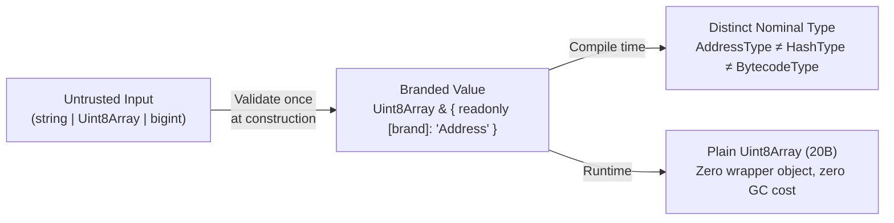

TypeScript is structurally typed: two aliases for `Uint8Array` or `` `0x${string}` `` are completely interchangeable. Voltaire attaches a phantom `unique symbol` brand to every primitive so the compiler rejects mixing an `Address` with a `Hash`, `Bytecode`, or `Wei` with `Gwei` — while emitting plain `Uint8Array` or `bigint` at runtime.



## How Branding Works

All primitives share a single `unique symbol` exported from `@tevm/voltaire`:

```typescript
declare const brand: unique symbol;

export type AddressType = Uint8Array & { readonly [brand]: 'Address' };
export type HashType = Uint8Array & { readonly [brand]: 'Hash' };
export type WeiType = bigint & { readonly [brand]: 'Wei' };
export type GweiType = bigint & { readonly [brand]: 'Gwei' };
```

The brand property never exists on the object at runtime. Because `AddressType` and `HashType` carry distinct literal tags under `[brand]`, TypeScript rejects swapped arguments:

```typescript
import { Address, Hash } from '@tevm/voltaire';
import type { AddressType } from '@tevm/voltaire/Address';
import type { HashType } from '@tevm/voltaire/Hash';

function recordTransfer(to: AddressType, txHash: HashType) {
  // Both arguments are already validated — no defensive re-parsing needed.
}

const addr = Address('0x742d35Cc6634C0532925a3b844Bc9e7595f51e3e');
const hash = Hash('0x' + 'ab'.repeat(32));

recordTransfer(addr, hash); // OK
// recordTransfer(hash, addr); // Compile error: HashType is not assignable to AddressType
```

## Validate Once at the Boundary

Every constructor validates length, character set, and range immediately. If a value has type `AddressType`, it is guaranteed to be exactly 20 bytes:

```typescript
Address('0xnot_valid_hex');  // throws InvalidHexFormatError
Address('0x1234');           // throws InvalidAddressLengthError
Address(new Uint8Array(10)); // throws InvalidAddressLengthError
```

Because `Address` stores 20 raw bytes rather than a string, case-sensitivity bugs disappear:

```typescript
const lower = Address('0x742d35cc6634c0532925a3b844bc9e7595f51e3e');
const mixed = Address('0x742d35Cc6634C0532925a3b844Bc9e7595f51e3e');

lower.equals(mixed);         // true
lower instanceof Uint8Array; // true
lower.length;                // 20
new DataView(lower.buffer);  // Direct native Web API interop
```

## Core Branded Types

| Type | Runtime Backing | Size | Module |
| --- | --- | --- | --- |
| `AddressType` | `Uint8Array` | 20 bytes | [`Address`](/primitives/address) |
| `HashType` | `Uint8Array` | 32 bytes | [`Hash`](/primitives/hash) |
| `Bytes32Type` | `Uint8Array` | 32 bytes | [`Bytes32`](/primitives/bytes32) |
| `BytecodeType` | `Uint8Array` | Variable | [`Bytecode`](/primitives/bytecode) |
| `BlobType` | `Uint8Array` | 131,072 bytes (128 KB) | [`Blob`](/primitives/blob) |
| `HexType` | `string` (`0x...`) | Variable | [`Hex`](/primitives/hex) |
| `Uint8Type`..`Uint256Type` | `bigint` / `number` | 1–32 bytes | [`Uint`](/primitives/uint) |
| `Int8Type`..`Int256Type` | `bigint` / `number` | 1–32 bytes | [`Int256`](/primitives/int256) |
| `WeiType` / `GweiType` / `EtherType` | `bigint` | 256-bit | [`Denomination`](/primitives/denomination) |

<Tip>
Never cast raw strings or `Uint8Array` with `as AddressType` — doing so bypasses construction-time validation and breaks the invariant that every branded value is valid. Always construct through `Address(...)` or `Address.fromBytes(...)`.
</Tip>
