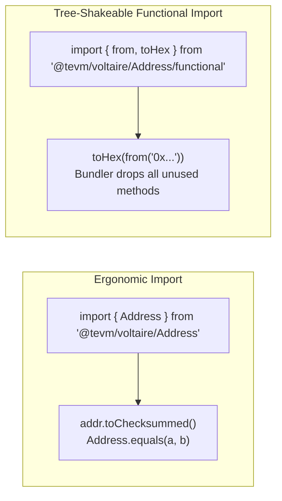

Voltaire models Ethereum values as **plain data** (`Uint8Array`, `bigint`, `string`) paired with pure functions that take the value as their first argument. You can call methods through ergonomic constructors or import standalone functions for aggressive tree-shaking.



## Two Styles, Identical Data

Both styles operate on the exact same `AddressType` (`Uint8Array`):

<Tabs>
  <Tab title="Constructor & Namespace (Default)">
    ```typescript
    import { Address } from '@tevm/voltaire/Address';

    const a = Address('0x742d35Cc6634C0532925a3b844Bc9e7595f51e3e');
    const b = Address('0xd8dA6BF26964aF9D7eEd9e03E53415D37aA96045');

    a.toHex();                  // Instance method
    Address.toChecksummed(a);   // Static data-first function (includes default keccak256)
    Address.equals(a, b);       // Static data-first function
    ```
  </Tab>
  <Tab title="Functional (Maximum Tree-Shaking)">
    ```typescript
    import { from, toHex, equals } from '@tevm/voltaire/Address/functional';

    const a = from('0x742d35Cc6634C0532925a3b844Bc9e7595f51e3e');
    const b = from('0xd8dA6BF26964aF9D7eEd9e03E53415D37aA96045');

    toHex(a);
    equals(a, b);
    // toChecksummed, calculateCreate2Address, Keccak256 are never bundled
    ```
  </Tab>
</Tabs>

## Why Data-First Matters

1. **Crypto dependency isolation.** Operations like `Address.toHex` and `Address.equals` need zero cryptography. Operations like `Address.toChecksummed` and `Address.calculateCreate2Address` require Keccak-256. Importing only what you call via `/Address/functional` keeps Keccak-256 out of bundles that never hash.
2. **Predictable argument order.** The value under inspection is always argument 0: `Address.equals(a, b)`, `Secp256k1.verify(signature, hash, publicKey)`, `Transaction.serialize(tx)`.
3. **Zero serialization friction.** Because values are plain `Uint8Array` or `bigint`, they pass directly to `WebCrypto`, `DataView`, `Worker.postMessage`, IndexedDB, and C/WASM linear memory without `.unwrap()` calls.

## Import Path Guidelines

| Pattern | Bundle impact | Best for |
| --- | --- | --- |
| `import { Address, Hex } from '@tevm/voltaire'` | Relies on bundler side-effect-free tree-shaking (`"sideEffects": false`) | Server code, scripts, quick prototyping |
| `import { Address } from '@tevm/voltaire/Address'` | Scopes resolution to one module | Frontend apps and libraries |
| `import { from, toHex } from '@tevm/voltaire/Address/functional'` | Bundles only the exact functions referenced | Size-critical browser widgets, wallets, extensions |
| `import { Address } from '@tevm/voltaire/functional'` | Functional API grouped by namespace | Functional style across multiple primitives |

<Note>
`@tevm/voltaire` declares `"sideEffects": false` in `package.json`, enabling Rollup, Vite, esbuild, webpack, and Bun to prune unused exports automatically.
</Note>
