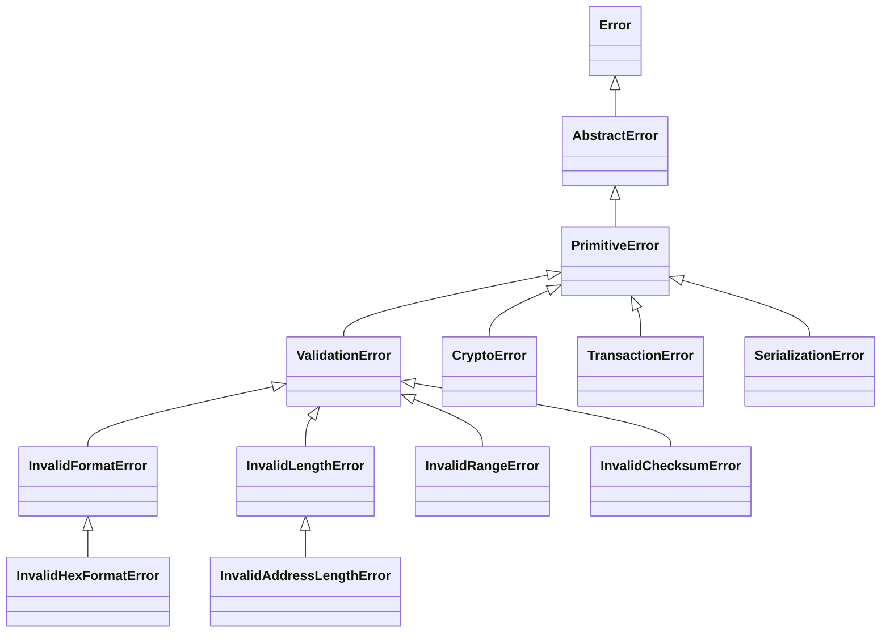

Voltaire constructors validate synchronously and throw structured exceptions carrying a machine-readable `code`, the invalid `value`, and an `expected` description.

## Error Hierarchy



## Inspecting Errors

Every error exposes consistent fields for logging, telemetry, and UI feedback:

```typescript
import { Address, InvalidAddressLengthError } from '@tevm/voltaire';

try {
  Address('0x1234');
} catch (error) {
  if (error instanceof InvalidAddressLengthError) {
    console.log(error.name);     // "InvalidAddressLengthError"
    console.log(error.code);     // "INVALID_ADDRESS_LENGTH"
    console.log(error.message);  // Human-readable explanation
  }
}
```

## Validation Without Exceptions

When checking untrusted input in form handlers or API guards, use the non-throwing predicates:

```typescript
import { Address } from '@tevm/voltaire/Address';

if (Address.isValid(userInput)) {
  const addr = Address(userInput); // Guaranteed not to throw
}

if (Address.isValidChecksum(userInput)) {
  // Valid EIP-55 mixed-case checksum
}
```

## Typed-Error Composition

Core `@tevm/voltaire` throws exceptions to match built-in JavaScript APIs (`JSON.parse`, `new URL`, `BigInt`). For application code that prefers typed error channels over `try`/`catch`, wrap constructors at the boundary or use [voltaire-effect](https://github.com/evmts/voltaire/tree/main/packages/voltaire-effect):

<Tabs>
  <Tab title="voltaire-effect (Effect.ts)">
    ```typescript
    import { Effect } from 'effect';
    import * as Address from 'voltaire-effect/primitives/Address';

    // Typed error channel: Effect<AddressType, InvalidAddressError>
    const parsed = Address.fromHex(userInput);
    ```
  </Tab>
  <Tab title="neverthrow">
    ```typescript
    import { err, ok, type Result } from 'neverthrow';
    import { Address } from '@tevm/voltaire/Address';
    import type { AddressType } from '@tevm/voltaire/Address';

    function parseAddress(input: string): Result<AddressType, Error> {
      try {
        return ok(Address(input));
      } catch (e) {
        return err(e instanceof Error ? e : new Error(String(e)));
      }
    }
    ```
  </Tab>
</Tabs>
