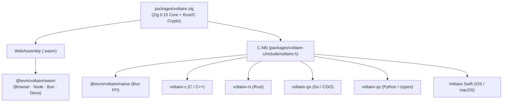

Ethereum primitives and cryptography should behave identically whether they run in a browser wallet, a Bun API server, a Rust indexer, a Go validator tool, or an iOS app. Voltaire implements core primitives, cryptography, and EVM execution in **Zig**, then exposes that core through WebAssembly and a stable C ABI.



## Supported Packages

| Language | Package | Binding layer | Status | Docs |
| --- | --- | --- | --- | --- |
| **TypeScript** | `packages/voltaire-ts` (`@tevm/voltaire`) | Pure TS, WASM, Bun FFI | Production | [Getting Started](/getting-started) |
| **Effect.ts** | `packages/voltaire-effect` (`voltaire-effect`) | Effect services & streams on TS primitives | Production | [voltaire-effect](https://github.com/evmts/voltaire/tree/main/packages/voltaire-effect) |
| **Zig** | `packages/voltaire-zig` | Native Zig core | Production | [`packages/voltaire-zig`](https://github.com/evmts/voltaire/tree/main/packages/voltaire-zig) |
| **C** | `packages/voltaire-c` | Direct C header (`voltaire.h`) | Beta | [`packages/voltaire-c`](https://github.com/evmts/voltaire/tree/main/packages/voltaire-c) |
| **Rust** | `packages/voltaire-rs` | Idiomatic Rust (`no_std` + optional `native` FFI) | Beta | [`packages/voltaire-rs`](https://github.com/evmts/voltaire/tree/main/packages/voltaire-rs) |
| **Go** | `packages/voltaire-go` | Go packages + CGO bindings | Beta | [`packages/voltaire-go`](https://github.com/evmts/voltaire/tree/main/packages/voltaire-go) |
| **Python** | `packages/voltaire-py` | Typed Python + `ctypes` FFI | Beta | [`packages/voltaire-py`](https://github.com/evmts/voltaire/tree/main/packages/voltaire-py) |
| **Swift** | `packages/voltaire-swift` | Swift Package Manager + C FFI | Beta | [Swift Docs](/swift/index) |

## Cross-Language API Consistency

Method names and semantics stay aligned across languages while respecting each language's idioms (error unions in Zig, `Result` in Rust, `(val, error)` in Go, exceptions in TS/Python, integer status codes in C):

<Tabs>
  <Tab title="TypeScript">
    ```typescript
    import { Address } from '@tevm/voltaire';
    const addr = Address.fromHex('0xd8da6bf26964af9d7eed9e03e53415d37aa96045');
    const checksum = Address.toChecksummed(addr);
    ```
  </Tab>
  <Tab title="Zig">
    ```zig
    const primitives = @import("primitives");
    const addr = try primitives.Address.fromHex("0xd8da6bf26964af9d7eed9e03e53415d37aa96045");
    const checksum = addr.toChecksumHex();
    ```
  </Tab>
  <Tab title="Rust">
    ```rust
    use voltaire::prelude::*;
    let addr: Address = "0xd8da6bf26964af9d7eed9e03e53415d37aa96045".parse()?;
    let checksum = addr.to_checksum();
    ```
  </Tab>
  <Tab title="C">
    ```c
    PrimitivesAddress addr;
    int rc = primitives_address_from_hex("0xd8da6bf26964af9d7eed9e03e53415d37aa96045", &addr);
    ```
  </Tab>
</Tabs>

## Building Native Artifacts From Source

Native bindings compile Zig plus audited Rust/C crypto dependencies (`blst`, `c-kzg-4844`, `arkworks`):

```bash
git clone https://github.com/evmts/voltaire.git
cd voltaire
zig build                # Builds native library and Zig targets
zig build build-ts-native # Builds shared library for FFI bindings
```

Requires **Zig 0.15.1+** and **Rust / Cargo**.
