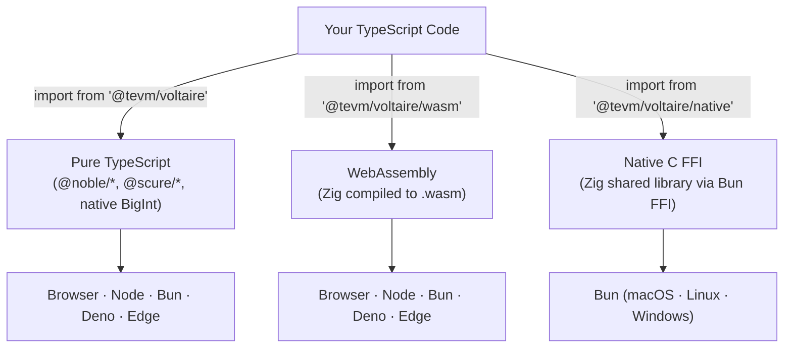

Voltaire ships three JavaScript/TypeScript execution backends behind one identical API. Switch backends by changing a single import path — no application code changes required.



## Entrypoint Matrix

| Entrypoint | Import | Runtime support | Best for |
| --- | --- | --- | --- |
| **Pure TS** | `@tevm/voltaire` | Every JS runtime | Default; zero boundary overhead for Address/Hex/Uint |
| **WASM** | `@tevm/voltaire/wasm` | Browser, Node, Bun, Deno, Edge | Faster & smaller crypto (Keccak-256, secp256k1, BLS12-381, BN254, KZG) |
| **Native FFI** | `@tevm/voltaire/native` | **Bun only** | Maximum server throughput for high-volume hashing, signing, and verification |

```typescript
// Identical API across all three entrypoints:
import { Address, Keccak256, Secp256k1 } from '@tevm/voltaire';        // Pure TS
import { Address, Keccak256, Secp256k1 } from '@tevm/voltaire/wasm';   // WASM
import { Address, Keccak256, Secp256k1 } from '@tevm/voltaire/native'; // Native FFI (Bun)
```

## Per-Module Backend Selection

Mix backends per module so cheap operations stay in pure JS while heavy cryptography runs in WASM or Native FFI:

```typescript
import { Address, Hex } from '@tevm/voltaire';        // Pure JS (0 µs bridge cost)
import { Keccak256Wasm } from '@tevm/voltaire/wasm';  // WASM-accelerated Keccak-256
```

## Runtime Caveats

| Feature | Pure TS | WASM | Native FFI (Bun) |
| --- | --- | --- | --- |
| Core primitives (`Address`, `Hex`, `Abi`, `Rlp`, `Transaction`) | Supported | Supported | Supported |
| `Keccak256`, `SHA256`, `Blake2`, `Secp256k1`, `P256`, `Ed25519` | Supported | Supported | Supported |
| `Bls12381`, `BN254`, `KZG` | Supported | Supported | Supported |
| `HDWallet` (`@scure/bip32` / `libwally-core`) | Supported (`@tevm/voltaire/HDWallet`) | Not available in WASM | Supported |

<Warning>
Native FFI (`@tevm/voltaire/native`) uses `bun:ffi` and requires the compiled native shared library (`zig build build-ts-native` when building from source). On Node.js and browsers, use `@tevm/voltaire` or `@tevm/voltaire/wasm`.
</Warning>

## WASM Build Modes

Published packages ship `ReleaseSmall` WASM binaries to balance bundle size and speed. If you run CPU-bound server workloads from source and want maximum raw throughput (loop unrolling + SIMD), build with `ReleaseFast`. See [WASM Build System](/dev/wasm) and [Performance](/performance).
