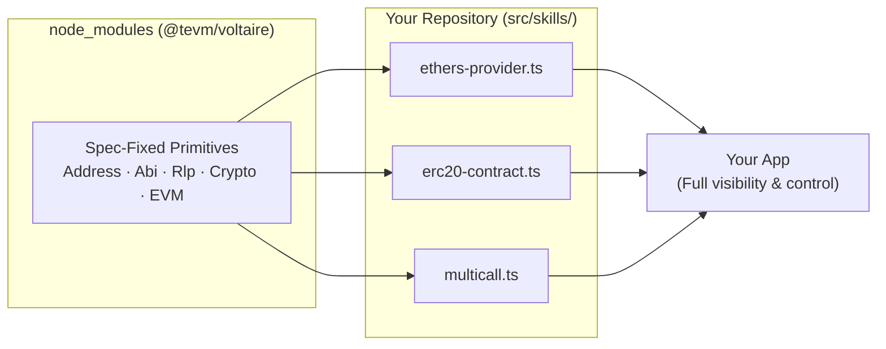

Voltaire exports low-level, spec-aligned primitives (`Address`, `Abi`, `Rlp`, `Transaction`, `Keccak256`, `Secp256k1`, EIP-1193 request types). Higher-level patterns — ethers/viem-style providers, contract wrappers, multicall batchers, React hooks, and protocol integrations — are delivered as **Skills**: tested, self-contained implementations you copy into your own codebase.

## Library Dependency vs. Skill

| Property | Monolithic SDK | Voltaire Skill |
| --- | --- | --- |
| **Ownership** | Black box in `node_modules` | Plain `.ts` file in your repo |
| **Customization** | Wait for plugin hooks or fork the SDK | Edit 5 lines directly |
| **Bundle size** | Ships features you never call | Keep only what your app uses |
| **AI-assisted coding** | Agent guesses hidden internals | Agent reads and edits your exact implementation |
| **Upgrades** | Breaking SDK major versions | Primitives stay stable; your wrapper evolves on your schedule |

## When to Use Skills vs. `voltaire-effect`

- **Use Skills** when you want minimal, zero-magic TypeScript files tailored to your exact contracts and transport stack (the [shadcn/ui](https://ui.shadcn.com) model for Ethereum).
- **Use [`voltaire-effect`](https://github.com/evmts/voltaire/tree/main/packages/voltaire-effect)** when you want a managed Effect.ts service layer with built-in retries, timeouts, typed errors, contract registries, and reorg-aware streams.

## Two Ways to Adopt Skills

1. **Copy from the catalog:** Browse [Skills](/skills/index) (providers, contracts, wallets, React/Vue hooks, Uniswap v4, Aave v3, Safe, ENS, OP Stack, Arbitrum) and drop the file into `src/skills/`.
2. **Generate with MCP:** Connect Voltaire's [MCP server](/concepts/ai-and-mcp) and ask your coding agent to generate a Skill tailored to your contract ABI and retry policy.

Walk through building your first Skill in [Tutorial 5: Build a Skill](/tutorials/building-a-skill).
