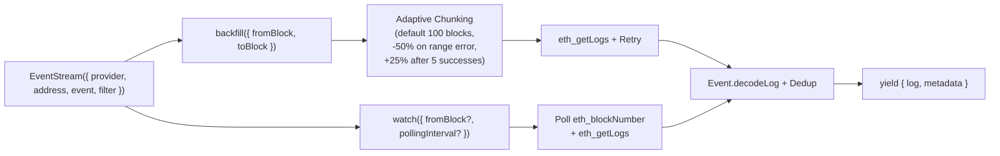

`EventStream` (exported from `@tevm/voltaire/contract`) streams decoded Ethereum event logs with adaptive block-range chunking, exponential backoff retries, deduplication, and `AbortSignal` cancellation.



## Standalone Usage

Use `EventStream` directly from `@tevm/voltaire/contract` without needing the `Contract` wrapper:

```typescript
import { EventStream } from '@tevm/voltaire/contract';
import { HttpProvider } from '@tevm/voltaire/provider';

const provider = new HttpProvider('https://eth.llamarpc.com');

const transferEvent = {
  type: 'event',
  name: 'Transfer',
  inputs: [
    { name: 'from', type: 'address', indexed: true },
    { name: 'to', type: 'address', indexed: true },
    { name: 'value', type: 'uint256', indexed: false },
  ],
} as const;

const stream = EventStream({
  provider,
  address: '0xA0b86991c6218b36c1d19D4a2e9Eb0cE3606eB48',
  event: transferEvent,
  filter: { from: '0x742d35Cc6634C0532925a3b844Bc9e7595f0bEb0' },
});

for await (const { log, metadata } of stream.backfill({
  fromBlock: 19_000_000n,
  toBlock: 19_001_000n,
})) {
  console.log(log.blockNumber, log.args.to, log.args.value, 'head:', metadata.chainHead);
}
```

When using the copyable [Contract Pattern](/contract), `usdc.events.Transfer(filter)` constructs the same `EventStream` instance from the ABI.

## Backfill Historical Events

`backfill(options)` fetches `[fromBlock, toBlock]` inclusively in adaptive chunks:

- Starts at `chunkSize` (default `100` blocks).
- Halves the chunk size when the RPC returns a "block range too large" or response-size error, down to `minChunkSize` (default `10`).
- Increases the chunk size by 25% after 5 consecutive successful chunks.
- Retries transient errors with exponential backoff (`retry.maxRetries` default `3`, `initialDelay` default `1000` ms, `maxDelay` default `30000` ms).

```typescript
for await (const { log, metadata } of stream.backfill({
  fromBlock: 18_000_000n,
  toBlock: 19_000_000n,
  chunkSize: 500,
  minChunkSize: 25,
  retry: {
    maxRetries: 5,
    initialDelay: 1000,
    maxDelay: 30_000,
  },
})) {
  console.log(`Range ${metadata.fromBlock}-${metadata.toBlock}:`, log.args);
}
```

## Watch Live Events

`watch(options?)` polls for new blocks and yields matching logs as blocks advance. Deduplication keys logs by `${blockNumber}:${logIndex}`.

```typescript
const controller = new AbortController();
setTimeout(() => controller.abort(), 30_000);

for await (const { log, metadata } of stream.watch({
  pollingInterval: 2000,
  signal: controller.signal,
})) {
  console.log(`Block ${log.blockNumber} (head ${metadata.chainHead}):`, log.args);
}
```

### Backfill Then Watch

Chain `backfill()` into `watch()` starting at `lastBlock + 1n` for gapless indexing:

```typescript
const headHex = (await provider.request({ method: 'eth_blockNumber', params: [] })) as string;
const head = BigInt(headHex);

for await (const { log } of stream.backfill({ fromBlock: head - 1000n, toBlock: head })) {
  processTransfer(log);
}

for await (const { log } of stream.watch({ fromBlock: head + 1n, signal: controller.signal })) {
  processTransfer(log);
}
```

## Yielded Result Shape

| Field | Type | Description |
| --- | --- | --- |
| `log.eventName` | `TEvent['name']` | ABI event name |
| `log.args` | `ParametersToObject<TEvent['inputs']>` | Decoded indexed and non-indexed arguments |
| `log.blockNumber` | `BlockNumberType` | Block height of the log |
| `log.blockHash` | `HashType` | 32-byte block hash |
| `log.transactionHash` | `TransactionHashType` | 32-byte transaction hash |
| `log.logIndex` | `number` | Log index within the block |
| `metadata.chainHead` | `bigint` | Latest chain head observed during the fetch |
| `metadata.fromBlock` | `bigint` | Start block of the chunk |
| `metadata.toBlock` | `bigint` | End block of the chunk |

## Error Handling

Import error classes from `@tevm/voltaire/contract`:

```typescript
import {
  BlockRangeTooLargeError,
  EventStream,
  EventStreamAbortedError,
  StreamAbortedError,
} from '@tevm/voltaire/contract';

try {
  for await (const { log } of stream.backfill({ fromBlock: 0n, toBlock: 1_000_000n, signal })) {
    processTransfer(log);
  }
} catch (error) {
  if (error instanceof EventStreamAbortedError || error instanceof StreamAbortedError) {
    console.log('Stream cancelled');
  } else if (error instanceof BlockRangeTooLargeError) {
    console.error('Node rejected even minChunkSize');
  } else {
    throw error;
  }
}
```

## Related

- [Contract Pattern](/contract) — Integrating `EventStream` under `contract.events`
- [Event Indexer Skill](/skills/event-indexer) — Persistent cursor and reorg handling
- [BlockStream Indexer Example](/examples/indexing/blockstream-indexer) — Streaming full blocks with reorg detection
