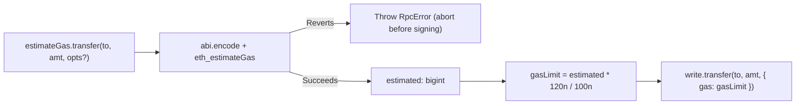

`contract.estimateGas.<fn>(...args, options?)` simulates a `nonpayable` or `payable` function via `eth_estimateGas` and returns the estimated gas units as a `bigint`. If the simulated execution reverts, the call rejects before any transaction is broadcast.



## Basic Usage

```typescript
import { Contract } from './Contract.js';

const usdc = Contract({
  address: '0xA0b86991c6218b36c1d19D4a2e9Eb0cE3606eB48',
  abi: erc20Abi,
  provider,
});

const estimated = await usdc.estimateGas.transfer(
  '0x742d35Cc6634C0532925a3b844Bc9e7595f0bEb0',
  1_000_000n,
  { from: '0xSenderAddress0000000000000000000000000000' },
);

console.log('Estimated gas:', estimated);
```

<Note>
Always pass `{ from }` when estimating functions that check `msg.sender`, token balances, or allowances. Without `from`, nodes simulate from the zero address (`0x0000...0000`), causing balance checks to revert.
</Note>

## Buffers and Revert Detection

Estimates reflect state at the latest block. Storage transitions, cold-to-warm slot differences, or concurrent mempool activity can increase actual execution gas. Apply an integer safety multiplier before sending:

| Workload | Multiplier | Expression |
| --- | --- | --- |
| Simple ERC-20 transfer | +10–20% | `(estimated * 120n) / 100n` |
| DEX swap / multi-hop router | +25–35% | `(estimated * 130n) / 100n` |
| Complex proxy / oracle write | +40–50% | `(estimated * 150n) / 100n` |

```typescript
async function safeTransfer(from: `0x${string}`, to: `0x${string}`, amount: bigint) {
  const estimated = await usdc.estimateGas.transfer(to, amount, { from });
  const gas = (estimated * 120n) / 100n;
  return usdc.write.transfer(to, amount, { from, gas });
}
```

## Payable Calls

Pass `{ from, value }` for functions that require `msg.value`:

```typescript
const depositGas = await weth.estimateGas.deposit({
  from: sender,
  value: 1_000_000_000_000_000_000n, // 1 ETH
});
```

## Computing EIP-1559 Cost Budgets

Combine `eth_estimateGas` with `eth_getBlockByNumber('latest', false)` and `eth_maxPriorityFeePerGas` to compute an upper bound on transaction cost in wei:

```typescript
const [latestBlock, priorityFeeHex, gasLimit] = await Promise.all([
  provider.request({ method: 'eth_getBlockByNumber', params: ['latest', false] }) as Promise<{
    baseFeePerGas?: `0x${string}`;
  }>,
  provider.request({ method: 'eth_maxPriorityFeePerGas', params: [] }) as Promise<`0x${string}`>,
  usdc.estimateGas.transfer(recipient, amount, { from: sender }),
]);

const baseFee = BigInt(latestBlock.baseFeePerGas ?? '0x0');
const maxPriorityFeePerGas = BigInt(priorityFeeHex);
// 2x baseFee headroom covers up to ~6 consecutive full blocks
const maxFeePerGas = baseFee * 2n + maxPriorityFeePerGas;

const bufferedGas = (gasLimit * 120n) / 100n;
const maxCostWei = bufferedGas * maxFeePerGas;
```

## Retrying Transient Estimation Failures

Wrap estimation in `retryWithBackoff` from `@tevm/voltaire/utils`, skipping retries on execution reverts (`code === 3` or `execution reverted`):

```typescript
import { retryWithBackoff } from '@tevm/voltaire/utils';

const gas = await retryWithBackoff(
  () => usdc.estimateGas.transfer(recipient, amount, { from: sender }),
  {
    maxRetries: 3,
    initialDelay: 500,
    shouldRetry: (err) => {
      const rpcErr = err as { code?: number; message?: string };
      return rpcErr.code !== 3 && !rpcErr.message?.includes('revert');
    },
  },
);
```

## Related

- [Contract Pattern](/contract) — Full copyable implementation
- [Write Methods](/contract/write) — Applying gas limits to transactions
- [Retry Utilities](/utils/retry) — `retryWithBackoff` reference
- [Gas Estimation Skill](/skills/gas-estimation) — Complete EIP-1559 fee oracle pattern
