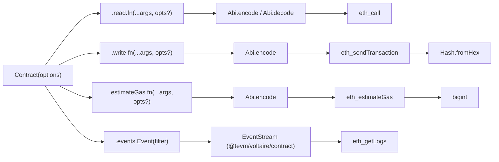

`Contract` is a copyable Skill that wraps `@tevm/voltaire/Abi`, `@tevm/voltaire/Address`, `@tevm/voltaire/Hex`, `@tevm/voltaire/Hash`, and `@tevm/voltaire/contract` (`EventStream`) into a Proxy-based interface with `.read`, `.write`, `.estimateGas`, and `.events`.

<Note>
`Contract` is a copyable Skill, not a runtime export of `@tevm/voltaire`. `EventStream` is exported directly from `@tevm/voltaire/contract` ([EventStream.js](https://github.com/evmts/voltaire/blob/main/packages/voltaire-ts/src/contract/EventStream.js)).
</Note>



## Quick Start

```typescript
import { HttpProvider } from '@tevm/voltaire/provider';
import { Contract } from './Contract.js';

const provider = new HttpProvider('https://eth.llamarpc.com');

const erc20Abi = [
  {
    type: 'function',
    name: 'balanceOf',
    stateMutability: 'view',
    inputs: [{ name: 'account', type: 'address' }],
    outputs: [{ name: '', type: 'uint256' }],
  },
  {
    type: 'function',
    name: 'transfer',
    stateMutability: 'nonpayable',
    inputs: [
      { name: 'to', type: 'address' },
      { name: 'amount', type: 'uint256' },
    ],
    outputs: [{ name: '', type: 'bool' }],
  },
  {
    type: 'event',
    name: 'Transfer',
    inputs: [
      { name: 'from', type: 'address', indexed: true },
      { name: 'to', type: 'address', indexed: true },
      { name: 'value', type: 'uint256', indexed: false },
    ],
  },
] as const;

const usdc = Contract({
  address: '0xA0b86991c6218b36c1d19D4a2e9Eb0cE3606eB48',
  abi: erc20Abi,
  provider,
});

const balance = await usdc.read.balanceOf('0x742d35Cc6634C0532925a3b844Bc9e7595f0bEb0');
const gas = await usdc.estimateGas.transfer('0x742d35Cc6634C0532925a3b844Bc9e7595f0bEb0', 1000n);

const stream = usdc.events.Transfer({ from: '0x742d35Cc6634C0532925a3b844Bc9e7595f0bEb0' });
for await (const { log } of stream.backfill({ fromBlock: 19000000n, toBlock: 19000100n })) {
  console.log(log.args.value);
}
```

## Copyable Implementation

Copy `Contract.ts` into your project. Every import resolves against published `@tevm/voltaire` entrypoints.

```typescript
import { Abi } from '@tevm/voltaire/Abi';
import { Address, type AddressType } from '@tevm/voltaire/Address';
import { EventStream } from '@tevm/voltaire/contract';
import { Hash, type HashType } from '@tevm/voltaire/Hash';
import { Hex } from '@tevm/voltaire/Hex';
import type { TypedProvider } from '@tevm/voltaire/provider';

export class ContractFunctionNotFoundError extends Error {
  override name = 'ContractFunctionNotFoundError';
  constructor(functionName: string) {
    super(`Function "${functionName}" not found in contract ABI`);
  }
}

export class ContractEventNotFoundError extends Error {
  override name = 'ContractEventNotFoundError';
  constructor(eventName: string) {
    super(`Event "${eventName}" not found in contract ABI`);
  }
}

export class ContractReadError extends Error {
  override name = 'ContractReadError';
  constructor(functionName: string, cause: unknown) {
    super(`Failed to read "${functionName}" from contract`, { cause });
  }
}

export class ContractWriteError extends Error {
  override name = 'ContractWriteError';
  constructor(functionName: string, cause: unknown) {
    super(`Failed to write "${functionName}" to contract`, { cause });
  }
}

export interface ReadCallOptions {
  from?: `0x${string}`;
  blockTag?: bigint | 'latest' | 'earliest' | 'pending' | 'safe' | 'finalized';
  blockHash?: `0x${string}`;
}

export interface WriteCallOptions {
  from?: `0x${string}`;
  gas?: bigint;
  gasPrice?: bigint;
  maxFeePerGas?: bigint;
  maxPriorityFeePerGas?: bigint;
  value?: bigint;
  nonce?: bigint;
}

export interface EstimateGasOptions {
  from?: `0x${string}`;
  value?: bigint;
}

function toHexQuantity(n: bigint): `0x${string}` {
  return `0x${n.toString(16)}`;
}

function splitOptions<TOpts extends object>(
  args: unknown[],
  expectedInputs: number,
): [unknown[], TOpts | undefined] {
  if (args.length === expectedInputs + 1 && typeof args[expectedInputs] === 'object' && args[expectedInputs] !== null) {
    return [args.slice(0, expectedInputs), args[expectedInputs] as TOpts];
  }
  return [args, undefined];
}

export interface ContractOptions<TAbi extends readonly Record<string, unknown>[]> {
  address: AddressType | `0x${string}`;
  abi: TAbi;
  provider: TypedProvider;
}

export function Contract<TAbi extends readonly Record<string, unknown>[]>(
  options: ContractOptions<TAbi>,
) {
  const { abi: abiItems, provider } = options;
  const address = Address.from(options.address);
  const abi = Abi(abiItems as never);
  const addressHex = Hex.fromBytes(address);

  const read = new Proxy({} as Record<string, (...args: unknown[]) => Promise<unknown>>, {
    get(_target, prop) {
      if (typeof prop !== 'string') return undefined;
      return async (...rawArgs: unknown[]) => {
        const fn = abi.getFunction(prop);
        if (!fn || (fn.stateMutability !== 'view' && fn.stateMutability !== 'pure')) {
          throw new ContractFunctionNotFoundError(prop);
        }

        const [fnArgs, opts] = splitOptions<ReadCallOptions>(rawArgs, fn.inputs.length);
        try {
          const data = abi.encode(prop, fnArgs);
          const callObj: Record<string, string> = {
            to: addressHex,
            data: Hex.fromBytes(data),
          };
          if (opts?.from) callObj.from = opts.from;

          const blockParam = opts?.blockHash
            ? { blockHash: opts.blockHash }
            : typeof opts?.blockTag === 'bigint'
              ? toHexQuantity(opts.blockTag)
              : (opts?.blockTag ?? 'latest');

          const result = (await provider.request({
            method: 'eth_call',
            params: [callObj, blockParam] as never,
          })) as `0x${string}`;

          const decoded = abi.decode(prop, Hex.toBytes(result));
          return decoded.length === 1 ? decoded[0] : decoded;
        } catch (error) {
          if (error instanceof ContractFunctionNotFoundError) throw error;
          throw new ContractReadError(prop, error);
        }
      };
    },
  });

  const write = new Proxy({} as Record<string, (...args: unknown[]) => Promise<HashType>>, {
    get(_target, prop) {
      if (typeof prop !== 'string') return undefined;
      return async (...rawArgs: unknown[]) => {
        const fn = abi.getFunction(prop);
        if (!fn || (fn.stateMutability !== 'nonpayable' && fn.stateMutability !== 'payable')) {
          throw new ContractFunctionNotFoundError(prop);
        }

        const [fnArgs, opts] = splitOptions<WriteCallOptions>(rawArgs, fn.inputs.length);
        try {
          const data = abi.encode(prop, fnArgs);
          const tx: Record<string, string> = {
            to: addressHex,
            data: Hex.fromBytes(data),
          };
          if (opts?.from) tx.from = opts.from;
          if (opts?.gas !== undefined) tx.gas = toHexQuantity(opts.gas);
          if (opts?.gasPrice !== undefined) tx.gasPrice = toHexQuantity(opts.gasPrice);
          if (opts?.maxFeePerGas !== undefined) tx.maxFeePerGas = toHexQuantity(opts.maxFeePerGas);
          if (opts?.maxPriorityFeePerGas !== undefined) {
            tx.maxPriorityFeePerGas = toHexQuantity(opts.maxPriorityFeePerGas);
          }
          if (opts?.value !== undefined) tx.value = toHexQuantity(opts.value);
          if (opts?.nonce !== undefined) tx.nonce = toHexQuantity(opts.nonce);

          const txHash = (await provider.request({
            method: 'eth_sendTransaction',
            params: [tx] as never,
          })) as `0x${string}`;

          return Hash.fromHex(txHash);
        } catch (error) {
          if (error instanceof ContractFunctionNotFoundError) throw error;
          throw new ContractWriteError(prop, error);
        }
      };
    },
  });

  const estimateGas = new Proxy({} as Record<string, (...args: unknown[]) => Promise<bigint>>, {
    get(_target, prop) {
      if (typeof prop !== 'string') return undefined;
      return async (...rawArgs: unknown[]) => {
        const fn = abi.getFunction(prop);
        if (!fn || (fn.stateMutability !== 'nonpayable' && fn.stateMutability !== 'payable')) {
          throw new ContractFunctionNotFoundError(prop);
        }

        const [fnArgs, opts] = splitOptions<EstimateGasOptions>(rawArgs, fn.inputs.length);
        const data = abi.encode(prop, fnArgs);
        const tx: Record<string, string> = {
          to: addressHex,
          data: Hex.fromBytes(data),
        };
        if (opts?.from) tx.from = opts.from;
        if (opts?.value !== undefined) tx.value = toHexQuantity(opts.value);

        const gasHex = (await provider.request({
          method: 'eth_estimateGas',
          params: [tx] as never,
        })) as `0x${string}`;

        return BigInt(gasHex);
      };
    },
  });

  const events = new Proxy({} as Record<string, (filter?: Record<string, unknown>) => ReturnType<typeof EventStream>>, {
    get(_target, prop) {
      if (typeof prop !== 'string') return undefined;
      return (filter?: Record<string, unknown>) => {
        const event = abi.getEvent(prop);
        if (!event) throw new ContractEventNotFoundError(prop);
        return EventStream({ provider, address, event: event as never, filter: filter as never });
      };
    },
  });

  return { address, abi, read, write, estimateGas, events };
}
```

## Instance Properties

| Property | Type | RPC Method | Behavior |
| --- | --- | --- | --- |
| `address` | `AddressType` | — | Validated 20-byte contract address |
| `abi` | `Abi` | — | `Abi` instance with `.encode`, `.decode`, `.getFunction`, `.getEvent`, `.parseLogs` |
| `read` | Proxy | `eth_call` | Calls `view`/`pure` functions; unwraps single outputs |
| `write` | Proxy | `eth_sendTransaction` | Submits `nonpayable`/`payable` calls; returns 32-byte `HashType` |
| `estimateGas` | Proxy | `eth_estimateGas` | Simulates `nonpayable`/`payable` calls; returns `bigint` gas units |
| `events` | Proxy | `eth_getLogs` | Returns an `EventStream` instance for `backfill()` and `watch()` |

## Extending Your Copy

Because `Contract.ts` lives in your repository, cross-cutting behavior goes directly in the factory:

- **Retries**: Wrap `provider.request(...)` with `retryWithBackoff` from `@tevm/voltaire/utils`.
- **Caching**: Memoize `read` results keyed by `${prop}:${Hex.fromBytes(data)}:${blockParam}`.
- **Domain helpers**: Return custom methods (such as `getTokenInfo()`) alongside `{ address, abi, read, write, estimateGas, events }`.

## Related

- [Read Methods](/contract/read) — Calling `view` and `pure` functions
- [Write Methods](/contract/write) — Sending state-changing transactions
- [Events](/contract/events) — Streaming logs with `EventStream`
- [Gas Estimation](/contract/gas-estimation) — Simulating calls and computing buffers
- [Abi](/primitives/abi) — Direct ABI encoding and decoding
