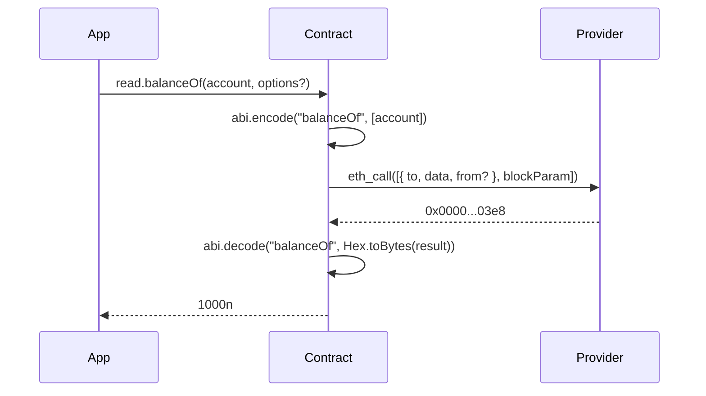

`contract.read.<fn>(...args, options?)` executes `view` and `pure` functions via `eth_call`. Calls run against node state without creating a transaction or spending gas.



## Basic Usage

```typescript
import { Contract } from './Contract.js';

const usdc = Contract({
  address: '0xA0b86991c6218b36c1d19D4a2e9Eb0cE3606eB48',
  abi: erc20Abi,
  provider,
});

const balance = await usdc.read.balanceOf('0x742d35Cc6634C0532925a3b844Bc9e7595f0bEb0');

const [name, symbol, decimals, totalSupply] = await Promise.all([
  usdc.read.name(),
  usdc.read.symbol(),
  usdc.read.decimals(),
  usdc.read.totalSupply(),
]);
```

## Direct Primitive Equivalent

Without the `Contract` wrapper, a read call combines `Abi`, `Hex`, and `provider.request`:

```typescript
import { Abi } from '@tevm/voltaire/Abi';
import { Hex } from '@tevm/voltaire/Hex';

const abi = Abi(erc20Abi);
const calldata = abi.encode('balanceOf', ['0x742d35Cc6634C0532925a3b844Bc9e7595f0bEb0']);

const raw = await provider.request({
  method: 'eth_call',
  params: [
    { to: '0xA0b86991c6218b36c1d19D4a2e9Eb0cE3606eB48', data: Hex.fromBytes(calldata) },
    'latest',
  ],
});

const [balance] = abi.decode('balanceOf', Hex.toBytes(raw as `0x${string}`));
```

## Return Value Unwrapping

| ABI Outputs | Returned Shape | Example |
| --- | --- | --- |
| 1 output (`uint256`) | Unwrapped value | `const balance = await usdc.read.balanceOf(addr)` |
| 2+ outputs (`uint112, uint112, uint32`) | Tuple array | `const [r0, r1, ts] = await pair.read.getReserves()` |
| Struct output | Decoded tuple/object | `const order = await exchange.read.getOrder(id)` |

## Block Target and Caller Override

Pass an optional trailing `ReadCallOptions` object after the function arguments to target historical state or override `msg.sender`:

```typescript
// Specific block height (requires archive node for old blocks)
const pastBalance = await usdc.read.balanceOf(account, {
  blockTag: 18_000_000n,
});

// Specific block hash (EIP-1898)
const hashBalance = await usdc.read.balanceOf(account, {
  blockHash: '0xabc123...0000',
});

// Pending state
const pendingBalance = await usdc.read.balanceOf(account, {
  blockTag: 'pending',
});

// Override msg.sender for access-controlled view calls
const allowed = await vault.read.canWithdraw(account, {
  from: '0x742d35Cc6634C0532925a3b844Bc9e7595f0bEb0',
});
```

## Error Handling

`read` throws `ContractFunctionNotFoundError` if the function is missing from the ABI or is not `view`/`pure`. RPC and revert errors are wrapped in `ContractReadError` with the underlying error preserved on `error.cause`.

```typescript
import { ContractFunctionNotFoundError, ContractReadError } from './Contract.js';

try {
  const balance = await usdc.read.balanceOf(account);
} catch (error) {
  if (error instanceof ContractFunctionNotFoundError) {
    console.error('ABI mismatch:', error.message);
  } else if (error instanceof ContractReadError) {
    console.error('eth_call failed:', error.message, error.cause);
  }
}
```

## Batching Reads

Use `Promise.all` for a handful of independent reads, or use the [Multicall Skill](/skills/multicall) to collapse dozens of calls into a single `eth_call` at one atomic block height.

## Related

- [Contract Pattern](/contract) — Full copyable implementation
- [Write Methods](/contract/write) — State-changing transactions
- [Gas Estimation](/contract/gas-estimation) — Simulating writes
- [Abi](/primitives/abi) — Low-level encoding and decoding
