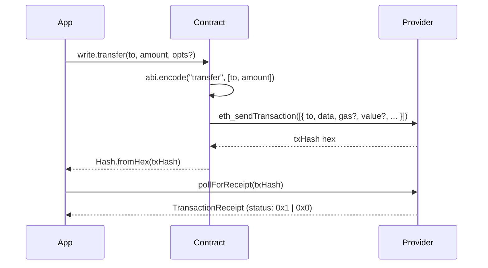

`contract.write.<fn>(...args, options?)` encodes calldata for `nonpayable` and `payable` functions, submits the transaction via `eth_sendTransaction`, and returns a 32-byte `HashType` transaction hash immediately upon submission.



## Basic Usage

```typescript
import { Hex } from '@tevm/voltaire/Hex';
import { Contract } from './Contract.js';

const usdc = Contract({
  address: '0xA0b86991c6218b36c1d19D4a2e9Eb0cE3606eB48',
  abi: erc20Abi,
  provider,
});

const txHash = await usdc.write.transfer(
  '0x742d35Cc6634C0532925a3b844Bc9e7595f0bEb0',
  1_000_000n, // 1 USDC (6 decimals)
);

console.log('Submitted:', Hex.fromBytes(txHash));
```

<Warning>
`eth_sendTransaction` resolves once the node accepts the transaction into its mempool. Execution happens asynchronously and may revert on-chain. Always wait for a receipt before treating state changes as final.
</Warning>

## Transaction Options

Pass a trailing `WriteCallOptions` object after the ABI arguments to set sender, fees, gas limit, ETH value, or nonce:

| Option | Type | RPC Field | Use |
| --- | --- | --- | --- |
| `from` | `` `0x${string}` `` | `from` | Sender account (required by nodes with multiple accounts) |
| `gas` | `bigint` | `gas` | Gas limit override |
| `maxFeePerGas` | `bigint` | `maxFeePerGas` | EIP-1559 max total fee per gas (wei) |
| `maxPriorityFeePerGas` | `bigint` | `maxPriorityFeePerGas` | EIP-1559 priority tip per gas (wei) |
| `gasPrice` | `bigint` | `gasPrice` | Legacy transaction gas price (wei) |
| `value` | `bigint` | `value` | ETH attached to `payable` calls (wei) |
| `nonce` | `bigint` | `nonce` | Explicit sender nonce |

```typescript
// EIP-1559 transfer with explicit gas limit and fee caps
const txHash = await usdc.write.transfer(recipient, 1_000_000n, {
  from: sender,
  gas: 65_000n,
  maxFeePerGas: 30_000_000_000n,
  maxPriorityFeePerGas: 2_000_000_000n,
});

// Payable call (zero ABI inputs, options as sole argument)
const depositHash = await weth.write.deposit({
  from: sender,
  value: 1_000_000_000_000_000_000n, // 1 ETH
});
```

## Simulate Before Sending

Call `estimateGas` first to catch reverts before broadcasting and add a 20% headroom buffer:

```typescript
const estimated = await usdc.estimateGas.transfer(recipient, amount, { from: sender });
const gasLimit = (estimated * 120n) / 100n;

const txHash = await usdc.write.transfer(recipient, amount, {
  from: sender,
  gas: gasLimit,
});
```

## Waiting for Confirmation

Use `pollForReceipt` from `@tevm/voltaire/utils` to wait until the transaction is mined:

```typescript
import { Hex } from '@tevm/voltaire/Hex';
import { pollForReceipt } from '@tevm/voltaire/utils';

const txHash = await usdc.write.transfer(recipient, amount, { from: sender });
const txHashHex = Hex.fromBytes(txHash);

const receipt = await pollForReceipt(
  txHashHex,
  (hash) => provider.request({ method: 'eth_getTransactionReceipt', params: [hash] }),
  { interval: 2000, timeout: 120_000 },
);

if (receipt.status !== '0x1') {
  throw new Error(`Transaction reverted: ${txHashHex}`);
}
```

## Error Handling

`write` throws `ContractFunctionNotFoundError` if the function is absent or is `view`/`pure`. Wallet rejections, insufficient funds, invalid nonces, and simulation reverts are wrapped in `ContractWriteError` with `error.cause` holding the underlying `RpcError`.

```typescript
import { ContractWriteError } from './Contract.js';

try {
  await usdc.write.transfer(recipient, amount, { from: sender });
} catch (error) {
  if (error instanceof ContractWriteError) {
    const rpcCause = error.cause as { code?: number; message?: string };
    if (rpcCause?.code === 4001) {
      console.error('User rejected transaction');
    } else {
      console.error('Submission failed:', rpcCause?.message ?? error.message);
    }
  }
}
```

## Related

- [Contract Pattern](/contract) — Full copyable implementation
- [Gas Estimation](/contract/gas-estimation) — Simulating transactions and computing costs
- [Polling Utilities](/utils/polling) — `pollForReceipt` reference
- [Send ETH & Tokens Skill](/skills/send-eth-tokens) — Local signing and `eth_sendRawTransaction`
