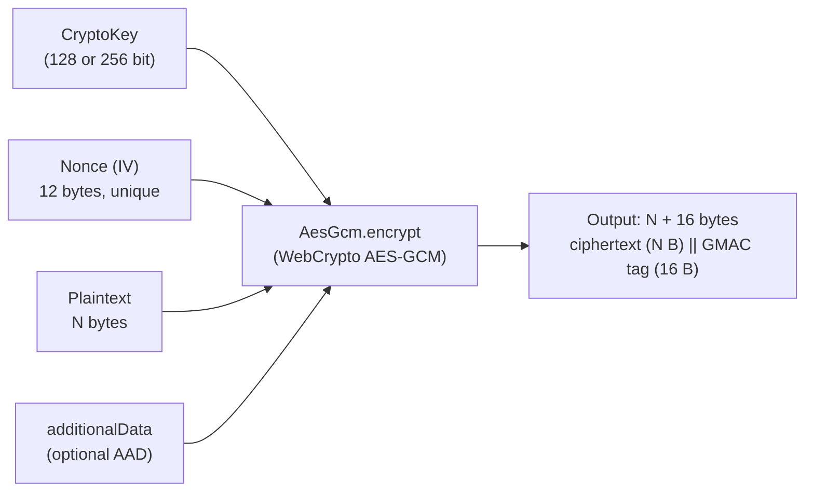

`AesGcm` provides NIST SP 800-38D authenticated encryption (AES-128-GCM and AES-256-GCM) over the native WebCrypto API (`crypto.subtle`). All encryption, decryption, and key-management functions are asynchronous and operate on WebCrypto `CryptoKey` objects.

## Encryption Pipeline



## Quick Start

```typescript
import { AesGcm } from '@tevm/voltaire/AesGcm';

// Generate a 256-bit key and fresh 12-byte nonce
const key = await AesGcm.generateKey(256);
const nonce = AesGcm.generateNonce(); // Uint8Array(12)

const plaintext = new TextEncoder().encode('Secret payload');
const aad = new TextEncoder().encode('record-id:42');

// Encrypt: output is ciphertext || 16-byte GMAC tag
const ciphertext = await AesGcm.encrypt(plaintext, key, nonce, aad);

// Decrypt: verifies GMAC tag before returning plaintext
const decrypted = await AesGcm.decrypt(ciphertext, key, nonce, aad);
```

### Password-Derived Keys (PBKDF2-SHA256)

```typescript
import { AesGcm } from '@tevm/voltaire/AesGcm';

const salt = crypto.getRandomValues(new Uint8Array(16));
const key = await AesGcm.deriveKey('user-passphrase', salt, 600_000, 256);

const nonce = AesGcm.generateNonce();
const ciphertext = await AesGcm.encrypt(
  new TextEncoder().encode('private note'),
  key,
  nonce,
);
```

## API Reference

All functions are exported on `AesGcm` and as named exports from `@tevm/voltaire/AesGcm`.

| Function | Signature | Returns | Notes |
|----------|-----------|---------|-------|
| `generateKey` | `(bits: 128 \| 256)` | `Promise<CryptoKey>` | Generates extractable AES-GCM key |
| `importKey` | `(keyBytes: Uint8Array)` | `Promise<CryptoKey>` | Imports raw 16-byte (AES-128) or 32-byte (AES-256) key |
| `exportKey` | `(key: CryptoKey)` | `Promise<Uint8Array>` | Exports raw key bytes (`16` or `32` bytes) |
| `deriveKey` | `(password: string \| Uint8Array, salt: Uint8Array, iterations: number, bits: 128 \| 256)` | `Promise<CryptoKey>` | PBKDF2-HMAC-SHA256 key derivation |
| `generateNonce` | `()` | `Uint8Array` (12 B) | Random 96-bit nonce via `crypto.getRandomValues` |
| `encrypt` | `(plaintext: Uint8Array, key: CryptoKey, nonce: Uint8Array, additionalData?: Uint8Array)` | `Promise<Uint8Array>` | Returns `ciphertext \|\| tag` (`plaintext.length + 16` bytes) |
| `decrypt` | `(ciphertext: Uint8Array, key: CryptoKey, nonce: Uint8Array, additionalData?: Uint8Array)` | `Promise<Uint8Array>` | Verifies tag and returns plaintext |

### Constants

| Constant | Value | Meaning |
|----------|-------|---------|
| `AES128_KEY_SIZE` | `16` | AES-128 raw key size in bytes |
| `AES256_KEY_SIZE` | `32` | AES-256 raw key size in bytes |
| `NONCE_SIZE` | `12` | GCM nonce/IV size in bytes (96 bits) |
| `TAG_SIZE` | `16` | GMAC authentication tag size in bytes (128 bits) |

## Errors and Security Invariants

<Warning>
Never reuse a `(key, nonce)` pair. A single repeated nonce in AES-GCM leaks the XOR of both plaintexts and exposes the GHASH authentication key, allowing arbitrary ciphertext forgery.
</Warning>

- **Error types:** Wrong nonce length throws `InvalidNonceError`; wrong raw key length throws `InvalidKeyError`; tampered ciphertext, wrong key, wrong nonce, or mismatched AAD throws `DecryptionError`; other WebCrypto failures throw `AesGcmError`.
- **Nonce storage:** Store the 12-byte nonce with the ciphertext (for example, `nonce || ciphertext`). Nonces are not secret.
- **PBKDF2 iterations:** Use at least `600_000` iterations with PBKDF2-SHA256 and a random 16-byte salt for user passwords.

## Related

- [Encryption](/crypto/aesgcm/encryption)
- [Decryption](/crypto/aesgcm/decryption)
- [Security](/crypto/aesgcm/security)
- [Test Vectors](/crypto/aesgcm/test-vectors)
- [Symmetric Encryption Comparison](/crypto/symmetric-encryption-comparison)
- [ChaCha20-Poly1305](/crypto/chacha20poly1305)
