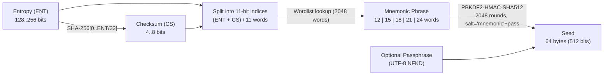

`Bip39` implements the BIP-39 mnemonic code standard backed by `@scure/bip39`: entropy-to-word encoding (12 to 24 words with SHA-256 checksum), mnemonic validation, and 64-byte seed derivation via PBKDF2-HMAC-SHA512 (2048 iterations).

## Mnemonic and Seed Pipeline



## Quick Start

```typescript
import { Bip39 } from '@tevm/voltaire/Bip39';

// Generate a 24-word mnemonic (256 bits entropy, default)
const mnemonic = Bip39.generateMnemonic(256);

// Validate wordlist membership and checksum
const isValid = Bip39.validateMnemonic(mnemonic); // true

// Derive 64-byte seed (async or sync)
const seed = await Bip39.mnemonicToSeed(mnemonic, 'optional passphrase');
const seedSync = Bip39.mnemonicToSeedSync(mnemonic, 'optional passphrase');
// Uint8Array(64)
```

## Entropy and Word Counts

| Constant | Entropy Bits (`ENT`) | Checksum Bits (`CS`) | Words |
|----------|----------------------|----------------------|-------|
| `ENTROPY_128` | `128` (16 B) | `4` | `12` |
| `ENTROPY_160` | `160` (20 B) | `5` | `15` |
| `ENTROPY_192` | `192` (24 B) | `6` | `18` |
| `ENTROPY_224` | `224` (28 B) | `7` | `21` |
| `ENTROPY_256` | `256` (32 B) | `8` | `24` |

## API Reference

All functions are exported on `Bip39` and as named exports from `@tevm/voltaire/Bip39`.

| Function | Signature | Returns | Notes |
|----------|-----------|---------|-------|
| `generateMnemonic` | `(strength?: 128 \| 160 \| 192 \| 224 \| 256, wordlist?: string[])` | `Mnemonic` (`string`) | Defaults to `256` bits (24 words) and English wordlist |
| `entropyToMnemonic` | `(entropy: Uint8Array, wordlist?: string[])` | `Mnemonic` (`string`) | Converts 16/20/24/28/32 bytes to mnemonic |
| `validateMnemonic` | `(mnemonic: string, wordlist?: string[])` | `boolean` | Verifies word count, wordlist, and SHA-256 checksum |
| `assertValidMnemonic` | `(mnemonic: string, wordlist?: string[])` | `void` | Throws `InvalidMnemonicError` if invalid |
| `mnemonicToSeed` | `(mnemonic: string, passphrase?: string)` | `Promise<Seed>` (64 B) | Async PBKDF2-HMAC-SHA512 (2048 iterations) |
| `mnemonicToSeedSync` | `(mnemonic: string, passphrase?: string)` | `Seed` (64 B) | Synchronous PBKDF2-HMAC-SHA512 |
| `getWordCount` | `(entropyBits: number)` | `number` | Maps `128..256` bits to `12..24` words |
| `getEntropyBits` | `(wordCount: number)` | `number` | Maps `12..24` words to `128..256` bits |

### Constants

- `ENTROPY_128 = 128`, `ENTROPY_160 = 160`, `ENTROPY_192 = 192`, `ENTROPY_224 = 224`, `ENTROPY_256 = 256`
- `SEED_LENGTH = 64`

## Security Notes

<Warning>
BIP-39 passphrases have no checksum: a typo in the passphrase silently derives a valid but completely different seed and set of addresses. Never rely on `mnemonicToSeed` to validate a passphrase.
</Warning>

- **Zero seed buffers:** Call `seed.fill(0)` after initializing the master HD key with [HDWallet](/crypto/hdwallet).
- **Errors:** Invalid entropy lengths throw `InvalidEntropyError`; invalid mnemonics in `assertValidMnemonic` throw `InvalidMnemonicError`; other failures throw `Bip39Error`.

## Related

- [Generation](/crypto/bip39/generation)
- [Validation](/crypto/bip39/validation)
- [Seed Derivation](/crypto/bip39/seed-derivation)
- [Passphrase](/crypto/bip39/passphrase)
- [Wordlists](/crypto/bip39/wordlists)
- [Wallet Integration](/crypto/wallet-integration)
- [HDWallet](/crypto/hdwallet)
