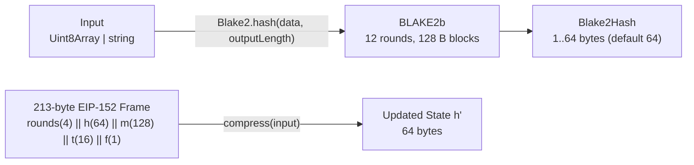

`Blake2` (also exported as `Blake2Hash`) computes RFC 7693 BLAKE2b digests of configurable length (`1` to `64` bytes, default `64`) backed by `@noble/hashes/blake2.js`, and exports the raw EIP-152 `compress` function used by EVM precompile `0x09` (`BLAKE2F`).

## Pipeline and EIP-152 Compression Layout



## Quick Start

```typescript
import { Blake2, compress } from '@tevm/voltaire/Blake2';

// Default 64-byte BLAKE2b digest
const h64 = Blake2.hash(new Uint8Array([1, 2, 3])); // Uint8Array(64)

// Variable-length digest (1 to 64 bytes)
const h32 = Blake2.hashString('hello', 32); // Uint8Array(32)
const h20 = Blake2.from('hello', 20);       // Uint8Array(20)
```

## API Reference

| Export | Signature | Returns | Notes |
|--------|-----------|---------|-------|
| `from` | `(input: Uint8Array \| string, outputLength?: number)` | `Blake2Hash` | Auto-detects `Uint8Array` or UTF-8 `string`; `outputLength` defaults to `64` |
| `hash` | `(data: Uint8Array, outputLength?: number)` | `Blake2Hash` | Hashes raw bytes; `1 <= outputLength <= 64` |
| `hashString` / `fromString` | `(str: string, outputLength?: number)` | `Blake2Hash` | UTF-8 encodes then hashes |
| `compress` | `(input: Uint8Array)` | `Uint8Array` (64 bytes) | Standalone named export implementing EIP-152 BLAKE2F compression |
| `SIZE` | `64` | `number` | Default and maximum digest size in bytes |

## EIP-152 `compress` Input Layout (213 Bytes)

`compress` matches the EVM `BLAKE2F` precompile (`0x09`) byte-for-byte:

| Offset | Size | Endianness | Field |
|--------|------|------------|-------|
| `0` | `4` | Big-endian | `rounds` (`uint32` compression round count) |
| `4` | `64` | Little-endian (8 x `u64`) | `h` (state vector) |
| `68` | `128` | Little-endian (16 x `u64`) | `m` (message block) |
| `196` | `16` | Little-endian (2 x `u64`) | `t` (offset counters `t0`, `t1`) |
| `212` | `1` | Flag (`0x00` or `0x01`) | `f` (final block indicator) |

## Errors and Edge Cases

- `outputLength` outside `1..64` throws `Blake2InvalidOutputLengthError`.
- `compress` throws `Blake2InvalidInputLengthError` if `input.length !== 213` and `Blake2Error` if the final flag `f` is neither `0` nor `1`.
- Unlike SHA-256, BLAKE2b is immune to length-extension attacks.
- For WASM execution, import `Blake2Wasm` from `@tevm/voltaire/wasm`.

## Test Vectors

| Input | Length | Digest |
|-------|--------|--------|
| `""` | 64 bytes | `0x786a02f742015903c6c6fd852552d272912f4740e15847618a86e217f71f5419d25e1031afee585313896444934eb04b903a685b1448b755d56f701afe9be2ce` |
| `"abc"` | 64 bytes | `0xba80a53f981c4d0d6a2797b69f12f6e94c212f14685ac4b74b12bb6fdbffa2d17d87c5392aab792dc252d5de4533cc9518d38aa8dbf1925ab92386edd4009923` |

## Related

- [EVM BLAKE2F Precompile (0x09)](/evm/precompiles/blake2f)
- [Keccak256](/crypto/keccak256)
- [SHA256](/crypto/sha256)
- [Cryptographic Algorithm Comparison](/crypto/comparison)
