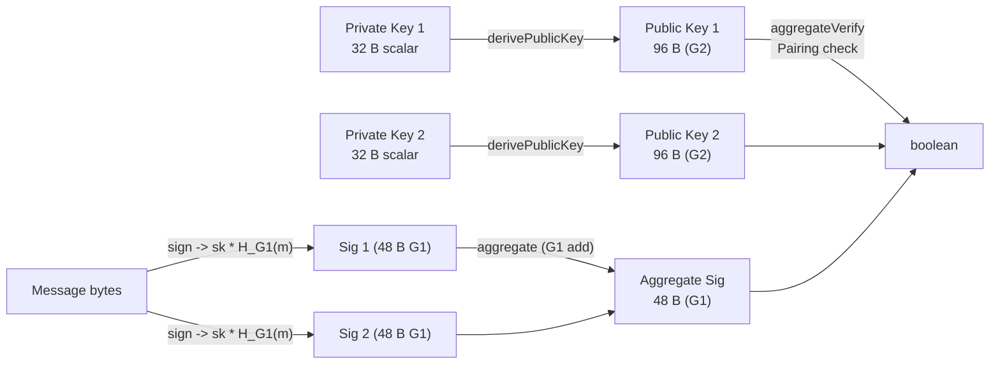

`Bls12381` implements BLS12-381 pairing-friendly elliptic curve operations (`Fp`, `Fp2`, `Fr`, `G1`, `G2`, `Pairing`) and high-level BLS signatures with aggregation backed by `@noble/curves/bls12-381.js`.

## Short-Signature Scheme and Aggregation Flow

The high-level `Bls12381` signature API uses `@noble/curves`'s **short signatures** layout: 48-byte compressed **G1** signatures and 96-byte compressed **G2** public keys. Multiple G1 signatures combine via point addition into a single 48-byte aggregate signature.



## Quick Start

```typescript
import { Bls12381 } from '@tevm/voltaire/Bls12381';

const msg = new TextEncoder().encode('block-root-0x1234');

const sk1 = Bls12381.randomPrivateKey();
const sk2 = Bls12381.randomPrivateKey();
const pk1 = Bls12381.derivePublicKey(sk1); // Uint8Array(96) compressed G2
const pk2 = Bls12381.derivePublicKey(sk2);

const sig1 = Bls12381.sign(msg, sk1); // Uint8Array(48) compressed G1
const sig2 = Bls12381.sign(msg, sk2);

const validSingle = Bls12381.verify(sig1, msg, pk1); // true

// Aggregate signatures for the same message
const aggSig = Bls12381.aggregate([sig1, sig2]);
const validAgg = Bls12381.aggregateVerify(aggSig, msg, [pk1, pk2]); // true

// Or pre-aggregate public keys for fastAggregateVerify
const aggPk = Bls12381.aggregatePublicKeys([pk1, pk2]);
const validFast = Bls12381.fastAggregateVerify(aggSig, msg, aggPk); // true
```

## API Reference

### High-Level Signature Operations

| Method | Signature | Returns | Notes |
|--------|-----------|---------|-------|
| `randomPrivateKey` | `()` | `Uint8Array` (32 bytes) | Uniform non-zero scalar `< FR_MOD` |
| `isValidPrivateKey` | `(key: Uint8Array)` | `boolean` | Checks length 32 and `0 < sk < FR_MOD` |
| `derivePublicKey` | `(privateKey: Uint8Array)` | `Uint8Array` (96 bytes) | Compressed G2 public key |
| `sign` | `(message: Uint8Array, privateKey: Uint8Array)` | `Uint8Array` (48 bytes) | Compressed G1 signature (`shortSignatures`) |
| `verify` | `(signature: Uint8Array, message: Uint8Array, publicKey: Uint8Array)` | `boolean` | Pairing verification; returns `false` on invalid curve points |
| `aggregate` | `(signatures: Uint8Array[])` | `Uint8Array` (48 bytes) | Sums compressed G1 signatures |
| `aggregatePublicKeys` | `(publicKeys: Uint8Array[])` | `Uint8Array` (96 bytes) | Sums compressed G2 public keys |
| `aggregateVerify` | `(aggSig: Uint8Array, message: Uint8Array, publicKeys: Uint8Array[])` | `boolean` | Verifies aggregate sig where all signers signed one message |
| `fastAggregateVerify` | `(aggSig: Uint8Array, message: Uint8Array, aggPublicKey: Uint8Array)` | `boolean` | Verifies against a pre-aggregated G2 public key |
| `batchVerify` | `(aggSig: Uint8Array, messages: Uint8Array[], publicKeys: Uint8Array[])` | `boolean` | Multi-pairing check when each signer signed a distinct message |
| `derivePublicKeyPoint` | `(privateKey: Uint8Array)` | `G1PointType` | Low-level G1 point public key (for `signPoint`/`verifyPoint`) |
| `signPoint` | `(messagePoint: G2PointType, privateKey: Uint8Array)` | `G2PointType` | Multiplies pre-hashed G2 point by scalar |
| `verifyPoint` | `(sigPoint: G2PointType, msgPoint: G2PointType, pkPoint: G1PointType)` | `boolean` | Verifies `e(pk, msg) == e(G1, sig)` |

### Curve & Field Namespaces

| Namespace | Operations |
|-----------|------------|
| `Bls12381.Fp` | Base field `GF(p)` arithmetic (381-bit prime) |
| `Bls12381.Fp2` | Quadratic extension `Fp[u] / (u^2 + 1)` |
| `Bls12381.Fr` | Scalar field `GF(r)` (255-bit subgroup order) |
| `Bls12381.G1` | `generator`, `infinity`, `add`, `double`, `negate`, `mul`, `isOnCurve`, `isInSubgroup`, `toAffine`, `equal` |
| `Bls12381.G2` | Same point operations over the twisted curve in `Fp2` |
| `Bls12381.Pairing` | Optimal ate pairing and pairing checks |

```typescript
import { Bls12381 } from '@tevm/voltaire/Bls12381';

const g1 = Bls12381.G1.generator();
const p = Bls12381.G1.mul(g1, 5n);
const sum = Bls12381.G1.add(g1, p);
console.log(Bls12381.G1.isOnCurve(sum)); // true
```

## Security Considerations

<Warning>
Aggregate signatures on the same message (`aggregateVerify` / `fastAggregateVerify`) are vulnerable to rogue-key attacks unless every participant proves possession of their private key (Proof of Possession, PoP) before their public key is accepted, or messages are guaranteed distinct via `batchVerify`.
</Warning>

- **Subgroup checks:** Deserialized points must be checked for both curve membership and prime-order subgroup membership to prevent small-subgroup attacks.
- **Scheme note:** `sign`/`verify`/`derivePublicKey` use G1 signatures (48 B) + G2 public keys (96 B) (`shortSignatures`), whereas `signPoint`/`verifyPoint`/`derivePublicKeyPoint` use G2 signatures + G1 public keys (matching the Ethereum Beacon Chain minimal-pubkey-size layout). Do not mix the two encodings.
- **Errors:** Invalid scalars throw `InvalidScalarError`; invalid input types or empty arrays throw `SignatureError`.

## Related

- [G1 Operations](/crypto/bls12-381/g1-operations)
- [G2 Operations](/crypto/bls12-381/g2-operations)
- [Pairing](/crypto/bls12-381/pairing)
- [Signatures](/crypto/bls12-381/signatures)
- [Aggregation](/crypto/bls12-381/aggregation)
- [Precompiles (EIP-2537)](/crypto/bls12-381/precompiles)
- [KZG Commitments](/crypto/kzg)
