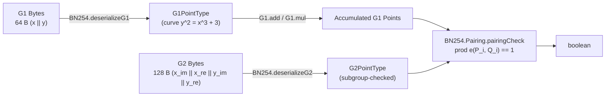

`BN254` (also known as `alt_bn128`) implements the Barreto-Naehrig curve used by Ethereum's EIP-196 and EIP-197 precompiles (`0x06`, `0x07`, `0x08`) for on-chain Groth16 and PLONK verification.

## Pairing Check Pipeline

A Groth16 verifier checks a multi-pairing equation `prod_i e(P_i, Q_i) == 1` over `G1 x G2 -> GT`.



## Quick Start

```typescript
import { BN254 } from '@tevm/voltaire/BN254';

// G1 arithmetic
const g1 = BN254.G1.generator();
const p = BN254.G1.mul(g1, 3n);
const q = BN254.G1.mul(g1, 5n);
const sum = BN254.G1.add(p, q); // 8 * G1

// G2 arithmetic
const g2 = BN254.G2.generator();
const r = BN254.G2.mul(g2, 4n);

// Bilinearity check: e(3*G1, 4*G2) * e(-12*G1, G2) == 1
const neg12 = BN254.G1.negate(BN254.G1.mul(g1, 12n));
const ok = BN254.Pairing.pairingCheck([
  [p, r],
  [neg12, g2],
]); // true

// EIP-196 / EIP-197 byte serialization
const g1Bytes = BN254.serializeG1(sum); // Uint8Array(64)
const decodedG1 = BN254.deserializeG1(g1Bytes);
```

## API Reference

| Export | Purpose |
|--------|---------|
| `BN254.Fp` | Base field `GF(p)` arithmetic (`p = 21888242871839275222246405745257275088696311157297823662689037894645226208583`) |
| `BN254.Fp2` | Quadratic extension `Fp[u] / (u^2 + 1)` |
| `BN254.Fr` | Scalar field `GF(r)` (`r = 21888242871839275222246405745257275088548364400416034343698204186575808495617`) |
| `BN254.G1` | `generator`, `infinity`, `add`, `double`, `negate`, `mul`, `isOnCurve`, `toAffine`, `equal` |
| `BN254.G2` | Same operations over `Fp2`, plus `isInSubgroup` |
| `BN254.Pairing` | `pair(p, q)`, `pairingCheck(pairs)` |
| `BN254.serializeG1` / `deserializeG1` | 64-byte big-endian `x (32 B) \|\| y (32 B)`; infinity is 64 zero bytes |
| `BN254.serializeG2` / `deserializeG2` | 128-byte big-endian `x.c1 \|\| x.c0 \|\| y.c1 \|\| y.c0` (EIP-197 ordering) |

## EIP-197 Byte Layout

| Point | Total Bytes | Offsets |
|-------|-------------|---------|
| G1 | `64` | `0..32`: `x`, `32..64`: `y` |
| G2 | `128` | `0..32`: `x_imag (c1)`, `32..64`: `x_real (c0)`, `64..96`: `y_imag (c1)`, `96..128`: `y_real (c0)` |
| Pairing pair | `192` | `0..64`: G1 point, `64..192`: G2 point |

<Note>
EIP-197 encodes G2 `Fp2` coordinates with the imaginary component (`c1`) first and real component (`c0`) second. `BN254.serializeG2` and `BN254.deserializeG2` enforce this ordering automatically.
</Note>

## Security and Performance Notes

- **Security margin:** Due to Tower Number Field Sieve (TNFS) advances, BN254 provides ~100-bit security rather than 128-bit. Prefer [BLS12-381](/crypto/bls12-381) for new protocols that do not depend on `0x06`-`0x08`.
- **WASM backend:** For Zig/WASM acceleration, import `Bn254Wasm` from `@tevm/voltaire/wasm`.

## Related

- [G1 Operations](/crypto/bn254/g1-operations)
- [G2 Operations](/crypto/bn254/g2-operations)
- [Pairing](/crypto/bn254/pairing)
- [ZK Usage](/crypto/bn254/zk-usage)
- [EVM BN254 Precompiles (0x06-0x08)](/evm/precompiles/bn254-pairing)
