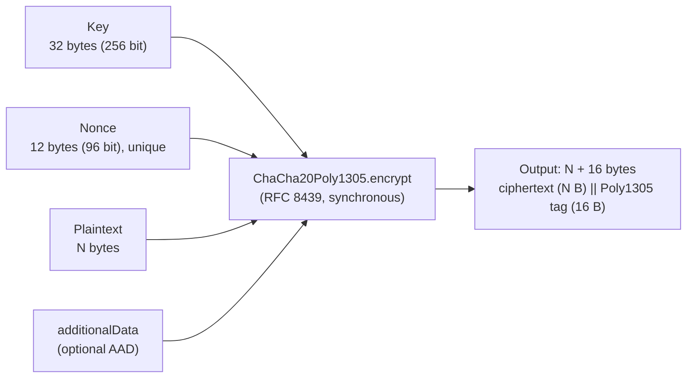

`ChaCha20Poly1305` implements RFC 8439 authenticated encryption (ChaCha20 stream cipher + Poly1305 MAC) backed by `@noble/ciphers/chacha.js`. Unlike `AesGcm`, every operation is synchronous, takes a raw 32-byte `Uint8Array` key, and runs in constant time without hardware AES instructions.

## Encryption Pipeline



## Quick Start

```typescript
import { ChaCha20Poly1305 } from '@tevm/voltaire/ChaCha20Poly1305';

const key = ChaCha20Poly1305.generateKey();     // Uint8Array(32)
const nonce = ChaCha20Poly1305.generateNonce(); // Uint8Array(12)

const plaintext = new TextEncoder().encode('Secret payload');
const aad = new TextEncoder().encode('frame-01');

// Synchronous encrypt: ciphertext || 16-byte Poly1305 tag
const ciphertext = ChaCha20Poly1305.encrypt(plaintext, key, nonce, aad);

// Synchronous decrypt: verifies tag before returning plaintext
const decrypted = ChaCha20Poly1305.decrypt(ciphertext, key, nonce, aad);
```

## API Reference

All functions are exported on `ChaCha20Poly1305` and as named exports from `@tevm/voltaire/ChaCha20Poly1305`.

| Function | Signature | Returns | Notes |
|----------|-----------|---------|-------|
| `generateKey` | `()` | `Uint8Array` (32 B) | Random 256-bit key via `crypto.getRandomValues` |
| `generateNonce` | `()` | `Uint8Array` (12 B) | Random 96-bit nonce via `crypto.getRandomValues` |
| `encrypt` | `(plaintext: Uint8Array, key: Uint8Array, nonce: Uint8Array, additionalData?: Uint8Array)` | `Uint8Array` | Returns `ciphertext \|\| tag` (`plaintext.length + 16` bytes) |
| `decrypt` | `(ciphertext: Uint8Array, key: Uint8Array, nonce: Uint8Array, additionalData?: Uint8Array)` | `Uint8Array` | Verifies Poly1305 tag and returns plaintext |

### Constants

| Constant | Value | Meaning |
|----------|-------|---------|
| `KEY_SIZE` | `32` | Fixed 256-bit key length in bytes |
| `NONCE_SIZE` | `12` | Fixed 96-bit nonce length in bytes |
| `TAG_SIZE` | `16` | Fixed 128-bit Poly1305 authentication tag length in bytes |

## Errors and Security Invariants

<Warning>
Never reuse a `(key, nonce)` pair. Reusing a nonce reveals the XOR of plaintexts and leaks the one-time Poly1305 key, allowing an attacker to forge tags on arbitrary messages.
</Warning>

- **Error types:** Invalid key length throws `InvalidKeyError`; invalid nonce length throws `InvalidNonceError`; authentication failure or truncated ciphertext throws `DecryptionError`; unexpected errors throw `ChaCha20Poly1305Error`.
- **Constant-time ARX design:** ChaCha20 uses only 32-bit addition, rotation, and XOR (no S-box lookup tables), eliminating cache-timing channels on platforms without AES-NI.
- **Message limit:** RFC 8439 uses a 32-bit block counter, limiting a single message to `2^32 - 1` 64-byte blocks (~256 GiB). Rotate keys before `2^32` random-nonce messages.

## Related

- [Symmetric Encryption Comparison](/crypto/symmetric-encryption-comparison)
- [AES-GCM](/crypto/aesgcm)
- [X25519](/crypto/x25519)
- [Keystore](/crypto/keystore)
