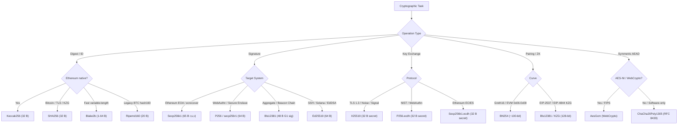

Voltaire implements Ethereum's execution-layer, consensus-layer, and wallet cryptography behind data-first namespaces over `Uint8Array`. Select an algorithm by protocol requirement first, then by hardware and security constraints.

## Algorithm Selection



## Elliptic Curve Signatures: Secp256k1 vs P-256 vs Ed25519 vs BLS12-381

| Property | Secp256k1 | P-256 (secp256r1) | Ed25519 | BLS12-381 |
|----------|-----------|-------------------|---------|-----------|
| Import | `@tevm/voltaire/Secp256k1` | `@tevm/voltaire/P256` | `@tevm/voltaire/Ed25519` | `@tevm/voltaire/Bls12381` |
| Standard | SEC 2 | NIST FIPS 186-4 | RFC 8032 | IETF BLS / EIP-2537 |
| Curve equation | `y^2 = x^3 + 7` | `y^2 = x^3 - 3x + b` | `-x^2 + y^2 = 1 + d*x^2*y^2` | `y^2 = x^3 + 4` (G1) |
| Security level | 128-bit | 128-bit | 128-bit | 128-bit |
| Private key | 32 bytes | 32 bytes | 32 bytes | 32 bytes (scalar in Fr) |
| Public key | 64 bytes (uncompressed) | 64 bytes (uncompressed) | 32 bytes (compressed) | 96 bytes (compressed G2) |
| Signature | `{ r, s, v }` (65 bytes) | `{ r, s }` (64 bytes) | 64 bytes | 48 bytes (compressed G1) |
| Key recovery | Yes (`v = 27 \| 28`) | No | No | No |
| Aggregation | No | No | No | Native (G1 addition) |
| ECDH support | Yes (`Secp256k1.ecdh`) | Yes (`P256.ecdh`) | Use `X25519` | No |
| EVM precompile | `0x01` (`ECRECOVER`, 3,000 gas) | L2 RIP-7212 / EIP-7951 | None | `0x0b`-`0x13` (Prague) |
| Hardware support | Ledger, Trezor | Secure Enclave, WebAuthn, TPM | Hardware security keys | Validator HSMs |

### Field Primes and Curve Orders

| Curve | Field Prime `p` | Subgroup Order `n` |
|-------|-----------------|--------------------|
| Secp256k1 | `0xFFFFFFFFFFFFFFFFFFFFFFFFFFFFFFFFFFFFFFFFFFFFFFFFFFFFFFFEFFFFFC2F` | `0xFFFFFFFFFFFFFFFFFFFFFFFFFFFFFFFEBAAEDCE6AF48A03BBFD25E8CD0364141` |
| P-256 | `0xFFFFFFFF00000001000000000000000000000000FFFFFFFFFFFFFFFFFFFFFFFF` | `0xFFFFFFFF00000000FFFFFFFFFFFFFFFFBCE6FAADA7179E84F3B9CAC2FC632551` |
| Ed25519 | `2^255 - 19` | `2^252 + 27742317777372353535851937790883648493` |
| BLS12-381 | 381-bit prime `p` | 255-bit prime `r` |

### Secp256k1 vs P-256 Usage

Ethereum externally owned accounts (EOAs), transaction signatures, EIP-712 typed data, and the `0x01` `ECRECOVER` precompile require **secp256k1**. Smart contract wallets using Face ID, Touch ID, Windows Hello, or FIPS-validated HSMs require **P-256**.

```typescript
import { Address, Hash, P256, Secp256k1, SHA256 } from '@tevm/voltaire';

// Ethereum EOA signing (secp256k1)
const ethHash = Hash.keccak256String('Authorize transfer');
const ethPriv = Secp256k1.randomPrivateKey();
const ethSig = Secp256k1.sign(ethHash, ethPriv);
const ethPub = Secp256k1.recoverPublicKey(ethSig, ethHash);
const signer = Address.fromPublicKey(ethPub);

// WebAuthn / passkey signing (P-256)
const p256Hash = SHA256.hashString('Authorize transfer');
const p256Priv = P256.randomPrivateKey();
const p256Pub = P256.derivePublicKey(p256Priv);
const p256Sig = P256.sign(p256Hash, p256Priv);
const valid = P256.verify(p256Sig, p256Hash, p256Pub);
```

## Hash Functions

| Algorithm | Import | Digest Size | Construction | Primary Use |
|-----------|--------|-------------|--------------|-------------|
| Keccak-256 | `@tevm/voltaire/Keccak256` | 32 bytes | Sponge (`0x01` pad, pre-NIST) | Ethereum addresses, selectors, topics, MPT |
| SHA-256 | `@tevm/voltaire/SHA256` | 32 bytes | Merkle-Damgard (FIPS 180-4) | EVM `0x02`, EIP-4844 versioned hashes, Bitcoin |
| BLAKE2b | `@tevm/voltaire/Blake2` | 1-64 bytes | HAIFA / ChaCha-based (RFC 7693) | EVM `0x09` (`BLAKE2F`), Zcash, high-speed hashing |
| RIPEMD-160 | `@tevm/voltaire/Ripemd160` | 20 bytes | Merkle-Damgard (ISO/IEC 10118-3) | EVM `0x03`, Bitcoin `HASH160` |

## Pairing-Friendly Curves

| Property | BN254 (alt_bn128) | BLS12-381 |
|----------|-------------------|-----------|
| Import | `@tevm/voltaire/BN254` | `@tevm/voltaire/Bls12381` |
| Effective security | ~100-bit (post-TNFS) | 128-bit |
| G1 uncompressed (EVM) | 64 bytes | 128 bytes |
| G2 uncompressed (EVM) | 128 bytes | 256 bytes |
| EVM precompiles | `0x06`, `0x07`, `0x08` (Byzantium) | `0x0b`-`0x13` (Prague) |
| Primary use | Groth16 / PLONK verification | Consensus BLS signatures, EIP-4844 KZG |

## Symmetric Encryption

For authenticated encryption choices between AES-GCM and ChaCha20-Poly1305, see [Symmetric Encryption Comparison](/crypto/symmetric-encryption-comparison).

## Related

- [Keccak256](/crypto/keccak256)
- [Secp256k1](/crypto/secp256k1)
- [P256](/crypto/p256)
- [Ed25519](/crypto/ed25519)
- [BLS12-381](/crypto/bls12-381)
- [BN254](/crypto/bn254)
- [EVM Precompiles](/evm/precompiles)
