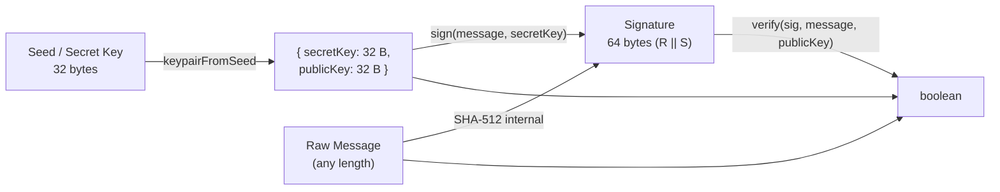

`Ed25519` implements RFC 8032 Edwards-curve Digital Signature Algorithm (EdDSA) over Curve25519 backed by `@noble/curves/ed25519.js`. Unlike ECDSA, `Ed25519.sign` hashes the raw message internally using SHA-512 and requires no external pre-hashing or random nonce.

## Signing and Verification Flow



## Quick Start

```typescript
import { Ed25519 } from '@tevm/voltaire/Ed25519';

const seed = crypto.getRandomValues(new Uint8Array(Ed25519.SEED_SIZE)); // 32 bytes
const { secretKey, publicKey } = Ed25519.keypairFromSeed(seed);

const message = new TextEncoder().encode('Authorize validator rotation');
const signature = Ed25519.sign(message, secretKey); // Uint8Array(64)

const valid = Ed25519.verify(signature, message, publicKey); // true
```

## API Reference

All functions are exported on `Ed25519` and as named exports from `@tevm/voltaire/Ed25519`.

| Function | Signature | Returns | Notes |
|----------|-----------|---------|-------|
| `keypairFromSeed` | `(seed: Uint8Array)` | `{ secretKey: Uint8Array; publicKey: Uint8Array }` | 32-byte seed -> 32-byte secret key + 32-byte public key |
| `derivePublicKey` | `(secretKey: Uint8Array)` | `Uint8Array` (32 bytes) | Derives compressed Edwards public key |
| `sign` | `(message: Uint8Array, secretKey: Uint8Array)` | `Uint8Array` (64 bytes) | Deterministic RFC 8032 signature over raw message bytes |
| `verify` | `(signature: Uint8Array, message: Uint8Array, publicKey: Uint8Array)` | `boolean` | Verifies 64-byte signature; returns `false` on cryptographic mismatch |
| `validateSecretKey` | `(secretKey: Uint8Array)` | `boolean` | Validates 32-byte secret key format |
| `validatePublicKey` | `(publicKey: Uint8Array)` | `boolean` | Validates 32-byte key length and curve point decoding |
| `validateSeed` | `(seed: Uint8Array)` | `boolean` | Checks 32-byte seed length |

### Constants

| Constant | Value | Meaning |
|----------|-------|---------|
| `SEED_SIZE` | `32` | Seed length in bytes |
| `SECRET_KEY_SIZE` | `32` | Secret key length in bytes |
| `PUBLIC_KEY_SIZE` | `32` | Compressed public key length in bytes |
| `SIGNATURE_SIZE` | `64` | Signature length in bytes (`R` 32 B + `S` 32 B) |

## Errors and Security Notes

- `sign` throws `InvalidSecretKeyError` if `secretKey.length !== 32` (`Ed25519Error` on signing failure).
- `verify` throws `InvalidPublicKeyError` if `publicKey.length !== 32` and `InvalidSignatureError` if `signature.length !== 64`; valid-length invalid signatures return `false`.
- **Do not reuse keys with X25519:** Keep Ed25519 signing keys separate from [X25519](/crypto/x25519) key-exchange keys.
- **WASM backend:** For Zig-compiled WASM execution, import `Ed25519Wasm` from `@tevm/voltaire/wasm`.

## Related

- [X25519 Key Exchange](/crypto/x25519)
- [Secp256k1](/crypto/secp256k1)
- [P256](/crypto/p256)
- [Cryptographic Algorithm Comparison](/crypto/comparison)
