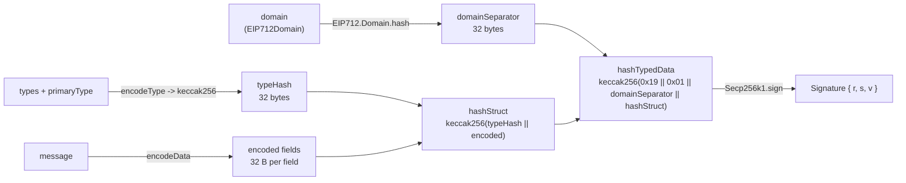

`EIP712` implements Ethereum's typed structured data specification (EIP-712): deterministic type encoding, recursive struct hashing, domain separation, `\x19\x01` digest construction, signing, and address recovery.

## Digest Construction



## Quick Start

```typescript
import { Address, EIP712, Secp256k1 } from '@tevm/voltaire';

const privateKey = Secp256k1.randomPrivateKey();
const signerAddress = Address.fromPrivateKey(privateKey);

const typedData = {
  domain: {
    name: 'PermitToken',
    version: '1',
    chainId: 1n,
    verifyingContract: Address('0xA0b86991c6218b36c1d19D4a2e9Eb0cE3606eB48'),
  },
  types: {
    Permit: [
      { name: 'owner', type: 'address' },
      { name: 'spender', type: 'address' },
      { name: 'value', type: 'uint256' },
      { name: 'nonce', type: 'uint256' },
      { name: 'deadline', type: 'uint256' },
    ],
  },
  primaryType: 'Permit',
  message: {
    owner: signerAddress,
    spender: Address('0x1111111111111111111111111111111111111111'),
    value: 1_000_000n,
    nonce: 0n,
    deadline: 1_800_000_000n,
  },
};

const digest = EIP712.hashTypedData(typedData); // 32-byte Uint8Array
const signature = EIP712.signTypedData(typedData, privateKey); // { r, s, v }
const recovered = EIP712.recoverAddress(signature, typedData); // 20-byte Address
const valid = EIP712.verifyTypedData(signature, typedData, signerAddress); // true
```

## API Reference

`EIP712` exports pre-wired convenience functions (using pure-TS Keccak-256 and Secp256k1) alongside uppercase dependency-injection factories (`HashDomain`, `HashType`, `HashStruct`, `EncodeValue`, `EncodeData`, `HashTypedData`, `SignTypedData`, `RecoverAddress`, `VerifyTypedData`) for custom or WASM crypto backends.

| Function | Signature | Returns | Purpose |
|----------|-----------|---------|---------|
| `hashTypedData` | `(typedData: TypedData)` | `HashType` (32 bytes) | Computes `keccak256("\x19\x01" \|\| domainSeparator \|\| hashStruct)` |
| `signTypedData` | `(typedData: TypedData, privateKey: Uint8Array \| string)` | `Signature` (`{ r, s, v }`) | Hashes and signs typed data |
| `recoverAddress` | `(signature: Signature, typedData: TypedData)` | `AddressType` (20 bytes) | Recovers signer address from signature and typed data |
| `verifyTypedData` | `(signature: Signature, typedData: TypedData, address: AddressType)` | `boolean` | Checks recovered address against expected address |
| `Domain.hash` / `hashDomain` | `(domain: Domain)` | `HashType` (32 bytes) | Computes `EIP712Domain` struct hash |
| `hashStruct` | `(primaryType: string, data: Message, types: TypeDefinitions)` | `HashType` (32 bytes) | Computes `keccak256(hashType \|\| encodeData)` |
| `encodeType` | `(primaryType: string, types: TypeDefinitions)` | `string` | Canonical type string with referenced structs sorted alphabetically |
| `hashType` | `(primaryType: string, types: TypeDefinitions)` | `HashType` (32 bytes) | `keccak256(encodeType(primaryType, types))` |
| `encodeData` | `(primaryType: string, data: Message, types: TypeDefinitions)` | `Uint8Array` | Concatenated 32-byte ABI-like field encodings |
| `encodeValue` | `(type: string, value: MessageValue, types: TypeDefinitions)` | `Uint8Array` (32 bytes) | Single EIP-712 atomic, dynamic, array, or struct encoding |
| `validate` | `(typedData: TypedData)` | `void` | Validates domain, type definitions, and message structure |
| `format` | `(typedData: TypedData)` | `string` | Human-readable representation for display/debugging |

## Domain Fields

`EIP712Domain` includes only the fields present on `domain`, encoded in canonical order:

| Order | Field | Solidity Type | Purpose |
|-------|-------|---------------|---------|
| 1 | `name` | `string` | Human-readable signing domain name |
| 2 | `version` | `string` | Domain schema version |
| 3 | `chainId` | `uint256` | EIP-155 chain ID (prevents cross-chain replay) |
| 4 | `verifyingContract` | `address` | Contract verifying the signature (prevents cross-contract replay) |
| 5 | `salt` | `bytes32` | Optional disambiguating salt |

## Security Considerations

<Warning>
Always bind `chainId` and `verifyingContract` in `domain`, and include a per-signer `nonce` and `deadline` in the signed struct. Without them, valid signatures can be replayed across forks, contracts, or indefinitely on the same chain.
</Warning>

- **Prefix collision safety:** The `0x19 0x01` prefix (EIP-191 version `0x01`) cannot collide with RLP-encoded transactions or EIP-191 personal messages (`\x19Ethereum Signed Message:\n`).
- **Dynamic field hashing:** `string` and `bytes` values are hashed with `keccak256` before being placed in their 32-byte slot; arrays hash the concatenation of their encoded elements.
- **Errors:** Invalid types, missing fields, or cyclic type references throw `Eip712Error` / `Eip712EncodingError` / `Eip712InvalidDomainError`.

## Related

- [Secp256k1](/crypto/secp256k1)
- [Keccak256](/crypto/keccak256)
- [Signers](/crypto/signers)
- [TypedData Primitive](/primitives/typed-data)
