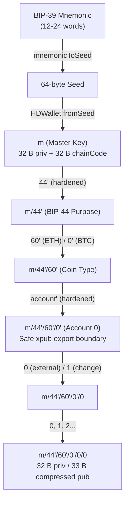

`HDWallet` implements BIP-32 hierarchical deterministic key derivation and BIP-44 multi-account paths over secp256k1, backed by `@scure/bip32`. Every function accepts an `ExtendedKey` as its first argument rather than attaching methods to the key object.

## BIP-39 / BIP-32 / BIP-44 Hierarchy



## Imports

`HDWallet` is exported from `@tevm/voltaire/HDWallet` and `@tevm/voltaire/native` (it is not re-exported from the root `@tevm/voltaire` barrel).

```typescript
import { Address, Bip39, PublicKey } from '@tevm/voltaire';
import { HDWallet } from '@tevm/voltaire/HDWallet';

const mnemonic = Bip39.generateMnemonic(256);
const seed = await Bip39.mnemonicToSeed(mnemonic);
const root = HDWallet.fromSeed(seed);

// Derive standard Ethereum account 0, address 0: m/44'/60'/0'/0/0
const eth0 = HDWallet.deriveEthereum(root, 0, 0);
const privKey = HDWallet.getPrivateKey(eth0); // Uint8Array(32) | null
const pubKey33 = HDWallet.getPublicKey(eth0); // Uint8Array(33) compressed

if (pubKey33) {
  const addr = Address.fromPublicKey(PublicKey.decompress(pubKey33));
  console.log(Address.toChecksummed(addr));
}
```

## API Reference

### Constructors & Serialization

| Function | Signature | Returns | Notes |
|----------|-----------|---------|-------|
| `fromSeed` | `(seed: Uint8Array)` | `ExtendedKey` | Derives master key `m` from 16-64 byte seed |
| `fromExtendedKey` | `(xkey: string)` | `ExtendedKey` | Parses Base58Check `xprv` or `xpub` |
| `fromPublicExtendedKey` | `(xpub: string)` | `ExtendedKey` | Parses watch-only `xpub` (`getPrivateKey` returns `null`) |
| `toExtendedPrivateKey` | `(key: ExtendedKey)` | `string` | Serializes as Base58Check `xprv...` |
| `toExtendedPublicKey` | `(key: ExtendedKey)` | `string` | Serializes as Base58Check `xpub...` |
| `toPublic` | `(key: ExtendedKey)` | `ExtendedKey` | Strips private key to produce watch-only extended key |

### Derivation & Key Inspection

| Function | Signature | Returns | Notes |
|----------|-----------|---------|-------|
| `derivePath` | `(key: ExtendedKey, path: string)` | `ExtendedKey` | Derives arbitrary BIP-32 path (e.g., `"m/44'/60'/0'/0/0"`) |
| `deriveChild` | `(key: ExtendedKey, index: number)` | `ExtendedKey` | Single-level derivation; use `index + HARDENED_OFFSET` for hardened |
| `deriveEthereum` | `(key: ExtendedKey, account?: number, index?: number)` | `ExtendedKey` | Shortcut for `m/44'/60'/${account}'/0/${index}` |
| `deriveBitcoin` | `(key: ExtendedKey, account?: number, index?: number)` | `ExtendedKey` | Shortcut for `m/44'/0'/${account}'/0/${index}` |
| `getPrivateKey` | `(key: ExtendedKey)` | `Uint8Array \| null` | 32-byte private key, or `null` for watch-only keys |
| `getPublicKey` | `(key: ExtendedKey)` | `Uint8Array \| null` | 33-byte compressed secp256k1 public key |
| `getChainCode` | `(key: ExtendedKey)` | `Uint8Array \| null` | 32-byte BIP-32 chain code |
| `canDeriveHardened` | `(key: ExtendedKey)` | `boolean` | `true` only if `key` holds a private key |

### Path Utilities, Mnemonic Helpers, and Constants

- **Path helpers:** `isHardenedPath(path)`, `isValidPath(path)`, `parseIndex(segment)`
- **Mnemonic helpers:** `generateMnemonic`, `mnemonicToSeed`, `validateMnemonic`
- **Constants:**
  - `HARDENED_OFFSET = 0x80000000` (`2^31`)
  - `CoinType = { BTC: 0, BTC_TESTNET: 1, ETH: 60, ETC: 61 }`
  - `BIP44_PATH = { ETH(account = 0, index = 0), BTC(account = 0, index = 0) }`

## Security Invariants

<Warning>
In BIP-32 non-hardened derivation, leaking a parent `xpub` together with any non-hardened child private key reveals the parent private key. Always keep `purpose'`, `coin_type'`, and `account'` hardened (`'`), and never expose a master `xpub` alongside child private keys.
</Warning>

- **Public key format:** `HDWallet.getPublicKey` returns a 33-byte **compressed** key (`0x02`/`0x03` + `x`). Decompress with `PublicKey.decompress` to 64 bytes before hashing for an Ethereum address.
- **Errors:** Invalid paths throw `InvalidPathError`; invalid seeds or keys throw `InvalidSeedError` / `InvalidKeyError`; hardened derivation from an `xpub` throws `HardenedDerivationError`.

## Related

- [Derivation Paths](/crypto/hdwallet/derivation-paths)
- [Child Derivation](/crypto/hdwallet/child-derivation)
- [Extended Keys](/crypto/hdwallet/extended-keys)
- [BIP-39 Mnemonics](/crypto/bip39)
- [Wallet Integration](/crypto/wallet-integration)
