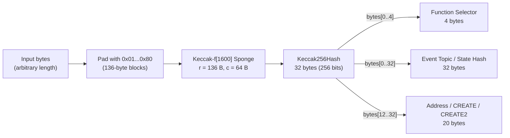

`Keccak256` (exported as `Keccak256` and `Keccak256Hash`) computes the 32-byte Ethereum Keccak-256 digest over arbitrary byte sequences, UTF-8 strings, or hex strings. Every hashing method returns a branded 32-byte `Uint8Array` (`Keccak256Hash`).

## Sponge Construction and Ethereum Derivations

Keccak-256 uses a 1600-bit permutation (`STATE_SIZE = 25` 64-bit lanes = 200 bytes) with rate `r = 1088` bits (`RATE = 136` bytes), capacity `c = 512` bits, and domain padding byte `0x01`.



<Warning>
Ethereum uses original Keccak-256 (`0x01` padding), not NIST FIPS 202 SHA3-256 (`0x06` padding). The two algorithms produce different digests for every input.
</Warning>

## Entrypoints and Runtime Backends

Voltaire exposes three Keccak-256 entrypoints with distinct execution models:

| Entrypoint | Export | Backend | Async? | Audited Crypto |
|------------|--------|---------|--------|----------------|
| `@tevm/voltaire` / `@tevm/voltaire/Keccak256` | `Keccak256`, `Keccak256Hash` | Pure TypeScript (`@noble/hashes/sha3.js`) | Sync | Yes (`@noble/hashes`) |
| `@tevm/voltaire/wasm` | `Keccak256Wasm`, `Keccak256._wasm` | Zig stdlib compiled to `primitives.wasm` | Requires `await init()`, then sync | Zig stdlib |
| `@tevm/voltaire/Keccak256/native` / `@tevm/voltaire/native` | `Keccak256`, `Keccak256Hash` | Native Zig FFI (Bun FFI / Node-API) | Async (`hashSync` after load) | Native Zig / keccak-asm |

`@tevm/voltaire/Keccak256/wasm` currently aliases the pure TypeScript module in `package.json`. Use `Keccak256Wasm` from `@tevm/voltaire/wasm` when you want explicit WASM execution.

<Tabs>
<Tab title="Default (Pure TS / @noble/hashes)">
```typescript
import { Keccak256 } from '@tevm/voltaire/Keccak256';

const h1 = Keccak256.hash(new Uint8Array([1, 2, 3]));
const h2 = Keccak256.hashString('hello');
const h3 = Keccak256.hashHex('0x1234abcd');
const sel = Keccak256.selector('transfer(address,uint256)');
```
</Tab>

<Tab title="WASM (@tevm/voltaire/wasm)">
```typescript
import { Keccak256Wasm } from '@tevm/voltaire/wasm';

await Keccak256Wasm.init(); // Must be called once before hashing
const h = Keccak256Wasm.hashString('hello');
const sel = Keccak256Wasm.selector('transfer(address,uint256)');
```
</Tab>

<Tab title="Native FFI (@tevm/voltaire/Keccak256/native)">
```typescript
import { Keccak256 } from '@tevm/voltaire/Keccak256/native';

// Lazy-loads the native library on first call
const h = await Keccak256.hashString('hello');
const sel = await Keccak256.selector('transfer(address,uint256)'); // hex string "0xa9059cbb"

// Synchronous hashing is available once the native library is loaded
const hSync = Keccak256.hashSync(new Uint8Array([1, 2, 3]));
```
</Tab>
</Tabs>

## API Reference

All functions below are available both as methods on `Keccak256` / `Keccak256Hash` and as tree-shakeable named exports from `@tevm/voltaire/Keccak256`.

| Method | Signature | Returns | Notes |
|--------|-----------|---------|-------|
| `from` | `(input: Uint8Array \| string)` | `Keccak256Hash` | Auto-detects `Uint8Array`, hex string (`0x...` or hex digits), or UTF-8 string |
| `hash` | `(data: Uint8Array)` | `Keccak256Hash` | Hashes raw bytes directly |
| `hashString` / `fromString` | `(str: string)` | `Keccak256Hash` | UTF-8 encodes via `TextEncoder` then hashes |
| `hashHex` / `fromHex` | `(hex: string)` | `Keccak256Hash` | Decodes hex string (with or without `0x`) then hashes |
| `hashMultiple` | `(chunks: readonly Uint8Array[])` | `Keccak256Hash` | Hashes concatenated chunks without copying into one buffer |
| `selector` | `(signature: string)` | `Uint8Array` (4 bytes) | First 4 bytes of `hashString(signature)` (native returns `Promise<string>`) |
| `topic` / `fromTopic` | `(signature: string)` | `Keccak256Hash` | Full 32-byte event topic hash |
| `contractAddress` | `(sender: Uint8Array, nonce: bigint)` | `Uint8Array` (20 bytes) | `keccak256(rlp([sender, nonce]))[12..32]` |
| `create2Address` | `(sender: Uint8Array, salt: Uint8Array, initCodeHash: Uint8Array)` | `Uint8Array` (20 bytes) | `keccak256(0xff \|\| sender \|\| salt \|\| initCodeHash)[12..32]` |

### Constants

| Constant | Value | Meaning |
|----------|-------|---------|
| `DIGEST_SIZE` | `32` | Output digest length in bytes |
| `RATE` | `136` | Sponge rate in bytes (`1088` bits) |
| `STATE_SIZE` | `25` | Permutation state in 64-bit lanes (`200` bytes; native exports `200`) |

## Ethereum Helpers

```typescript
import { Address, Bytes, Keccak256 } from '@tevm/voltaire';

// Function selector: Uint8Array(4) [0xa9, 0x05, 0x9c, 0xbb]
const sel = Keccak256.selector('transfer(address,uint256)');

// Event topic: 32-byte Keccak256Hash
const topic = Keccak256.topic('Transfer(address,address,uint256)');

// CREATE address: keccak256(rlp([sender, nonce]))[12..32]
const deployer = Address('0x742d35Cc6634C0532925a3b844Bc9e7595f51e3e');
const created = Keccak256.contractAddress(deployer, 5n);

// CREATE2 address: pass 32-byte initCodeHash (hash of initCode)
const salt = Bytes.zero(32);
const initCodeHash = Keccak256.hashHex('0x6080604052');
const created2 = Keccak256.create2Address(deployer, salt, initCodeHash);
```

## Errors and Edge Cases

- `from(input)` treats any string matching `/^[0-9a-fA-F]*$/` (including `""` or `"deadbeef"`) as hex rather than UTF-8. Call `hashString` explicitly when hashing arbitrary text to avoid hex misdetection.
- `contractAddress` throws `InvalidLengthError` if `sender.length !== 20`.
- `create2Address` takes `initCodeHash` (32 bytes), not raw initCode. It throws `InvalidLengthError` if `sender` is not 20 bytes or `salt` / `initCodeHash` is not 32 bytes.
- `Keccak256.hashSync` on `@tevm/voltaire/Keccak256/native` throws `Keccak256NativeNotLoadedError` if called before any async call loads the native shared library.

## Test Vectors

| Input | Digest |
|-------|--------|
| `""` (empty) | `0xc5d2460186f7233c927e7db2dcc703c0e500b653ca82273b7bfad8045d85a470` |
| `"abc"` | `0x4e03657aea45a94fc7d47ba826c8d667c0d1e6e33a64a036ec44f58fa12d6c45` |
| `"hello"` | `0x1c8aff950685c2ed4bc3174f3472287b56d9517b9c948127319a09a7a36deac8` |
| `selector("transfer(address,uint256)")` | `0xa9059cbb` |

## Related

- [Hash Methods](/crypto/keccak256/hash-methods)
- [Ethereum Methods](/crypto/keccak256/ethereum-methods)
- [Implementations](/crypto/keccak256/implementations)
- [Usage Patterns](/crypto/keccak256/usage-patterns)
- [Address](/primitives/address)
- [SHA256](/crypto/sha256)
