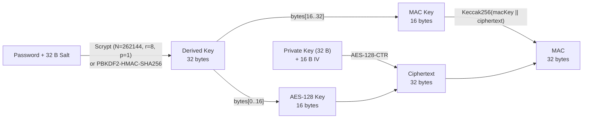

`Keystore` implements the Ethereum Web3 Secret Storage Definition (v3) used by Geth, Foundry, MetaMask, and ethers.js: password-based key derivation (`scrypt` or `pbkdf2`), `aes-128-ctr` encryption, and a Keccak-256 MAC verified in constant time.

## Keystore v3 Construction



## Quick Start

```typescript
import { Keystore, PrivateKey, Secp256k1 } from '@tevm/voltaire';

const privateKey = PrivateKey.fromBytes(Secp256k1.randomPrivateKey());

// Encrypt to Web3 v3 keystore JSON object (async, defaults to Scrypt N=262144)
const keystore = await Keystore.encrypt(privateKey, 'strong-passphrase');

// Persist JSON string
const json = JSON.stringify(keystore, null, 2);

// Decrypt synchronously: verifies MAC in constant time before decrypting
const recovered = Keystore.decrypt(JSON.parse(json), 'strong-passphrase');
```

## API Reference

`Keystore` exports `encrypt` and `decrypt` on the `Keystore` namespace (from `@tevm/voltaire` or `@tevm/voltaire/Keystore`).

| Function | Signature | Returns | Notes |
|----------|-----------|---------|-------|
| `encrypt` | `(privateKey: PrivateKeyType, password: string, options?: EncryptOptions)` | `Promise<KeystoreV3>` | Async; defaults to `kdf: "scrypt"` with `N = 262144, r = 8, p = 1` |
| `decrypt` | `(keystore: KeystoreV3, password: string)` | `PrivateKeyType` (32 B) | Synchronous; verifies Keccak-256 MAC in constant time before AES-128-CTR decryption |

### `EncryptOptions`

| Option | Type | Default | Description |
|--------|------|---------|-------------|
| `kdf` | `"scrypt" \| "pbkdf2"` | `"scrypt"` | Key derivation function |
| `scryptN` | `number` | `262144` (`2^18`) | Scrypt CPU/memory cost (power of 2) |
| `scryptR` | `number` | `8` | Scrypt block size |
| `scryptP` | `number` | `1` | Scrypt parallelization factor |
| `pbkdf2C` | `number` | `262144` | PBKDF2-HMAC-SHA256 iteration count |
| `salt` | `Uint8Array` | Random 32 bytes | Custom KDF salt |
| `iv` | `Uint8Array` | Random 16 bytes | Custom AES-128-CTR IV |
| `uuid` | `string` | Random UUID v4 | Custom keystore `id` |

### `KeystoreV3` Structure

```typescript
type KeystoreV3 = {
  version: 3;
  id: string;
  address?: string;
  crypto: {
    cipher: 'aes-128-ctr';
    ciphertext: string;
    cipherparams: { iv: string };
    kdf: 'scrypt' | 'pbkdf2';
    kdfparams:
      | { dklen: number; n: number; r: number; p: number; salt: string }
      | { c: number; dklen: number; prf: 'hmac-sha256'; salt: string };
    mac: string;
  };
};
```

## Errors and Security Notes

<Warning>
Use `scrypt` (the default) over `pbkdf2` for production keystores. Scrypt is memory-hard (`N = 262144, r = 8` requires ~256 MiB per attempt), resisting GPU and ASIC brute-force attacks. Only lower `scryptN` in unit tests.
</Warning>

- **Error types:**
  - `UnsupportedVersionError`: `keystore.version !== 3`
  - `UnsupportedKdfError`: `kdf` is not `"scrypt"` or `"pbkdf2"`
  - `InvalidMacError`: wrong password or tampered ciphertext/MAC
  - `InvalidScryptNError` / `InvalidPbkdf2IterationsError`: invalid KDF parameters
  - `EncryptionError` / `DecryptionError`: general cipher failure
- **Fresh salt and IV:** Leave `salt` and `iv` omitted unless reproducing a deterministic test vector. Reusing an IV with the same derived AES-CTR key breaks confidentiality.

## Related

- [Encryption](/crypto/keystore/encryption)
- [Decryption](/crypto/keystore/decryption)
- [Security](/crypto/keystore/security)
- [Wallet Integration](/crypto/wallet-integration)
- [AES-GCM](/crypto/aesgcm)
