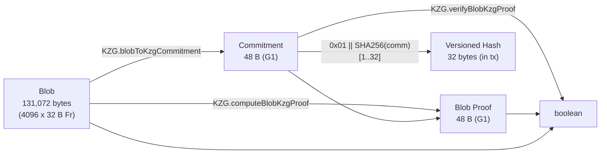

`KZG` implements EIP-4844 KZG polynomial commitments over BLS12-381 using `c-kzg-4844` compiled to WebAssembly. Every blob is 131,072 bytes (`4096` big-endian 32-byte BLS12-381 scalar field elements), producing a 48-byte G1 commitment and 48-byte G1 proof.

## EIP-4844 Blob-to-Versioned-Hash Pipeline



## Quick Start

Load the Ethereum KZG trusted setup once before calling any commitment, proof, or verification method.

```typescript
import { KZG, SHA256 } from '@tevm/voltaire';

// 1. Initialize trusted setup (once per process)
KZG.loadTrustedSetup();

try {
  // 2. Create or validate a 131,072-byte blob
  const blob = KZG.generateRandomBlob();
  KZG.validateBlob(blob);

  // 3. Compute 48-byte commitment and 48-byte blob proof
  const commitment = KZG.blobToKzgCommitment(blob);
  const blobProof = KZG.computeBlobKzgProof(blob, commitment);

  // 4. Verify blob against commitment and proof
  const isValid = KZG.verifyBlobKzgProof(blob, commitment, blobProof); // true

  // 5. Derive EIP-4844 versioned hash: 0x01 || sha256(commitment)[1..32]
  const versionedHash = SHA256.hash(commitment);
  versionedHash[0] = 0x01;

  // 6. Evaluate polynomial at arbitrary field element z (32 bytes)
  const z = new Uint8Array(32);
  z[31] = 1;
  const { proof, y } = KZG.computeKzgProof(blob, z);
  const evalValid = KZG.verifyKzgProof(commitment, z, y, proof); // true
} finally {
  KZG.freeTrustedSetup();
}
```

## API Reference

All functions are available as static methods on `KZG` and as named exports from `@tevm/voltaire/KZG`. Uppercase factory functions (`BlobToKzgCommitment`, `ComputeKzgProof`, `ComputeBlobKzgProof`, `VerifyKzgProof`, `VerifyBlobKzgProof`, `VerifyBlobKzgProofBatch`) are also exported for custom dependency injection.

### Lifecycle and Blob Helpers

| Method | Signature | Returns | Notes |
|--------|-----------|---------|-------|
| `loadTrustedSetup` | `(filePath?: string)` | `void` | Loads the embedded Ethereum KZG Ceremony setup (or custom file) |
| `freeTrustedSetup` | `()` | `void` | Releases trusted setup memory |
| `isInitialized` | `()` | `boolean` | Returns `true` if trusted setup is loaded |
| `validateBlob` | `(blob: Uint8Array)` | `void` | Checks length (`131072`) and ensures every 32-byte element `< BLS_MODULUS` |
| `createEmptyBlob` | `()` | `Uint8Array` (131,072 B) | Zero-initialized valid blob |
| `generateRandomBlob` | `()` | `Uint8Array` (131,072 B) | Random valid blob (high byte zeroed per field element) |

### Commitments and Proofs

| Method | Signature | Returns | Alias |
|--------|-----------|---------|-------|
| `blobToKzgCommitment` | `(blob: Uint8Array)` | `Uint8Array` (48 B) | `KZG.Commitment` |
| `computeKzgProof` | `(blob: Uint8Array, z: Uint8Array)` | `{ proof: Uint8Array; y: Uint8Array }` | `KZG.Proof` |
| `computeBlobKzgProof` | `(blob: Uint8Array, commitment: Uint8Array)` | `Uint8Array` (48 B) | `KZG.BlobProof` |
| `verifyKzgProof` | `(commitment: Uint8Array, z: Uint8Array, y: Uint8Array, proof: Uint8Array)` | `boolean` | — |
| `verifyBlobKzgProof` | `(blob: Uint8Array, commitment: Uint8Array, proof: Uint8Array)` | `boolean` | — |
| `verifyBlobKzgProofBatch` | `(blobs: Uint8Array[], commitments: Uint8Array[], proofs: Uint8Array[])` | `boolean` | — |

### Constants

| Constant | Value | Meaning |
|----------|-------|---------|
| `BYTES_PER_BLOB` | `131072` | `4096 * 32` bytes per blob |
| `FIELD_ELEMENTS_PER_BLOB` | `4096` | Polynomial evaluation points per blob |
| `BYTES_PER_FIELD_ELEMENT` | `32` | Scalar size in bytes |
| `BYTES_PER_COMMITMENT` | `48` | Compressed BLS12-381 G1 commitment |
| `BYTES_PER_PROOF` | `48` | Compressed BLS12-381 G1 proof |

## Errors and Edge Cases

<Warning>
Calling `KZG()` directly throws an error (`KZG is not a constructor`). Calling commitment or proof methods before `KZG.loadTrustedSetup()` throws `KzgNotInitializedError`.
</Warning>

- **Canonical field elements:** Each 32-byte chunk in a blob must be strictly less than the BLS12-381 scalar modulus `r` (`0x73eda753...00000001`). Setting the top byte (`chunk[0] = 0`) guarantees validity (248 usable bits per 32-byte field element).
- **Errors:** Invalid lengths or out-of-range field elements throw `KzgInvalidBlobError` or `KzgError`.

## Related

- [Commitments](/crypto/kzg/commitments)
- [Proofs](/crypto/kzg/proofs)
- [Point Evaluation](/crypto/kzg/point-evaluation)
- [Trusted Setup](/crypto/kzg/trusted-setup)
- [EIP-4844 Overview](/crypto/kzg/eip-4844)
- [EVM Point Evaluation Precompile (0x0a)](/evm/precompiles/point-evaluation)
- [Blob Primitive](/primitives/blob)
