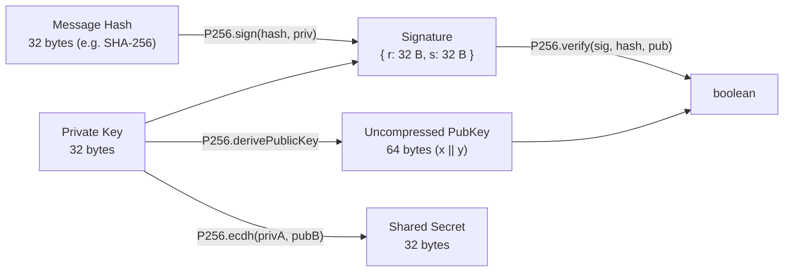

`P256` implements ECDSA signing, verification, and ECDH key exchange on the NIST P-256 curve (`secp256r1` / `prime256v1`) backed by `@noble/curves/nist.js`. P-256 is the default curve for WebAuthn passkeys, Apple Secure Enclave, Android Keystore, and TLS 1.3.

## ECDSA and ECDH Flow



## Quick Start

```typescript
import { P256, SHA256 } from '@tevm/voltaire';

// Key generation and signing
const privateKey = P256.randomPrivateKey(); // 32 bytes
const publicKey = P256.derivePublicKey(privateKey); // 64 bytes (x || y, no 0x04 prefix)

const messageHash = SHA256.hashString('WebAuthn assertion');
const signature = P256.sign(messageHash, privateKey); // { r, s }
const valid = P256.verify(signature, messageHash, publicKey); // true

// ECDH key agreement
const peerPriv = P256.randomPrivateKey();
const peerPub = P256.derivePublicKey(peerPriv);
const sharedA = P256.ecdh(privateKey, peerPub); // Uint8Array(32)
const sharedB = P256.ecdh(peerPriv, publicKey); // identical 32 bytes
```

## API Reference

All functions are exported on `P256` and as named exports from `@tevm/voltaire/P256`.

| Function | Signature | Returns | Notes |
|----------|-----------|---------|-------|
| `randomPrivateKey` | `()` | `P256PrivateKeyType` (32 B) | Uniform scalar `1 <= d < CURVE_ORDER` |
| `derivePublicKey` | `(privateKey: Uint8Array)` | `P256PublicKeyType` (64 B) | Uncompressed `x \|\| y` without `0x04` prefix |
| `sign` | `(messageHash: Uint8Array, privateKey: Uint8Array, options?: { extraEntropy?: boolean \| Uint8Array; lowS?: boolean })` | `P256SignatureType` (`{ r, s }`) | RFC 6979 deterministic by default; `lowS` defaults to `true` |
| `verify` | `(signature: { r: Uint8Array; s: Uint8Array }, messageHash: Uint8Array, publicKey: Uint8Array)` | `boolean` | Verifies 64-byte public key and `{ r, s }` over 32-byte hash |
| `ecdh` | `(privateKey: Uint8Array, publicKey: Uint8Array)` | `Uint8Array` (32 B) | Computes x-coordinate shared secret |
| `validatePrivateKey` | `(key: Uint8Array)` | `boolean` | Checks length 32 and `1 <= d < CURVE_ORDER` |
| `validatePublicKey` | `(key: Uint8Array)` | `boolean` | Checks length 64 and valid curve point |

### Constants

| Constant | Value | Meaning |
|----------|-------|---------|
| `CURVE_ORDER` | `0xffffffff00000000ffffffffffffffffbce6faada7179e84f3b9cac2fc632551n` | Subgroup order `n` |
| `PRIVATE_KEY_SIZE` | `32` | Private key bytes |
| `PUBLIC_KEY_SIZE` | `64` | Uncompressed public key bytes (no `0x04` prefix) |
| `SIGNATURE_COMPONENT_SIZE` | `32` | Byte length of `r` and `s` |
| `SHARED_SECRET_SIZE` | `32` | ECDH output bytes |

## Security Notes

- **KDF on ECDH output:** Do not use raw `P256.ecdh` bytes directly as a symmetric key. Pass the 32-byte shared secret through a KDF (e.g., HKDF-SHA256) bound to session context.
- **No recovery ID:** Unlike secp256k1, P-256 signatures contain `{ r, s }` (64 bytes) without `v`. Callers supply the 64-byte public key when verifying.
- **Errors:** `sign` throws `InvalidPrivateKeyError` for non-32-byte keys (`P256Error` on signing failure). `verify` throws `InvalidPublicKeyError` if `publicKey.length !== 64`.
- **WASM backend:** For Zig-compiled WASM execution, import `P256Wasm` from `@tevm/voltaire/wasm`.

## Related

- [Cryptographic Algorithm Comparison](/crypto/comparison)
- [Secp256k1](/crypto/secp256k1)
- [X25519](/crypto/x25519)
- [SHA256](/crypto/sha256)
