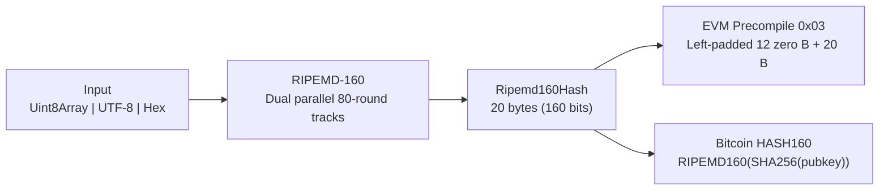

`Ripemd160` (also exported as `Ripemd160Hash`) computes 20-byte (160-bit) RIPEMD-160 digests backed by `@noble/hashes/legacy.js`. Every hashing method returns a branded 20-byte `Uint8Array` (`Ripemd160Hash`).

## Data Flow



## Quick Start

```typescript
import { Ripemd160, SHA256 } from '@tevm/voltaire';

const digest = Ripemd160.hashString('hello'); // Uint8Array(20)
const fromHex = Ripemd160.hashHex('0xdeadbeef');

// Bitcoin HASH160 = RIPEMD160(SHA256(data))
function hash160(pubkey: Uint8Array) {
  return Ripemd160.hash(SHA256.hash(pubkey));
}
```

## API Reference

All functions are available on `Ripemd160` / `Ripemd160Hash` and as tree-shakeable named exports from `@tevm/voltaire/Ripemd160`.

| Method | Signature | Returns | Notes |
|--------|-----------|---------|-------|
| `from` | `(input: Uint8Array \| string)` | `Ripemd160Hash` | Auto-detects `Uint8Array` or UTF-8 `string` |
| `hash` | `(data: Uint8Array)` | `Ripemd160Hash` | Hashes raw bytes |
| `hashString` / `fromString` | `(str: string)` | `Ripemd160Hash` | UTF-8 encodes then hashes |
| `hashHex` / `fromHex` | `(hex: string)` | `Ripemd160Hash` | Decodes hex string then hashes |
| `SIZE` | `20` | `number` | Digest length in bytes |
| `HEX_SIZE` | `40` | `number` | Digest length in hex characters (without `0x`) |

## Security Warning

<Warning>
RIPEMD-160 provides only 80-bit collision resistance due to its 160-bit output size. Use it only for protocol compatibility (EVM precompile `0x03`, Bitcoin `HASH160`). Use `Keccak256` or `SHA256` for new protocols.
</Warning>

## Test Vectors

| Input | RIPEMD-160 Digest |
|-------|-------------------|
| `""` | `0x9c1185a5c5e9fc54612808977ee8f548b2258d31` |
| `"abc"` | `0x8eb208f7e05d987a9b044a8e98c6b087f15a0bfc` |
| `"message digest"` | `0x5d0689ef49d2fae572b881b123a85ffa21595f36` |

## Related

- [EVM RIPEMD160 Precompile (0x03)](/evm/precompiles/ripemd160)
- [SHA256](/crypto/sha256)
- [Keccak256](/crypto/keccak256)
- [Cryptographic Algorithm Comparison](/crypto/comparison)
