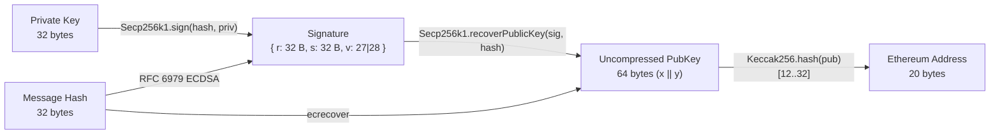

`Secp256k1` implements deterministic ECDSA (RFC 6979), Ethereum public key recovery (`v = 27 | 28`), ECDH key agreement, and raw point operations over the secp256k1 curve (`y^2 = x^3 + 7 mod p`) backed by `@noble/curves/secp256k1.js`.

## Sign, Recover, and Address Derivation



## Quick Start

```typescript
import { Address, Hash, Secp256k1 } from '@tevm/voltaire';

const privateKey = Secp256k1.randomPrivateKey(); // 32 bytes
const publicKey = Secp256k1.derivePublicKey(privateKey); // 64 bytes (uncompressed, no 0x04 prefix)

const messageHash = Hash.keccak256String('Hello, Ethereum!');
const signature = Secp256k1.sign(messageHash, privateKey); // { r, s, v }

const valid = Secp256k1.verify(signature, messageHash, publicKey); // true
const recovered = Secp256k1.recoverPublicKey(signature, messageHash); // 64-byte public key
const signerAddress = Address.fromPublicKey(recovered);
```

## Representations

| Type | Byte Length | Layout |
|------|-------------|--------|
| Private key | `32` (`PRIVATE_KEY_SIZE`) | Big-endian scalar `1 <= d < CURVE_ORDER` |
| Public key | `64` (`PUBLIC_KEY_SIZE`) | Uncompressed `x (32 B) \|\| y (32 B)` without `0x04` prefix |
| Signature (`Secp256k1SignatureType`) | `r: 32`, `s: 32`, `v: number` | `r` and `s` as `HashType`; `v` is `27` or `28` (`recoverPublicKey` also accepts `0` or `1`) |
| Compact signature | `64` | `r (32 B) \|\| s (32 B)` |

## API Reference

### Signing, Verification, and Recovery

| Function | Signature | Returns |
|----------|-----------|---------|
| `sign` | `(messageHash: HashType, privateKey: PrivateKeyType, options?: { extraEntropy?: Uint8Array \| boolean })` | `Secp256k1SignatureType` (`{ r, s, v }`) |
| `signHash` | `(hash: Uint8Array, privateKey: Uint8Array)` | `Uint8Array` (65-byte `r \|\| s \|\| v`) |
| `verify` | `(signature: Secp256k1SignatureType, messageHash: HashType, publicKey: Secp256k1PublicKeyType)` | `boolean` |
| `verifyHash` | `(signature: Uint8Array, hash: Uint8Array, publicKey: Uint8Array)` | `boolean` |
| `recoverPublicKey` | `(signature: { r: Uint8Array; s: Uint8Array; v: number }, messageHash: HashType)` | `Secp256k1PublicKeyType` (64 bytes) |
| `recoverPublicKeyFromHash` | `(signature: Uint8Array, hash: Uint8Array)` | `Uint8Array` (64 bytes) |

### Key Management, ECDH, and Point Math

| Function | Signature | Returns |
|----------|-----------|---------|
| `randomPrivateKey` | `()` | `PrivateKeyType` (32 bytes) |
| `createKeyPair` | `()` | `{ privateKey, publicKey }` |
| `derivePublicKey` | `(privateKey: PrivateKeyType)` | `Secp256k1PublicKeyType` (64 bytes) |
| `ecdh` / `getSharedSecret` | `(privateKey: Uint8Array, publicKey: Uint8Array)` | `Uint8Array` (32-byte shared secret) |
| `addPoints` | `(p1: Uint8Array, p2: Uint8Array)` | `Uint8Array` (64-byte point) |
| `scalarMultiply` | `(point: Uint8Array, scalar: Uint8Array)` | `Uint8Array` (64-byte point) |
| `isValidPrivateKey` | `(key: Uint8Array)` | `boolean` |
| `isValidPublicKey` | `(key: Uint8Array)` | `boolean` |
| `isValidSignature` | `(sig: Secp256k1SignatureType)` | `boolean` |

### Sub-Namespaces and Constants

- `Secp256k1.Signature`: `fromBytes`, `fromCompact`, `toBytes`, `toCompact`
- `Secp256k1.PublicKey`: `from`, `fromBytes`
- `Secp256k1.PrivateKey`: re-exported `@tevm/voltaire/PrivateKey` methods
- `CURVE_ORDER`: `0xfffffffffffffffffffffffffffffffebaaedce6af48a03bbfd25e8cd0364141n`
- `PRIVATE_KEY_SIZE = 32`, `PUBLIC_KEY_SIZE = 64`, `SIGNATURE_COMPONENT_SIZE = 32`

## Security Invariants and EIP-2 Malleability

<Warning>
ECDSA signatures have a malleable twin: if `(r, s, v)` is valid, then `(r, n - s, v ^ 1)` is also valid on the curve. Ethereum (EIP-2) requires canonical low-`s` values (`1 <= s <= n / 2`).
</Warning>

- **Low-`s` canonicalization:** `Secp256k1.sign` delegates to `@noble/curves` with low-`s` normalization enabled, producing EIP-2 canonical signatures by default.
- **Deterministic nonces (RFC 6979):** `sign` derives the signing nonce deterministically from `(privateKey, messageHash)`, preventing nonce-reuse private key recovery. Pass `{ extraEntropy: true }` for hedged signatures against fault attacks.
- **Strict `v` checking:** `verify` requires `v === 27 || v === 28` and confirms in constant time that the recovered public key equals the supplied `publicKey`. `recoverPublicKey` accepts `0`, `1`, `27`, or `28`.
- **Errors:** `sign` and `derivePublicKey` throw `InvalidPrivateKeyError` for non-32-byte or zero keys (`CryptoError` on unexpected signing failure). `recoverPublicKey` and `verify` throw `InvalidSignatureError` on malformed lengths or invalid `v` (for `recoverPublicKey`).

## Related

- [Signing](/crypto/secp256k1/signing)
- [Verification](/crypto/secp256k1/verification)
- [Public Key Recovery](/crypto/secp256k1/recovery)
- [Key Derivation](/crypto/secp256k1/key-derivation)
- [Point Operations](/crypto/secp256k1/point-operations)
- [Security](/crypto/secp256k1/security)
- [EIP-712 Typed Data](/crypto/eip712)
