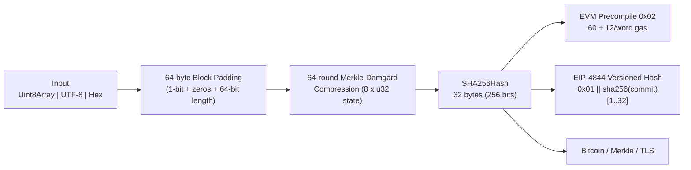

`SHA256` (also exported as `SHA256Hash`) implements FIPS 180-4 SHA-256 backed by `@noble/hashes/sha2.js` (with an optional WASM backend via `@tevm/voltaire/wasm`). Every one-shot hash method returns a branded 32-byte `Uint8Array` (`SHA256Hash`).

## Data Flow



## Quick Start

```typescript
import { SHA256 } from '@tevm/voltaire/SHA256';

// One-shot hashing
const fromBytes = SHA256.hash(new Uint8Array([1, 2, 3]));
const fromStr = SHA256.hashString('hello');
const fromHex = SHA256.hashHex('0xdeadbeef');

// Format digest as 0x-prefixed hex
const hex = SHA256.toHex(fromStr);
// "0x2cf24dba5fb0a30e26e83b2ac5b9e29e1b161e5c1fa7425e73043362938b9824"

// Incremental streaming hasher
const hasher = SHA256.create();
hasher.update(new TextEncoder().encode('hello '));
hasher.update(new TextEncoder().encode('world'));
const streamed = hasher.digest(); // Uint8Array(32)
```

## API Reference

All functions are available on `SHA256` / `SHA256Hash` and as tree-shakeable named exports from `@tevm/voltaire/SHA256`.

| Method | Signature | Returns | Notes |
|--------|-----------|---------|-------|
| `from` | `(input: Uint8Array \| string)` | `SHA256Hash` | Auto-detects bytes, hex string, or UTF-8 string |
| `hash` | `(data: Uint8Array)` | `SHA256Hash` | Hashes raw bytes |
| `hashString` / `fromString` | `(str: string)` | `SHA256Hash` | UTF-8 encodes then hashes |
| `hashHex` / `fromHex` | `(hex: string)` | `SHA256Hash` | Decodes hex (with or without `0x`) then hashes |
| `toHex` | `(hash: Uint8Array)` | `string` | Formats 32-byte digest as `0x`-prefixed hex |
| `create` | `()` | `{ update(data: Uint8Array): void; digest(): Uint8Array }` | Incremental streaming hasher |

### Constants

| Constant | Value | Meaning |
|----------|-------|---------|
| `OUTPUT_SIZE` | `32` | Digest size in bytes (256 bits) |
| `BLOCK_SIZE` | `64` | Internal compression block size in bytes (512 bits) |

## Test Vectors

| Input | SHA-256 Digest |
|-------|----------------|
| `""` | `0xe3b0c44298fc1c149afbf4c8996fb92427ae41e4649b934ca495991b7852b855` |
| `"abc"` | `0xba7816bf8f01cfea414140de5dae2223b00361a396177a9cb410ff61f20015ad` |
| `"hello"` | `0x2cf24dba5fb0a30e26e83b2ac5b9e29e1b161e5c1fa7425e73043362938b9824` |

## Security Notes

- **Length-extension vulnerability:** SHA-256 uses Merkle-Damgard construction. Never authenticate messages with `SHA256(secret || message)`; use `HMAC` (`@tevm/voltaire/HMAC`) or `Keccak256`.
- **Password hashing:** SHA-256 is too fast for passwords. Use PBKDF2 or Scrypt via [Keystore](/crypto/keystore) or `AesGcm.deriveKey`.
- **WASM backend:** For explicit Zig-compiled WASM execution, import `Sha256Wasm` from `@tevm/voltaire/wasm`.

## Related

- [API Reference](/crypto/sha256/api-reference)
- [Comparison](/crypto/sha256/comparison)
- [Performance](/crypto/sha256/performance)
- [Security](/crypto/sha256/security)
- [Test Vectors](/crypto/sha256/test-vectors)
- [EVM SHA256 Precompile (0x02)](/evm/precompiles/sha256)
