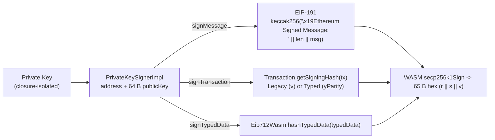

`@tevm/voltaire/signers` (also exported as `Signers` from `@tevm/voltaire`) provides the `Signer` interface and `PrivateKeySignerImpl`, a WASM-backed signer that encapsulates the 32-byte private key inside a private closure and exposes only the checksummed `address`, 64-byte `publicKey`, and signing methods.

## Signing Flows



## Quick Start

`PrivateKeySignerImpl` uses the Zig WASM primitives (`Keccak256Wasm`, `secp256k1Sign`, `Eip712Wasm`). Initialize the WASM module once before creating a signer.

```typescript
import { Keccak256Wasm } from '@tevm/voltaire/wasm';
import { PrivateKeySignerImpl, getAddress } from '@tevm/voltaire/signers';

await Keccak256Wasm.init();

const signer = PrivateKeySignerImpl.fromPrivateKey({
  privateKey:
    '0xac0974bec39a17e36ba4a6b4d238ff944bacb478cbed5efcae784d7bf4f2ff80',
});

console.log(getAddress(signer)); // EIP-55 checksummed address

// EIP-191 personal_sign (returns 65-byte 0x-prefixed hex: r || s || v)
const msgSig = await signer.signMessage('Hello, Ethereum!');

// EIP-1559 transaction (returns tx with { yParity, r, s })
const signedTx = await signer.signTransaction({
  type: 2,
  chainId: 1n,
  nonce: 0n,
  maxFeePerGas: 20_000_000_000n,
  maxPriorityFeePerGas: 1_000_000_000n,
  gasLimit: 21_000n,
  to: '0x70997970C51812dc3A010C7d01b50e0d17dc79C8',
  value: 1_000_000_000_000_000_000n,
  data: new Uint8Array(0),
});

// EIP-712 typed data (returns 65-byte 0x-prefixed hex)
const typedSig = await signer.signTypedData({
  types: {
    EIP712Domain: [
      { name: 'name', type: 'string' },
      { name: 'version', type: 'string' },
    ],
    Message: [{ name: 'content', type: 'string' }],
  },
  primaryType: 'Message',
  domain: { name: 'MyApp', version: '1' },
  message: { content: 'Hello' },
});
```

## API Reference

### `Signer` Interface

```typescript
export interface Signer {
  address: string;            // EIP-55 checksummed address
  publicKey: Uint8Array;      // 64-byte uncompressed public key (no 0x04 prefix)
  signMessage(message: string | Uint8Array): Promise<string>;
  signTransaction(transaction: any): Promise<any>;
  signTypedData(typedData: any): Promise<string>;
}
```

### Exports (`@tevm/voltaire/signers`)

| Export | Signature | Returns | Notes |
|--------|-----------|---------|-------|
| `PrivateKeySignerImpl.fromPrivateKey` | `(options: { privateKey: string \| Uint8Array })` | `PrivateKeySignerImpl` | Accepts 32-byte `Uint8Array` or 64-hex-char string (with or without `0x`) |
| `signer.signMessage` | `(message: string \| Uint8Array)` | `Promise<string>` | Prepends `\x19Ethereum Signed Message:\n<byteLength>` and signs |
| `signer.signTransaction` | `(transaction: any)` | `Promise<any>` | Legacy (`type === 0`) sets EIP-155 `v = recoveryBit + 35 + chainId * 2`; typed (`1..4`) sets `yParity` |
| `signer.signTypedData` | `(typedData: any)` | `Promise<string>` | Hashes via `Eip712Wasm.hashTypedData` and returns 65-byte hex |
| `getAddress` | `(signer: Signer)` | `string` | Returns `signer.address` |
| `recoverTransactionAddress` | `(transaction: any)` | `Promise<string>` | Placeholder; currently throws `"recoverTransactionAddress not yet implemented"` |

## Security Notes

<Warning>
`PrivateKeySignerImpl` isolates the private key in a closure to prevent accidental property serialization (`JSON.stringify`, `Object.keys`), but the bytes still reside in JS/WASM heap memory for the lifetime of the instance. For high-value production keys, isolate signing behind a dedicated HSM, KMS, or hardware wallet.
</Warning>

- `fromPrivateKey` throws `Error` if the key is not exactly 32 bytes (64 hex characters).
- Calling `PrivateKeySignerImpl.fromPrivateKey` before initializing WASM (`await Keccak256Wasm.init()`) throws because `Keccak256Wasm.hash` requires an initialized WASM instance.

## Related

- [Secp256k1](/crypto/secp256k1)
- [EIP-712 Typed Data](/crypto/eip712)
- [Keystore](/crypto/keystore)
- [Wallet Integration](/crypto/wallet-integration)
