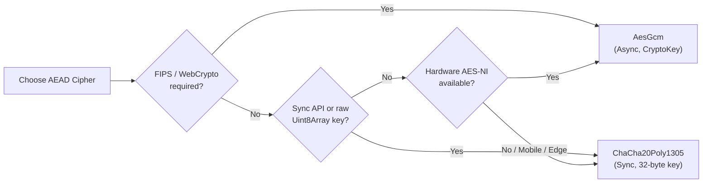

Voltaire provides two Authenticated Encryption with Associated Data (AEAD) modules: `AesGcm` (WebCrypto API, NIST SP 800-38D) and `ChaCha20Poly1305` (`@noble/ciphers`, RFC 8439). Both produce `ciphertext || 16-byte tag` from a 12-byte nonce and optional Additional Authenticated Data (AAD).

## Selection Flow



## Feature Comparison

| Property | `AesGcm` | `ChaCha20Poly1305` |
|----------|----------|--------------------|
| Import | `@tevm/voltaire/AesGcm` | `@tevm/voltaire/ChaCha20Poly1305` |
| Standard | NIST SP 800-38D (FIPS 197) | RFC 8439 (IETF) |
| Backing implementation | WebCrypto (`crypto.subtle`) | `@noble/ciphers/chacha.js` |
| Execution model | Asynchronous (`Promise`) | Synchronous |
| Key representation | `CryptoKey` (128 or 256 bit) | `Uint8Array` (32 bytes / 256 bit) |
| Nonce size | 12 bytes (`NONCE_SIZE`) | 12 bytes (`NONCE_SIZE`) |
| Auth tag size | 16 bytes (`TAG_SIZE`) | 16 bytes (`TAG_SIZE`) |
| Output layout | `ciphertext \|\| tag` | `ciphertext \|\| tag` |
| Built-in KDF | `deriveKey` (PBKDF2-SHA256) | None (derive 32-byte key externally) |
| Software side-channel safety | Depends on host WebCrypto / AES-NI | Constant-time ARX operations (no S-box tables) |
| FIPS 140 compliance | Yes | No |

## Ciphertext Wire Format

Both modules append the 16-byte authentication tag to the ciphertext. Store or transmit the 12-byte nonce alongside the output; the nonce is public and must never be reused under the same key.

| Offset | Size | Field | Notes |
|--------|------|-------|-------|
| `0` | `12` bytes | `nonce` | Store separately or prepend on wire; unique per message |
| `12` | `N` bytes | `ciphertext` | Same byte length as plaintext |
| `12 + N` | `16` bytes | `tag` | GMAC (AES-GCM) or Poly1305 (ChaCha20-Poly1305) |

## API Comparison

<Tabs>
<Tab title="AesGcm (Async / WebCrypto)">
```typescript
import { AesGcm } from '@tevm/voltaire/AesGcm';

const key = await AesGcm.generateKey(256);
const nonce = AesGcm.generateNonce(); // 12 bytes
const plaintext = new TextEncoder().encode('secret payload');
const aad = new TextEncoder().encode('header-v1');

const ciphertext = await AesGcm.encrypt(plaintext, key, nonce, aad);
const decrypted = await AesGcm.decrypt(ciphertext, key, nonce, aad);
```
</Tab>

<Tab title="ChaCha20Poly1305 (Sync / Raw Key)">
```typescript
import { ChaCha20Poly1305 } from '@tevm/voltaire/ChaCha20Poly1305';

const key = ChaCha20Poly1305.generateKey(); // Uint8Array(32)
const nonce = ChaCha20Poly1305.generateNonce(); // Uint8Array(12)
const plaintext = new TextEncoder().encode('secret payload');
const aad = new TextEncoder().encode('header-v1');

const ciphertext = ChaCha20Poly1305.encrypt(plaintext, key, nonce, aad);
const decrypted = ChaCha20Poly1305.decrypt(ciphertext, key, nonce, aad);
```
</Tab>
</Tabs>

## Security Invariants

<Warning>
Nonce reuse with the same key breaks both confidentiality and authenticity in both AES-GCM and ChaCha20-Poly1305. An attacker recovers the XOR of plaintexts and can forge authentication tags (GHASH key recovery in GCM; Poly1305 one-time key recovery in ChaCha20-Poly1305).
</Warning>

- **Random nonce limit:** With 96-bit random nonces, rotate keys well before `2^32` encryptions per key (birthday bound collision risk). Use a monotonic counter nonce for higher message volumes.
- **AAD binding:** Pass protocol version, sender ID, or record index as `additionalData` to prevent ciphertext transplantation across contexts.
- **Password-based storage:** For Ethereum Web3 v3 keystores (`aes-128-ctr` + Scrypt/PBKDF2 + Keccak-256 MAC), use [Keystore](/crypto/keystore).

## Related

- [AES-GCM](/crypto/aesgcm)
- [ChaCha20-Poly1305](/crypto/chacha20poly1305)
- [Keystore](/crypto/keystore)
- [Cryptographic Algorithm Comparison](/crypto/comparison)
