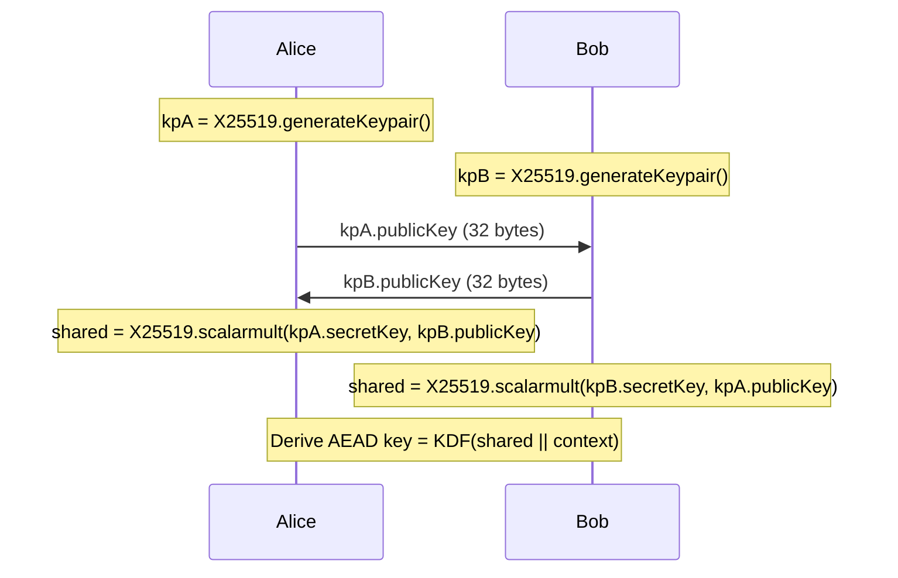

`X25519` implements RFC 7748 Elliptic Curve Diffie-Hellman key agreement on Montgomery Curve25519 backed by `@noble/curves/ed25519.js`. All keys and shared secrets are fixed 32-byte `Uint8Array` values.

## Key Exchange Protocol



## Quick Start

```typescript
import { X25519 } from '@tevm/voltaire/X25519';

const alice = X25519.generateKeypair();
const bob = X25519.generateKeypair();

const aliceShared = X25519.scalarmult(alice.secretKey, bob.publicKey); // Uint8Array(32)
const bobShared = X25519.scalarmult(bob.secretKey, alice.publicKey);   // identical 32 bytes

// Deterministic keypair from 32-byte seed
const seed = crypto.getRandomValues(new Uint8Array(32));
const derived = X25519.keypairFromSeed(seed);
```

## API Reference

All functions are exported on `X25519` and as named exports from `@tevm/voltaire/X25519`.

| Function | Signature | Returns | Notes |
|----------|-----------|---------|-------|
| `generateSecretKey` | `()` | `Uint8Array` (32 B) | Cryptographically random 32-byte secret key |
| `generateKeypair` | `()` | `{ secretKey: Uint8Array; publicKey: Uint8Array }` | Random secret key and corresponding public key |
| `keypairFromSeed` | `(seed: Uint8Array)` | `{ secretKey: Uint8Array; publicKey: Uint8Array }` | Deterministic keypair from 32-byte seed |
| `derivePublicKey` | `(secretKey: Uint8Array)` | `Uint8Array` (32 B) | Scalar multiplication with Curve25519 base point (`u = 9`) |
| `scalarmult` | `(secretKey: Uint8Array, publicKey: Uint8Array)` | `Uint8Array` (32 B) | Computes raw 32-byte X25519 shared secret |
| `validateSecretKey` | `(secretKey: Uint8Array)` | `boolean` | Validates 32-byte length |
| `validatePublicKey` | `(publicKey: Uint8Array)` | `boolean` | Validates 32-byte length |

### Constants

| Constant | Value | Meaning |
|----------|-------|---------|
| `SECRET_KEY_SIZE` | `32` | Secret key length in bytes |
| `PUBLIC_KEY_SIZE` | `32` | Public key length in bytes |
| `SHARED_SECRET_SIZE` | `32` | Shared secret length in bytes |

## Security Notes

<Warning>
Never use the raw `scalarmult` output directly as an encryption key, and reject all-zero shared secrets (produced by low-order contributor points). Always derive symmetric keys by passing the shared secret and public keys through a KDF (such as HKDF-SHA256 or BLAKE2b).
</Warning>

- **Constant-time Montgomery ladder:** Scalar clamping and ladder operations execute in constant time without secret-dependent branches.
- **Errors:** Invalid key lengths throw `InvalidSecretKeyError` or `InvalidPublicKeyError` (`X25519Error` on computation failures).
- **WASM backend:** For Zig-compiled WASM execution, import `X25519Wasm` from `@tevm/voltaire/wasm`.

## Related

- [Ed25519](/crypto/ed25519)
- [ChaCha20-Poly1305](/crypto/chacha20poly1305)
- [AES-GCM](/crypto/aesgcm)
- [Cryptographic Algorithm Comparison](/crypto/comparison)
