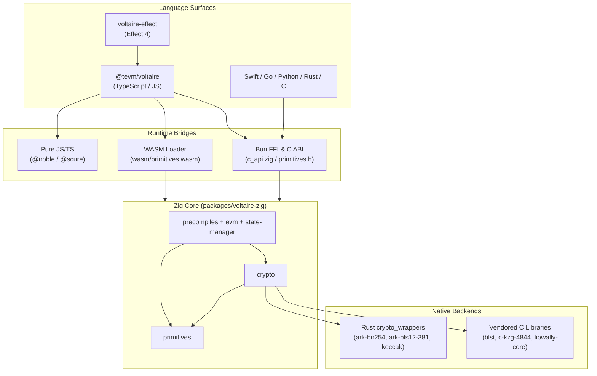

Voltaire separates high-level language ergonomics from low-level execution. Ethereum primitives, EVM precompiles, and cryptographic kernels live in Zig, Rust, and C, while TypeScript and language bindings expose typed, idiomatic APIs over the same underlying semantics.



## Zig Module Graph

`build.zig` registers explicit Zig modules so every cross-module import is checked by the build graph:

| Module Name | Entry Point | Imports |
| --- | --- | --- |
| `primitives` | `packages/voltaire-zig/src/primitives/root.zig` | `crypto`, `z_ens_normalize` |
| `crypto` | `packages/voltaire-zig/src/crypto/root.zig` | `primitives`, `c_kzg`, `blst`, `crypto_wrappers` |
| `jsonrpc` | `packages/voltaire-zig/src/jsonrpc/root.zig` | self-contained base types |
| `precompiles` | `packages/voltaire-zig/src/precompiles/root.zig` | `primitives`, `crypto` |
| `evm` | `packages/voltaire-zig/src/evm/root.zig` | `primitives`, `crypto`, `precompiles` |
| `state-manager` | `packages/voltaire-zig/src/state-manager/root.zig` | `primitives`, `crypto` |
| `blockchain` | `packages/voltaire-zig/src/blockchain/root.zig` | `primitives`, `crypto` |

Always import via registered module names, never relative paths across package boundaries:

```zig
const primitives = @import("primitives");
const crypto = @import("crypto");
const Address = primitives.Address;
```

## Runtime Execution Paths in `@tevm/voltaire`

`@tevm/voltaire` ships three entrypoints conforming to the same `VoltaireAPI` interface:

| Entrypoint | Runtime Target | Crypto Implementation | Notes |
| --- | --- | --- | --- |
| `@tevm/voltaire` | Node 18+, Bun, Deno, Browser, Edge | Pure JS/TS (`@noble/*`, `@scure/*`) | Zero WASM startup cost, full tree-shaking |
| `@tevm/voltaire/wasm` | Browser, Node, Bun, Edge | Zig/Rust compiled to `wasm32-wasi` / `wasm32-freestanding` | Explicit WASM acceleration; KZG stays JS/native |
| `@tevm/voltaire/native` | Bun (`bun:ffi`) | Native shared library (`libprimitives_ts_native`) | Lowest latency, assembly-accelerated Keccak & curves |

## Platform Matrix

| Platform | Pure TS (`@tevm/voltaire`) | WASM (`@tevm/voltaire/wasm`) | Native FFI (`@tevm/voltaire/native`) |
| --- | --- | --- | --- |
| macOS (`arm64` / `x64`) | Supported | Supported | Supported (Bun) |
| Linux (`arm64` / `x64`) | Supported | Supported | Supported (Bun) |
| Windows (`x64`) | Supported | Supported | Supported (Bun) |
| Browsers / Workers | Supported | Supported | Not supported |
| Node.js (`>= 18`) | Supported | Supported | Use pure TS or WASM |

## Design Invariants

1. **Zero-cost nominal types.** In TypeScript, `AddressType`, `HashType`, `HexType`, and `Uint256Type` are branded `Uint8Array` or `string` types enforced strictly at compile time.
2. **Validate on construction.** Constructors (`Address.from`, `Hash.fromHex`, `Hex.from`) reject malformed lengths, invalid hex digits, or out-of-range values immediately with typed error classes from `@tevm/voltaire/errors`.
3. **Explicit Zig allocators.** No global hidden heap allocations. Functions needing dynamic buffers accept `allocator: std.mem.Allocator` and transfer ownership to the caller.
4. **Single C ABI surface.** `packages/voltaire-zig/src/c_api.zig` defines the exported C symbols and generates `primitives.h`, which feeds Bun FFI, Swift (`CVoltaire`), Go (CGo), Python, and C consumers from one source of truth.

## Related

- [Codebase Map](/dev/codebase-map) — Exact directory and file layout
- [Build System](/dev/build-system) — How `build.zig`, Cargo, and pnpm fit together
- [Multi-Language Integration](/dev/multi-language) — C ABI, Rust FFI, and vendored C libraries
