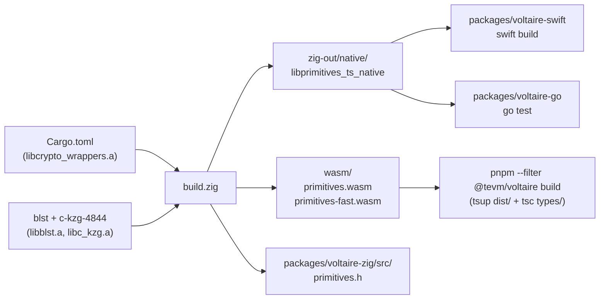

Voltaire orchestrates native, WASM, C, and Rust compilation through root `build.zig`, and JavaScript/TypeScript bundling through `pnpm` workspaces (`pnpm@10.26.2`, `tsup`, and `tsc`).



## Zig Build Steps (`build.zig`)

Run all Zig commands from the repository root.

### Core Build and Optimization Modes

```bash
zig build                          # Default build (Zig modules + C libs + Rust crypto_wrappers)
zig build -Doptimize=Debug         # Debug symbols, runtime safety checks
zig build -Doptimize=ReleaseFast   # Maximum throughput
zig build -Doptimize=ReleaseSmall  # Minimum binary size
zig build -Doptimize=ReleaseSafe   # Optimized with safety checks retained
zig build -Dwith-c-api=true        # Include optional libwally-core C API library
zig build -Dwith-benches=true      # Include zbench benchmark executables
```

### Native FFI and WASM Artifacts

| Step | Command | Output |
| --- | --- | --- |
| Native FFI library | `zig build build-ts-native -Dwith-c-api=true` | `zig-out/native/libprimitives_ts_native.{dylib,so,dll}` (`ReleaseFast`) |
| Size-optimized WASM | `zig build build-ts-wasm` | `wasm/primitives.wasm` (`ReleaseSmall`) |
| Speed-optimized WASM | `zig build build-ts-wasm-fast` | `wasm/primitives-fast.wasm` (`ReleaseFast`) |
| TS package | `pnpm --filter @tevm/voltaire build` | `packages/voltaire-ts/{dist,types}` |
| Stage WASM into `@tevm/zig` | `pnpm --filter @tevm/zig build:wasm` | `packages/voltaire-zig/wasm/` |

### Code Generation & Examples

| Step | Command | Purpose |
| --- | --- | --- |
| C header generation | `zig build generate-header` | Regenerates `primitives.h` from `c_api.zig` |
| OpenRPC codegen | `zig build generate-jsonrpc` | Regenerates JSON-RPC modules from OpenRPC spec |
| Clean generated JSON-RPC | `zig build clean-jsonrpc` | Removes generated JSON-RPC files (keeps hand-written `types/`) |
| Zig examples | `zig build example-keccak256` (also `example-abi`, `example-address`, `example-rlp`, `example-secp256k1`, `example-eip712`, `example-transaction`, `example-eip4844`, `example-eip7702`, `example-bls`) | Builds and runs standalone Zig examples |
| C example | `zig build example-c -Dwith-c-api=true` | Builds and runs the C API example |

### Test & Quality Steps in `build.zig`

```bash
zig build test               # All Zig tests (primitives, crypto, precompiles, state-manager, blockchain)
zig build test-state-manager # State-manager unit tests
zig build test-c-api -Dwith-c-api=true
zig build test-go -Dwith-c-api=true # Go CGo tests
zig build test-ts            # Every workspace test:run (pnpm -r test:run)
zig build test-all           # Same as test-ts; runs no Zig or Go tests
zig build lint               # Every workspace lint (pnpm -r lint)
```

`build.zig` has no test filter option. Its `format`, `format-check`, `check`, `ci`, and `pre-commit` steps are broken (`zig build format` and root `pnpm format` recurse forever), so format and check with the tools directly:

```bash
zig fmt build.zig packages/voltaire-zig/src packages/voltaire-zig/lib packages/voltaire-zig/examples  # Format Zig (add --check to verify only)
pnpm --filter @tevm/voltaire format         # Format TS (format:check to verify only)
pnpm --filter voltaire-effect format        # Format voltaire-effect
pnpm -r run lint:check                      # Check lint without fixing
```

## pnpm Workspace Scripts

Root `package.json` runs across all workspace packages; package-scoped commands use `--filter`:

```bash
# Workspace-wide
pnpm build          # pnpm -r build
pnpm build:zig      # zig build
pnpm test:run       # pnpm -r test:run
pnpm lint           # pnpm -r lint
pnpm typecheck      # pnpm -r typecheck
pnpm clean          # Remove zig-out/, .zig-cache/, target/, and package dist/types

# @tevm/voltaire (packages/voltaire-ts)
pnpm --filter @tevm/voltaire build          # build:dist (tsup) + build:types (tsup --dts-only + tsc)
pnpm --filter @tevm/voltaire test:run       # vitest run
pnpm --filter @tevm/voltaire test:coverage  # vitest --coverage --run
pnpm --filter @tevm/voltaire lint:package   # publint export validation
pnpm --filter @tevm/voltaire typecheck      # tsc --noEmit

# voltaire-effect (packages/voltaire-effect)
pnpm --filter voltaire-effect build         # vibelang -p tsconfig.build.json
pnpm --filter voltaire-effect test:run      # vitest run
```

## Cross-Compilation

Zig cross-compiles native and WASM targets out of the box (Rust targets require the corresponding `rustup target add` toolchain):

```bash
zig build build-ts-native -Dwith-c-api=true -Dtarget=aarch64-macos
zig build build-ts-native -Dwith-c-api=true -Dtarget=x86_64-macos
zig build build-ts-native -Dwith-c-api=true -Dtarget=aarch64-linux-gnu
zig build build-ts-native -Dwith-c-api=true -Dtarget=x86_64-linux-gnu
zig build build-ts-native -Dwith-c-api=true -Dtarget=x86_64-windows-gnu
zig build build-ts-wasm   -Dtarget=wasm32-wasi
```

## Common Build Failures

- **Missing vendored C libraries (`blst` / `c-kzg-4844`):** Run `git submodule update --init --recursive` (or check submodules exist under `packages/voltaire-zig/lib/`).
- **Missing Cargo / Rust target:** `build.zig` invokes `cargo` for `crypto_wrappers` (BN254 + Keccak assembly). Install Rust via `rustup` and add cross-targets if cross-compiling.
- **Node heap OOM during TS build:** `packages/voltaire-ts/package.json` sets `NODE_OPTIONS=--max-old-space-size=8192` for `build:dist` and `build:types`. Keep that flag if invoking `tsup` or `tsc` directly.

## Related

- [Architecture](/dev/architecture) — Module dependency graph
- [WASM](/dev/wasm) — WASM compilation modes and browser bundler setup
- [Testing](/dev/testing) — Running and writing Zig and Vitest test suites
