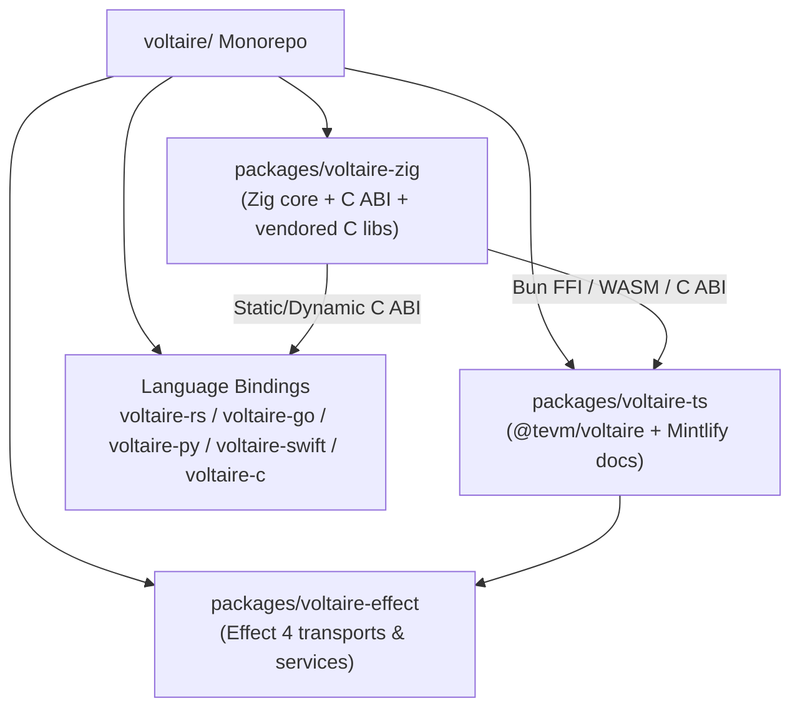

Voltaire is a polyglot Ethereum primitives, cryptography, and EVM monorepo with a Zig core, Rust/C cryptographic backends, a TypeScript SDK (`@tevm/voltaire`), an Effect 4 layer (`voltaire-effect`), and native bindings for Go, Python, Rust, Swift, and C.



## Quick Start

```bash
# Clone with submodules (blst, c-kzg-4844, libwally-core)
git clone --recurse-submodules https://github.com/evmts/voltaire
cd voltaire

# Install JS workspace dependencies (pnpm 10)
pnpm install

# Build Zig core + Rust crypto_wrappers + C libraries
zig build

# Run Zig tests and TypeScript tests
zig build test
pnpm test:run

# Run docs locally (Mintlify)
cd packages/voltaire-ts/docs && pnpm dlx mintlify dev
```

## Workspace Packages

| Directory | Package | Stack | Role |
| --- | --- | --- | --- |
| `packages/voltaire-zig` | Zig modules (`primitives`, `crypto`, `precompiles`, `evm`, `jsonrpc`, `state-manager`, `blockchain`) | Zig 0.15 + C + Rust | Core implementations, WASM, C ABI (`c_api.zig`) |
| `packages/voltaire-ts` | `@tevm/voltaire` | TypeScript + Vitest + tsup | Public JS/TS SDK, WASM/Bun FFI bindings, Mintlify docs |
| `packages/voltaire-effect` | `voltaire-effect` | Effect 4 / VibeLang | Composable transports, typed errors, Effect services |
| `packages/voltaire-rs` | Rust crate | Rust | Safe Rust wrappers over Voltaire primitives & crypto |
| `packages/voltaire-go` | Go module | Go (CGo) | Go bindings linking Voltaire's C ABI |
| `packages/voltaire-py` | Python package | Python | Python bindings over Voltaire's shared library |
| `packages/voltaire-swift` | `Voltaire` (SPM) | Swift 5.9 (`CVoltaire`) | macOS 12+ / iOS 15+ Swift bindings |
| `packages/voltaire-c` | C library & headers | C (`primitives.h`) | Direct C API consumption |

## Core Engineering Rules

1. **No stubs or skipped tests.** Every committed test passes; broken or unimplemented tests are fixed or removed.
2. **Module imports in Zig.** Import `@import("primitives")`, `@import("crypto")`, or `@import("precompiles")` — never relative cross-module paths like `../primitives/...`.
3. **Explicit memory ownership in Zig.** Functions that allocate take an explicit `std.mem.Allocator`; callers free returned slices.
4. **Zero-overhead branded types in TypeScript.** Primitives are branded `Uint8Array` or `string` types with `sideEffects: false` subpath exports.
5. **Cross-language parity.** Zig, TypeScript, WASM, and native FFI outputs must match byte-for-byte on shared test vectors.

## Essential Commands

| Task | Command |
| --- | --- |
| Full Zig + C + Rust build | `zig build` |
| Run all Zig unit tests | `zig build test` |
| Filter Zig tests | `zig build test -Dtest-filter=Address` |
| Build TS package (`dist/` + `types/`) | `pnpm --filter @tevm/voltaire build` |
| Run TS test suite | `pnpm --filter @tevm/voltaire test:run` |
| Build native FFI dylib (Bun / Swift) | `zig build build-ts-native` |
| Build WASM (`ReleaseSmall` / `ReleaseFast`) | `zig build build-ts-wasm` / `zig build build-ts-wasm-fast` |
| Format and lint workspace | `pnpm format && pnpm lint` |
| Typecheck workspace | `pnpm typecheck` |

## Developer Guides

<CardGroup cols={2}>
  <Card title="Architecture" icon="sitemap" href="/dev/architecture">
    Layered runtime architecture, Zig module graph, and memory ownership.
  </Card>
  <Card title="Codebase Map" icon="map" href="/dev/codebase-map">
    Directory-by-directory layout of every package and build output.
  </Card>
  <Card title="Build System" icon="hammer" href="/dev/build-system">
    `build.zig` steps, Cargo features, pnpm scripts, and cross-compilation.
  </Card>
  <Card title="WASM" icon="microchip" href="/dev/wasm">
    WASM build modes, linear memory protocol, bundler config, and limitations.
  </Card>
  <Card title="Multi-Language" icon="language" href="/dev/multi-language">
    C ABI, Bun FFI, Rust `crypto_wrappers`, C libraries, and Swift/Go/Python bindings.
  </Card>
  <Card title="Testing" icon="flask-vial" href="/dev/testing">
    Zig inline tests, Vitest suites, cross-validation, fuzzing, and benchmarks.
  </Card>
  <Card title="TypeScript Patterns" icon="js" href="/dev/typescript-patterns">
    Branded types, dual APIs, JSDoc typing, and tree-shaking rules.
  </Card>
  <Card title="Zig Patterns" icon="code" href="/dev/zig-patterns">
    Allocator conventions, error sets, comptime patterns, and inline tests.
  </Card>
</CardGroup>
