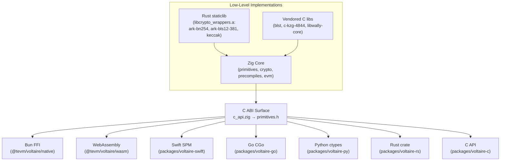

Voltaire compiles its core algorithms once in Zig, Rust, and C and exposes them across every target language through a stable C ABI defined in `packages/voltaire-zig/src/c_api.zig` and `packages/voltaire-zig/src/primitives.h`.



## Language Responsibilities

| Layer | Language | Package / Location | Responsibility |
| --- | --- | --- | --- |
| Core & ABI | Zig | `packages/voltaire-zig` | Primitives, EVM precompiles, state manager, WASM & C ABI exports |
| Pairing & ASM Crypto | Rust | `Cargo.toml` (`crypto_wrappers`) | `ark-bn254`, `ark-bls12-381`, `keccak-asm` / `tiny-keccak` |
| Audited C Crypto | C | `packages/voltaire-zig/lib/` | `blst` (BLS12-381), `c-kzg-4844` (EIP-4844 KZG), `libwally-core` (optional) |
| TypeScript SDK | TypeScript | `packages/voltaire-ts` | Branded types, pure JS fallbacks, WASM loader, Bun FFI, providers |
| Effect Layer | VibeLang / TS | `packages/voltaire-effect` | Effect 4 transports, tagged errors, services |
| Native Bindings | Swift / Go / Python / Rust / C | `packages/voltaire-{swift,go,py,rs,c}` | Idiomatic safe wrappers over `primitives.h` and `libprimitives_ts_native` |

## C ABI Boundary (`c_api.zig` & `primitives.h`)

All foreign language callers cross the same flat C calling convention:

- Fixed-size buffers (20-byte addresses, 32-byte hashes/U256s, 64/65-byte signatures) are passed by pointer from caller-allocated memory to avoid cross-allocator frees.
- Return values are `c_int` status codes: `0` on success, negative constants on error (e.g. invalid hex, invalid length, invalid signature, buffer too small).
- Regenerate the C header whenever `c_api.zig` signatures change:

```bash
zig build generate-header
```

This updates `packages/voltaire-zig/src/primitives.h`, which is mirrored into Swift (`packages/voltaire-swift/Sources/CVoltaire/include/primitives.h`), Go, Python, and C packages.

## Zig to Rust (`crypto_wrappers`)

`build.zig` invokes `cargo build` automatically to compile `libcrypto_wrappers.a` (or `crypto_wrappers.lib` on MSVC) and links it into the `crypto` Zig module. Zig imports the Rust `extern "C"` functions via `@cImport` and translates negative status codes into Zig error unions (`error.InvalidPoint`, `error.PairingFailed`).

## Zig to C (`blst`, `c-kzg-4844`, `libwally-core`)

`packages/voltaire-zig/lib/c_libs.zig` compiles vendored C sources directly with Zig's bundled C compiler (`zig cc`):

- `blst` — Compiled as `libblst.a` and linked into `c_kzg` and `crypto`.
- `c-kzg-4844` — Compiled as `libc_kzg.a` with Zig bindings at `packages/voltaire-zig/lib/c-kzg-4844/bindings/zig/root.zig`.
- `libwally-core` — Lazily built only when `-Dwith-c-api=true` is passed.

## Native FFI Bindings

### Bun FFI (`@tevm/voltaire/native`)

Uses `bun:ffi` (`dlopen`) to load `libprimitives_ts_native.{dylib,so,dll}` directly from `zig-out/native/` (or prebuilt platform binaries). Node.js does not support `bun:ffi`; use `@tevm/voltaire` (pure JS) or `@tevm/voltaire/wasm` in Node.

### Swift (`packages/voltaire-swift`)

`Package.swift` defines a C system target `CVoltaire` pointing to `zig-out/native` (`-lprimitives_ts_native`) and a Swift target `Voltaire` wrapping C status codes into `VoltaireError`.

```bash
zig build build-ts-native -Dwith-c-api=true
cd packages/voltaire-swift && swift build && swift test
```

### Go (`packages/voltaire-go`)

Uses CGo against `primitives.h` and the Zig-built static/dynamic library:

```bash
zig build test-go -Dwith-c-api=true
```

## Cross-Language Error Mapping

| C ABI Return Code | Meaning | Zig Error | TypeScript / Swift |
| --- | --- | --- | --- |
| `0` | Success | value | value |
| `-1` | Invalid hex / format | `error.InvalidHex` | `InvalidFormatError` / `VoltaireError.invalidHex` |
| `-2` | Invalid length | `error.InvalidLength` | `InvalidLengthError` / `VoltaireError.invalidLength` |
| `-3` | Invalid checksum | `error.InvalidChecksum` | `InvalidChecksumError` / `VoltaireError.invalidChecksum` |
| `-4` | Buffer too small | `error.BufferTooSmall` | `InvalidRangeError` / `VoltaireError.bufferTooSmall` |

## Related

- [Build System](/dev/build-system) — Cross-compilation and `generate-header`
- [WASM](/dev/wasm) — Compiling `c_api.zig` to WebAssembly
- [Swift Bindings](/swift) — macOS/iOS usage and API reference
