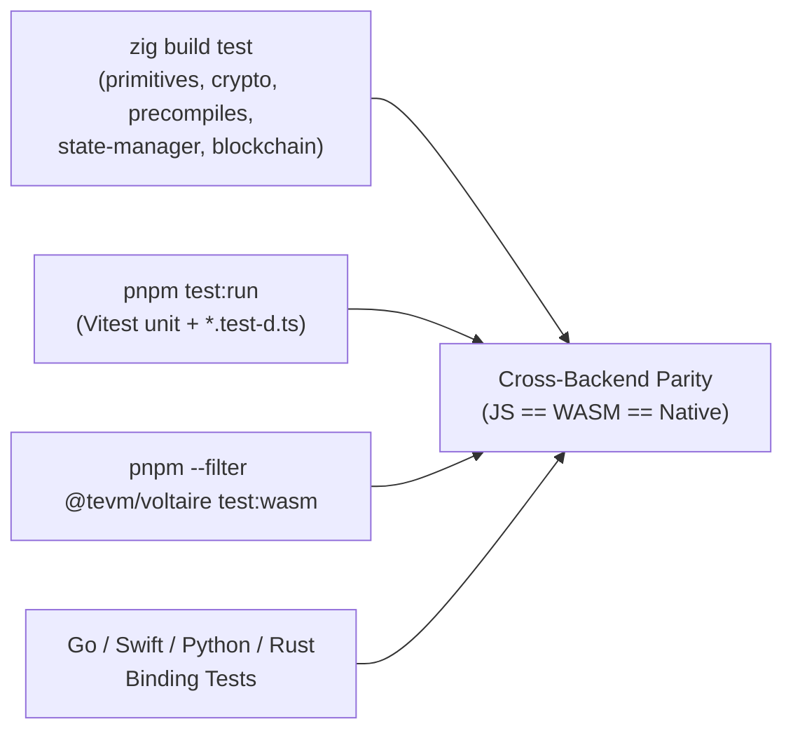

Voltaire enforces a zero-stub policy: every committed test must pass, and every bug fix starts with a regression test. Tests span Zig inline tests, Vitest unit and type-level tests, WASM/native parity tests, and language-binding suites.



## Test Commands

| Suite | Command | Scope |
| --- | --- | --- |
| All Zig tests | `zig build test` | `primitives`, `crypto`, `precompiles`, `state-manager`, `blockchain` |
| State-manager tests | `zig build test-state-manager` | StateManager unit suite |
| C API tests | `zig build test-c-api -Dwith-c-api=true` | C ABI wrapper tests |
| All TS unit tests | `pnpm --filter @tevm/voltaire test:run` | Vitest single run |
| Filtered TS tests | `pnpm --filter @tevm/voltaire test:run src/primitives/Address` | Test files under the given path |
| TS coverage | `pnpm --filter @tevm/voltaire test:coverage` | V8 coverage report |
| TS watch mode | `pnpm --filter @tevm/voltaire test` | Interactive Vitest watch |
| WASM tests | `pnpm --filter @tevm/voltaire test:wasm` | WebAssembly loader & crypto tests |
| Effect package tests | `pnpm --filter voltaire-effect test:run` | Effect 4 transports & primitives |
| Go binding tests | `zig build test-go -Dwith-c-api=true` | CGo suite |
| Swift binding tests | `cd packages/voltaire-swift && swift test` | XCTest suite (run `zig build build-ts-native -Dwith-c-api=true` first) |
| Every workspace `test:run` | `zig build test-all` | Runs `pnpm -r test:run` only; no Zig or Go tests |

## Test File Organization

- **Zig**: Inline `test "..."` blocks colocated inside `.zig` implementation files under `packages/voltaire-zig/src/`. Memory leaks are caught automatically via `std.testing.allocator`.
- **TypeScript**: Colocated `*.test.ts` runtime tests and `*.test-d.ts` compile-time type tests under `packages/voltaire-ts/src/`.
- **WASM / Native**: Dedicated `*.wasm.test.ts` and native test suites asserting byte-for-byte equality with pure JS implementations.

## Zig Test Patterns

Use `std.testing.allocator` in every test that allocates so leaks fail the test immediately:

```zig
const std = @import("std");
const testing = std.testing;
const primitives = @import("primitives");

test "Address.fromHex parses checksummed input and rejects invalid length" {
    const addr = try primitives.Address.fromHex("0x742d35Cc6634C0532925a3b844Bc9e7595f0bEb0");
    try testing.expectEqual(@as(u8, 0x74), addr.bytes[0]);

    try testing.expectError(error.InvalidHexLength, primitives.Address.fromHex("0x1234"));
}

test "allocating function does not leak" {
    const allocator = testing.allocator;
    const out = try someAllocatingFn(allocator, "input");
    defer allocator.free(out);
    try testing.expect(out.len > 0);
}
```

## TypeScript Test Patterns

Use table-driven `it.each` tests for deterministic spec vectors and explicit error assertions:

```typescript
import { describe, expect, it } from 'vitest';
import { Address } from '@tevm/voltaire/Address';

describe('Address.toChecksummed', () => {
  const vectors = [
    [
      '0x742d35cc6634c0532925a3b844bc9e7595f0beb0',
      '0x742d35Cc6634C0532925a3b844Bc9e7595f0bEb0',
    ],
    [
      '0x0000000000000000000000000000000000000000',
      '0x0000000000000000000000000000000000000000',
    ],
    [
      '0xffffffffffffffffffffffffffffffffffffffff',
      '0xFFfFfFffFFfffFFfFFfFFFFFffFFFffffFfFFFfF',
    ],
  ] as const;

  it.each(vectors)('checksums %s', (input, expected) => {
    const addr = Address.fromHex(input);
    expect(Address.toChecksummed(addr)).toBe(expected);
  });

  it('rejects malformed hex', () => {
    expect(() => Address.fromHex('0x123')).toThrow();
  });
});
```

## Benchmarks

Voltaire tracks performance with `zbench` in Zig and `mitata` in TypeScript:

```bash
# Zig benchmarks
zig build bench -Dwith-benches=true

# TypeScript benchmarks (colocated mitata *.bench.ts files)
cd packages/voltaire-ts && bun run src/crypto/keccak256.bench.ts
```

## Anti-Patterns Rejected in Review

- Commented-out or `.skip`ped tests without an explicit tracked issue.
- Empty test bodies or tautological assertions (`expect(true).toBe(true)`).
- Catching and swallowing errors inside tests instead of `expect(() => ...).toThrow(...)` or `testing.expectError(...)`.

## Related

- [Build System](/dev/build-system) — All `zig build` and `pnpm` scripts
- [WASM](/dev/wasm) — Running WASM parity tests
- [Architecture](/dev/architecture) — Cross-language verification invariants
