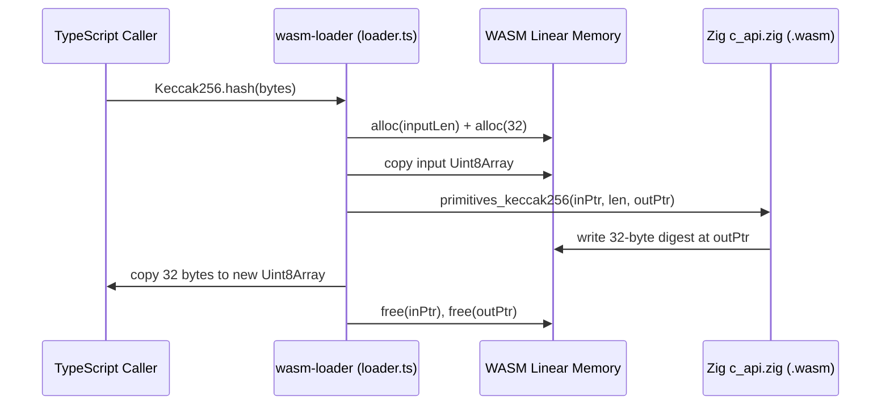

Voltaire compiles its Zig core (and portable Rust crypto kernels) to WebAssembly so browsers, Node.js, and edge runtimes can invoke native-grade implementations without Bun FFI.



## Using WASM in Applications

Import the WASM entrypoint (`@tevm/voltaire/wasm`) or a module-specific WASM subpath (`@tevm/voltaire/Keccak256/wasm`):

```typescript
import { Address, Keccak256, Secp256k1 } from '@tevm/voltaire/wasm';

const addr = Address('0x742d35Cc6634C0532925a3b844Bc9e7595f0bEb0');
const digest = Keccak256.hash(new TextEncoder().encode('hello'));
```

`@tevm/voltaire/wasm` satisfies the same `VoltaireAPI` contract as `@tevm/voltaire` and `@tevm/voltaire/native`. Crypto modules with WASM acceleration (`Keccak256`, `SHA256`, `Blake2`, `Ripemd160`, `Secp256k1`, `Ed25519`, `P256`, `X25519`, `BN254`, `EIP712`) expose their raw WASM namespace on `._wasm` alongside the standard synchronous API.

<Note>
`HDWallet` uses native FFI bindings (`libwally-core`) and is not bundled in `@tevm/voltaire/wasm`. Import `HDWallet` from `@tevm/voltaire/HDWallet` or `@tevm/voltaire/native`. `KZG` and `Bls12381` fall back to their JS/native implementations because KZG trusted setup tables are large for browser WASM payloads.
</Note>

## Build Modes

Build WASM artifacts from the repository root with `zig build`:

| Command | Optimize Mode | Output Artifact | Target Use |
| --- | --- | --- | --- |
| `zig build build-ts-wasm` | `ReleaseSmall` | `wasm/primitives.wasm` | Production browser bundles |
| `zig build build-ts-wasm-fast` | `ReleaseFast` | `wasm/primitives-fast.wasm` | Throughput-critical Node/worker workloads |

Additional standalone WASM modules built under `wasm/`:

- `wasm/state-manager.wasm` — Forked/local EVM state manager for `ForkProvider({ useWasm: true })`
- `wasm/blockchain.wasm` — Block storage backend for `ForkProvider({ useWasm: true })`
- `wasm/crypto/*.wasm` — Individual crypto modules for size-sensitive builds

## WASM Loader Architecture

The internal WASM loader lives at `packages/voltaire-ts/src/wasm-loader/loader.ts` (typed by `loader.d.ts` and `types.ts`):

1. Loads the `.wasm` binary from a filesystem path, `URL`, or `ArrayBuffer` (supporting both Node.js `fs` and browser `fetch` / `WebAssembly.instantiateStreaming`).
2. Manages a bump/free memory interface over WASM linear memory so JavaScript `Uint8Array` slices are copied safely across the boundary and freed in `finally` blocks.
3. Translates integer C ABI error codes (`0` = success, negative = typed error) into Voltaire error classes.

### Rust Portable Feature for WASM

Because `wasm32` targets cannot link x86_64/aarch64 assembly (`keccak-asm`), `Cargo.toml` switches to pure-Rust portable kernels when compiling `crypto_wrappers` for WASM:

```toml
[features]
default = ["asm"]
asm = ["keccak-asm"]         # Native targets
portable = ["tiny-keccak"]   # WASM targets
```

## Bundler Configuration

<Tabs>
  <Tab title="Vite">
```typescript
// vite.config.ts
import { defineConfig } from 'vite';

export default defineConfig({
  optimizeDeps: {
    exclude: ['@tevm/voltaire'],
  },
  build: {
    target: 'esnext',
  },
});
```
  </Tab>
  <Tab title="Webpack 5">
```javascript
// webpack.config.js
module.exports = {
  experiments: {
    asyncWebAssembly: true,
  },
  module: {
    rules: [
      {
        test: /\.wasm$/,
        type: 'webassembly/async',
      },
    ],
  },
};
```
  </Tab>
</Tabs>

## Testing WASM Parity

Run the WASM tests with Vitest to verify byte-for-byte parity between WASM and JS/native outputs:

```bash
# Vitest run of test files matching "wasm" in packages/voltaire-ts
pnpm --filter @tevm/voltaire test:wasm
```

## Related

- [Build System](/dev/build-system) — Zig WASM targets and optimization flags
- [Multi-Language Integration](/dev/multi-language) — How `c_api.zig` powers both WASM and native FFI
- [Testing](/dev/testing) — Cross-validating JS, WASM, and native outputs
