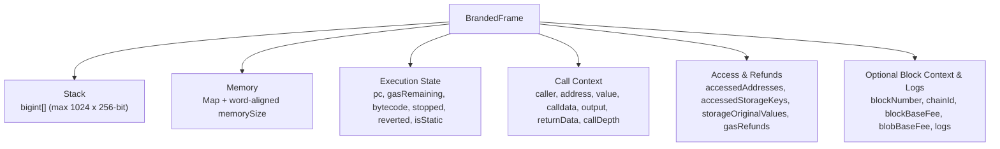

`Frame` constructs and mutates a `BrandedFrame`—the complete state of a single EVM call context (stack, memory, program counter, remaining gas, bytecode, calldata, output, return data, EIP-2929 warm sets, and emitted logs).

## Internal Layout



## Creating a Frame

Import `Frame` and helpers from `@tevm/voltaire/evm` or `@tevm/voltaire/evm/Frame`.

```typescript
import { Address } from '@tevm/voltaire';
import { Frame } from '@tevm/voltaire/evm';

const frame = Frame({
  bytecode: new Uint8Array([0x60, 0x0a, 0x60, 0x14, 0x01]), // PUSH1 10, PUSH1 20, ADD
  gas: 100_000n,
  caller: Address('0x1111111111111111111111111111111111111111'),
  address: Address('0x2222222222222222222222222222222222222222'),
  value: 0n,
  calldata: new Uint8Array(0),
  isStatic: false,
});
```

### `FrameParams`

| Parameter | Type | Default | Meaning |
|-----------|------|---------|---------|
| `bytecode` | `Uint8Array` | `new Uint8Array(0)` | Contract code to execute |
| `gas` | `bigint` | `1_000_000n` | Initial gas budget |
| `gasRemaining` | `bigint` | `gas` | Explicit starting `gasRemaining` override |
| `caller` | `Uint8Array` | Zero address | `CALLER` (`msg.sender`) |
| `address` | `Uint8Array` | Zero address | Executing account (`ADDRESS`) |
| `value` | `bigint` | `0n` | Wei transferred (`CALLVALUE`) |
| `calldata` | `Uint8Array` | `new Uint8Array(0)` | Call input bytes |
| `isStatic` | `boolean` | `false` | Disallows state mutations (`STATICCALL`) |
| `stack` | `bigint[]` | `[]` | Initial stack values |

## Frame Operations

All helper functions are attached to `Frame` (`Frame.pushStack`, etc.) and exported directly from `@tevm/voltaire/evm/Frame`.

| Function | Signature | Returns | Behavior |
|----------|-----------|---------|----------|
| `Frame` / `Frame.from` | `(params?: FrameParams)` | `BrandedFrame` | Creates a new frame with bound arithmetic methods |
| `pushStack` | `(frame, value: bigint)` | `EvmError \| null` | Pushes 256-bit word; returns `{ type: "StackOverflow" }` at depth `1024` |
| `popStack` | `(frame)` | `{ value: bigint; error: null } \| { value: null; error: EvmError }` | Pops top word; returns `{ type: "StackUnderflow" }` when empty |
| `peekStack` | `(frame, index: number)` | `{ value: bigint; error: null } \| { value: null; error: EvmError }` | Reads `index` from top (`0` = top) without removing |
| `consumeGas` | `(frame, amount: bigint)` | `EvmError \| null` | Deducts `amount`; sets `gasRemaining = 0n` and returns `{ type: "OutOfGas" }` if insufficient |
| `readMemory` | `(frame, offset: number)` | `number` | Reads single byte (`0` for unwritten offsets) |
| `writeMemory` | `(frame, offset: number, value: number)` | `void` | Writes byte and updates `memorySize` to next 32-byte word boundary |
| `memoryExpansionCost` | `(frame, endBytes: number)` | `bigint` | Incremental quadratic expansion gas from current `memorySize` to `ceil(endBytes / 32) * 32` |

### Memory Expansion Gas Formula

For `words = ceil(sizeBytes / 32)`:

```text
totalCost(words) = 3 * words + floor(words^2 / 512)
expansionGas     = totalCost(newWords) - totalCost(oldWords)
```

`memoryExpansionCost` returns `0n` whenever `endBytes <= frame.memorySize`.

## Bound Arithmetic Methods

Every `BrandedFrame` exposes bound instance methods for opcodes `0x01`-`0x0b` that deduct gas, mutate `stack`, advance `pc`, and return `EvmError | null`:

`add`, `mul`, `sub`, `div`, `sdiv`, `mod`, `smod`, `addmod`, `mulmod`, `exp`, `signextend`.

```typescript
import { Frame } from '@tevm/voltaire/evm';

const frame = Frame({ gas: 1000n });
Frame.pushStack(frame, 10n);
Frame.pushStack(frame, 20n);

const err = frame.add(); // null; deducts 3 gas, pushes 30n, increments pc
const top = Frame.popStack(frame);
console.log(err, top.value, frame.gasRemaining); // null, 30n, 997n
```

## Example: Manual Gas, Memory, and Stack Handling

```typescript
import { Frame } from '@tevm/voltaire/evm';

const frame = Frame({ gas: 500n });

// Charge memory expansion before writing at byte offset 63
const expansion = Frame.memoryExpansionCost(frame, 64); // 6n (2 words)
const gasErr = Frame.consumeGas(frame, expansion);
if (gasErr) throw new Error(gasErr.type);

Frame.writeMemory(frame, 63, 0xab);
console.log(frame.memorySize);            // 64
console.log(Frame.readMemory(frame, 63)); // 0xab (171)
console.log(Frame.readMemory(frame, 0));  // 0
```

## Related

- [Host](/evm/host)
- [EVM Types](/evm/types)
- [EVM Instructions](/evm/instructions)
- [Gas Constants](/primitives/gas-constants)
