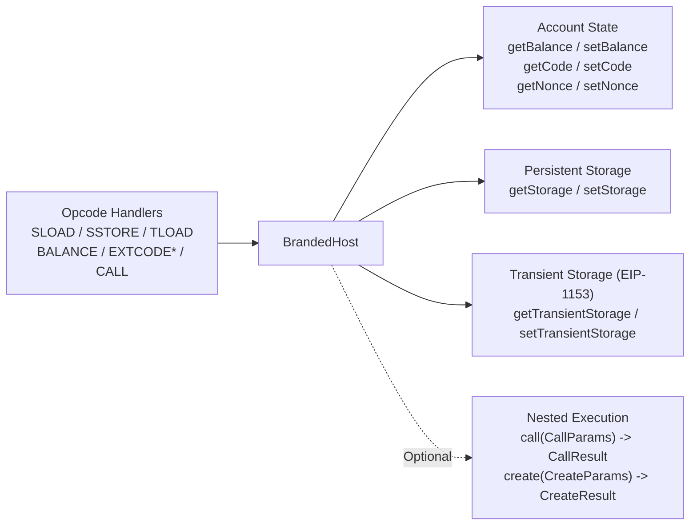

`Host` wraps a state backend into a `BrandedHost` interface consumed by state-reading and state-mutating EVM opcode handlers (`BALANCE`, `EXTCODE*`, `SLOAD`, `SSTORE`, `TLOAD`, `TSTORE`, `CALL*`, `CREATE*`).

## State Boundary



## Creating a Host

Import `Host` from `@tevm/voltaire/evm` or `@tevm/voltaire/evm/Host`.

<Tabs>
<Tab title="In-Memory Host">
```typescript
import { Address } from '@tevm/voltaire';
import { Frame, Host, Storage } from '@tevm/voltaire/evm';

const host = Host.createMemoryHost();
const contract = Address('0x1234567890123456789012345678901234567890');

host.setBalance(contract, 1_000_000_000_000_000_000n);
host.setStorage(contract, 0x42n, 0x1337n);

const frame = Frame({
  bytecode: new Uint8Array([0x54]), // SLOAD
  address: contract,
  gas: 10_000n,
});
Frame.pushStack(frame, 0x42n);

const err = Storage.sload(frame, host); // null
console.log(Frame.popStack(frame).value); // 0x1337n
```
</Tab>

<Tab title="Custom Backend">
```typescript
import { Hex } from '@tevm/voltaire';
import { Host } from '@tevm/voltaire/evm';

const balances = new Map<string, bigint>();
const storage = new Map<string, bigint>();
const transient = new Map<string, bigint>();
const codes = new Map<string, Uint8Array>();
const nonces = new Map<string, bigint>();

const key = (addr: Uint8Array) => Hex.fromBytes(addr);

const host = Host({
  getBalance: (addr) => balances.get(key(addr)) ?? 0n,
  setBalance: (addr, bal) => { balances.set(key(addr), bal); },
  getCode: (addr) => codes.get(key(addr)) ?? new Uint8Array(0),
  setCode: (addr, code) => { codes.set(key(addr), code); },
  getStorage: (addr, slot) => storage.get(`${key(addr)}:${slot}`) ?? 0n,
  setStorage: (addr, slot, val) => { storage.set(`${key(addr)}:${slot}`, val); },
  getNonce: (addr) => nonces.get(key(addr)) ?? 0n,
  setNonce: (addr, nonce) => { nonces.set(key(addr), nonce); },
  getTransientStorage: (addr, slot) => transient.get(`${key(addr)}:${slot}`) ?? 0n,
  setTransientStorage: (addr, slot, val) => { transient.set(`${key(addr)}:${slot}`, val); },
});
```
</Tab>
</Tabs>

## Interface Reference

| Method | Signature | Used By |
|--------|-----------|---------|
| `getBalance` | `(address: Address) => bigint` | `BALANCE` (`0x31`) |
| `setBalance` | `(address: Address, balance: bigint) => void` | Transfers, `SELFDESTRUCT` |
| `getCode` | `(address: Address) => Uint8Array` | `EXTCODESIZE`, `EXTCODECOPY`, `EXTCODEHASH` |
| `setCode` | `(address: Address, code: Uint8Array) => void` | `CREATE`, `CREATE2` |
| `getNonce` | `(address: Address) => bigint` | Nonce checks, `CREATE` address derivation |
| `setNonce` | `(address: Address, nonce: bigint) => void` | Transaction & contract creation |
| `getStorage` | `(address: Address, slot: bigint) => bigint` | `SLOAD` (`0x54`) |
| `setStorage` | `(address: Address, slot: bigint, value: bigint) => void` | `SSTORE` (`0x55`) |
| `getTransientStorage` | `(address: Address, slot: bigint) => bigint` | `TLOAD` (`0x5c`, EIP-1153) |
| `setTransientStorage` | `(address: Address, slot: bigint, value: bigint) => void` | `TSTORE` (`0x5d`, EIP-1153) |
| `call?` | `(params: CallParams) => CallResult` | `CALL`, `CALLCODE`, `DELEGATECALL`, `STATICCALL` |
| `create?` | `(params: CreateParams) => CreateResult` | `CREATE`, `CREATE2` |

### Constructors

- `Host(impl: HostImpl): BrandedHost` — Wraps `impl` as a branded host. If `getTransientStorage` / `setTransientStorage` are omitted on `impl`, defaults are supplied.
- `Host.from(impl: HostImpl): BrandedHost` — Alias for `Host(impl)`.
- `Host.createMemoryHost(): BrandedHost` — Returns a fresh Map-backed host initialized to `0n` / empty `Uint8Array` for all addresses and slots.

## Invariants and Behavior

- **Uninitialized reads:** Return `0n` for balances, nonces, persistent storage, and transient storage; return `new Uint8Array(0)` for code.
- **Transient vs persistent isolation:** Transient storage (`TLOAD` / `TSTORE`) shares no state with persistent storage (`SLOAD` / `SSTORE`) and must be cleared by the caller at the end of every transaction.
- **Optional nested execution:** When `call` or `create` is not provided on `Host`, system opcodes (`CALL`, `DELEGATECALL`, `STATICCALL`, `CALLCODE`, `CREATE`, `CREATE2`) return `{ type: "NotImplemented", message: ... }` rather than executing subframes.

## Related

- [Frame](/evm/frame)
- [EVM Types](/evm/types)
- [Storage Instructions](/evm/instructions/storage)
- [System Instructions](/evm/instructions/system)
