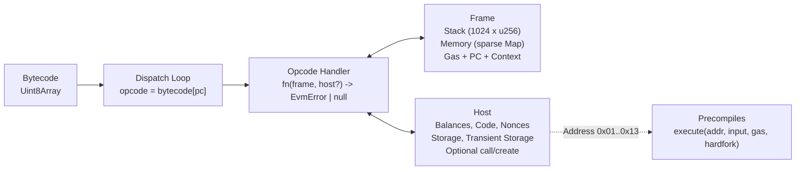

`@tevm/voltaire/evm` provides low-level, composable EVM execution primitives in TypeScript (with companion Zig implementations): a mutable execution `Frame`, a pluggable `Host` state interface, `146` opcode handlers across `12` functional categories, and `19` precompiled contracts (`0x01`-`0x13`).

## Execution Architecture



<Note>
`@tevm/voltaire/evm` provides individual execution primitives rather than a full transaction executor. `Host.call` and `Host.create` are optional; without them, system call/create handlers return `{ type: "NotImplemented" }`. For full EVM engines built on these primitives, see [guillotine](https://github.com/evmts/guillotine) and [guillotine-mini](https://github.com/evmts/guillotine-mini).
</Note>

## Module Exports

Import from `@tevm/voltaire/evm` (or subpath `@tevm/voltaire/evm/Frame`, `@tevm/voltaire/evm/Host`, `@tevm/voltaire/precompiles`):

| Export | Kind | Contents |
|--------|------|----------|
| `Frame` | Function + namespace | Execution frame factory and stack/memory/gas helpers |
| `Host` | Function + namespace | State backend wrapper and `createMemoryHost()` |
| `Arithmetic` | Namespace (11) | `add`, `mul`, `sub`, `div`, `sdiv`, `mod`, `smod`, `addmod`, `mulmod`, `exp`, `signextend` |
| `Comparison` | Namespace (6) | `LT`, `GT`, `SLT`, `SGT`, `EQ`, `ISZERO` |
| `Bitwise` | Namespace (8) | `AND`, `OR`, `XOR`, `NOT`, `BYTE`, `SHL`, `SHR`, `SAR` |
| `Keccak` | Namespace (1) | `sha3` (`0x20`) |
| `Context` | Namespace (16) | `address`, `balance`, `origin`, `caller`, `callvalue`, `calldataload`, `calldatasize`, `calldatacopy`, `codesize`, `codecopy`, `gasprice`, `extcodesize`, `extcodecopy`, `returndatasize`, `returndatacopy`, `extcodehash` |
| `Block` | Namespace (11) | `handler_0x40_BLOCKHASH` .. `handler_0x4a_BLOBBASEFEE` |
| `Stack` | Namespace (66) | `handler_0x50_POP`, `handler_0x5f_PUSH0` .. `handler_0x7F_PUSH32`, `handler_0x80_DUP1` .. `handler_0x8F_DUP16`, `handler_0x90_SWAP1` .. `handler_0x9F_SWAP16` |
| `Memory` | Namespace (4) | `mload`, `mstore`, `mstore8`, `mcopy` |
| `Storage` | Namespace (4) | `sload`, `sstore`, `tload`, `tstore` |
| `Control` | Namespace (7) | `handler_0x00_STOP`, `handler_0x56_JUMP`, `handler_0x57_JUMPI`, `handler_0x58_PC`, `handler_0x5b_JUMPDEST`, `handler_0xf3_RETURN`, `handler_0xfd_REVERT` |
| `Log` | Namespace (5) | `handler_0xa0_LOG0` .. `handler_0xa4_LOG4` |
| `System` | Namespace (7) | `create`, `call`, `callcode`, `delegatecall`, `create2`, `staticcall`, `selfdestruct` |
| `Precompiles` | Namespace (19) | `PrecompileAddress`, `isPrecompile`, `execute`, and 19 direct functions |

## Quick Start

```typescript
import { Address, Hardfork } from '@tevm/voltaire';
import { Arithmetic, Frame, Host, Precompiles, Storage } from '@tevm/voltaire/evm';

// 1. Create frame and in-memory host
const contract = Address('0x2222222222222222222222222222222222222222');
const host = Host.createMemoryHost();
host.setStorage(contract, 0n, 40n);

const frame = Frame({
  address: contract,
  gas: 100_000n,
});

// 2. Execute SLOAD(0) then ADD(2)
Frame.pushStack(frame, 0n);
const sloadErr = Storage.sload(frame, host); // null on success

Frame.pushStack(frame, 2n);
const addErr = Arithmetic.add(frame);        // null on success

const top = Frame.popStack(frame);
console.log(top.value); // 42n

// 3. Execute a precompile directly
const sha = Precompiles.execute(
  Precompiles.PrecompileAddress.SHA256,
  new TextEncoder().encode('hello'),
  10_000n,
  Hardfork.PRAGUE,
);
console.log(sha.success, sha.gasUsed); // true, 72n
```

## Memory, Stack, and Storage Limits

| Resource | Specification | Behavior on Limit |
|----------|---------------|-------------------|
| Stack | Max `1024` 256-bit words (`bigint[]`) | Returns `{ type: "StackOverflow" }` or `{ type: "StackUnderflow" }` |
| Memory | Byte-addressable sparse `Map<number, number>`, expanded in 32-byte words | Quadratic gas cost `3 * words + floor(words^2 / 512)`; returns `{ type: "OutOfGas" }` |
| Persistent storage | Per-address `uint256 -> uint256` via `Host` | EIP-2929 warm (`100`) / cold (`2100`) `SLOAD`, EIP-2200/3529 `SSTORE` |
| Transient storage | Per-address `uint256 -> uint256` via `Host` (EIP-1153, Cancun+) | Fixed `100` gas (`TLOAD` / `TSTORE`), cleared at transaction end |
| Call depth | Max `1024` nested frames | Returns `{ type: "CallDepthExceeded" }` |

## Hardfork Milestones

| Hardfork | Notable EVM Additions |
|----------|-----------------------|
| Frontier | Core opcodes; precompiles `0x01`-`0x04` |
| Homestead | `DELEGATECALL` (`0xf4`) |
| Byzantium | `STATICCALL`, `REVERT`, `RETURNDATASIZE`, `RETURNDATACOPY`; `0x05`-`0x08` |
| Constantinople | `SHL`, `SHR`, `SAR`, `EXTCODEHASH`, `CREATE2` |
| Istanbul | `CHAINID`, `SELFBALANCE`; `BLAKE2F` (`0x09`) |
| Berlin | EIP-2929 warm/cold access gas accounting |
| London | `BASEFEE` (`0x48`) |
| Shanghai | `PUSH0` (`0x5f`, EIP-3855) |
| Cancun | `MCOPY` (`0x5e`), `TLOAD`/`TSTORE` (`0x5c`/`0x5d`), `BLOBHASH` (`0x49`), `BLOBBASEFEE` (`0x4a`), `POINT_EVALUATION` (`0x0a`) |
| Prague | BLS12-381 precompiles `0x0b`-`0x13` (EIP-2537) |
| Osaka | `MODEXP` 1,024-byte operand cap (EIP-7823) and repricing (EIP-7883) |

## Sections

- [Frame](/evm/frame) — Execution frame state, stack, memory, and gas accounting
- [Host](/evm/host) — State access interface and `createMemoryHost()`
- [Types](/evm/types) — `BrandedFrame`, `BrandedHost`, `EvmError`, `CallParams`, `CreateParams`
- [Instructions](/evm/instructions) — All 146 opcode handlers across 12 categories
- [Precompiles](/evm/precompiles) — All 19 precompiled contracts (`0x01`-`0x13`)
