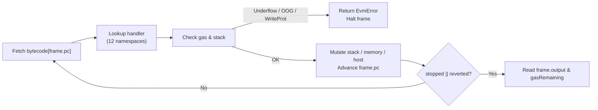

`@tevm/voltaire/evm` exports `146` opcode handlers grouped into `12` namespaces. Each handler validates stack depth and gas, mutates `frame` (and `host` when state access is required), advances `frame.pc`, and returns `null` on success or an `EvmError` object on failure.

## Dispatch Loop



## Category Index

| Category | Namespace | Count | Opcodes | Docs |
|----------|-----------|-------|---------|------|
| Arithmetic | `Arithmetic` | 11 | `0x01`-`0x0b` | [Arithmetic](/evm/instructions/arithmetic) |
| Comparison | `Comparison` | 6 | `0x10`-`0x15` | [Comparison](/evm/instructions/comparison) |
| Bitwise | `Bitwise` | 8 | `0x16`-`0x1d` | [Bitwise](/evm/instructions/bitwise) |
| Keccak | `Keccak` | 1 | `0x20` (`SHA3`) | [Keccak](/evm/instructions/keccak) |
| Context | `Context` | 16 | `0x30`-`0x3f` | [Context](/evm/instructions/context) |
| Block | `Block` | 11 | `0x40`-`0x4a` | [Block](/evm/instructions/block) |
| Stack | `Stack` | 66 | `0x50`, `0x5f`-`0x9f` | [Stack](/evm/instructions/stack) |
| Memory | `Memory` | 4 | `0x51`-`0x53`, `0x5e` | [Memory](/evm/instructions/memory) |
| Storage | `Storage` | 4 | `0x54`-`0x55`, `0x5c`-`0x5d` | [Storage](/evm/instructions/storage) |
| Control Flow | `Control` | 7 | `0x00`, `0x56`-`0x58`, `0x5b`, `0xf3`, `0xfd` | [Control Flow](/evm/instructions/control-flow) |
| Logging | `Log` | 5 | `0xa0`-`0xa4` | [Log](/evm/instructions/log) |
| System | `System` | 7 | `0xf0`-`0xf2`, `0xf4`-`0xf5`, `0xfa`, `0xff` | [System](/evm/instructions/system) |

## Quick Start

```typescript
import { Arithmetic, Comparison, Frame, Host, Memory, Stack, Storage } from '@tevm/voltaire/evm';

const frame = Frame({
  bytecode: new Uint8Array([0x5f, 0x60, 0x2a, 0x01]), // PUSH0, PUSH1 0x2a, ADD
  gas: 100_000n,
});
const host = Host.createMemoryHost();

// Execute PUSH0 -> PUSH1 0x2a -> ADD
Stack.handler_0x5f_PUSH0(frame);
Stack.handler_0x60_PUSH1(frame);
Arithmetic.add(frame);

// Store top of stack into memory offset 0, then load back
Frame.pushStack(frame, 0n);
Memory.mstore(frame);

// Persist slot 0 = 42n via host
Frame.pushStack(frame, 42n);
Frame.pushStack(frame, 0n);
Storage.sstore(frame, host);

// Compare 42n == 42n
Frame.pushStack(frame, 42n);
Frame.pushStack(frame, 42n);
Comparison.EQ(frame);
console.log(Frame.popStack(frame).value); // 1n
```

## Complete Opcode Tables

### Arithmetic (`0x01`-`0x0b`)

| Opcode | Name | Base Gas | Stack (`top` first) | Description |
|--------|------|----------|---------------------|-------------|
| `0x01` | [ADD](/evm/instructions/arithmetic/add) | `3` | `a, b -> (a + b) mod 2^256` | Wrapping unsigned addition |
| `0x02` | [MUL](/evm/instructions/arithmetic/mul) | `5` | `a, b -> (a * b) mod 2^256` | Wrapping unsigned multiplication |
| `0x03` | [SUB](/evm/instructions/arithmetic/sub) | `3` | `a, b -> (a - b) mod 2^256` | Wrapping unsigned subtraction |
| `0x04` | [DIV](/evm/instructions/arithmetic/div) | `5` | `a, b -> floor(a / b)` | Unsigned division (`0` if `b == 0`) |
| `0x05` | [SDIV](/evm/instructions/arithmetic/sdiv) | `5` | `a, b -> trunc(a / b)` | Signed two's-complement division |
| `0x06` | [MOD](/evm/instructions/arithmetic/mod) | `5` | `a, b -> a % b` | Unsigned modulo (`0` if `b == 0`) |
| `0x07` | [SMOD](/evm/instructions/arithmetic/smod) | `5` | `a, b -> a % b` | Signed modulo |
| `0x08` | [ADDMOD](/evm/instructions/arithmetic/addmod) | `8` | `a, b, N -> (a + b) % N` | Arbitrary-precision addition mod `N` |
| `0x09` | [MULMOD](/evm/instructions/arithmetic/mulmod) | `8` | `a, b, N -> (a * b) % N` | Arbitrary-precision multiplication mod `N` |
| `0x0a` | [EXP](/evm/instructions/arithmetic/exp) | `10 + 50/byte` | `a, exp -> a^exp mod 2^256` | Modular exponentiation |
| `0x0b` | [SIGNEXTEND](/evm/instructions/arithmetic/signextend) | `5` | `b, x -> y` | Sign-extend `(b + 1)`-byte integer |

### Comparison (`0x10`-`0x15`)

| Opcode | Name | Base Gas | Stack | Description |
|--------|------|----------|-------|-------------|
| `0x10` | [LT](/evm/instructions/comparison/lt) | `3` | `a, b -> a < b` | Unsigned less-than (`0` or `1`) |
| `0x11` | [GT](/evm/instructions/comparison/gt) | `3` | `a, b -> a > b` | Unsigned greater-than |
| `0x12` | [SLT](/evm/instructions/comparison/slt) | `3` | `a, b -> a < b` | Signed less-than |
| `0x13` | [SGT](/evm/instructions/comparison/sgt) | `3` | `a, b -> a > b` | Signed greater-than |
| `0x14` | [EQ](/evm/instructions/comparison/eq) | `3` | `a, b -> a == b` | Equality |
| `0x15` | [ISZERO](/evm/instructions/comparison/iszero) | `3` | `a -> a == 0` | Logical negation |

### Bitwise (`0x16`-`0x1d`)

| Opcode | Name | Base Gas | Stack | Description |
|--------|------|----------|-------|-------------|
| `0x16` | [AND](/evm/instructions/bitwise/and) | `3` | `a, b -> a & b` | Bitwise AND |
| `0x17` | [OR](/evm/instructions/bitwise/or) | `3` | `a, b -> a \| b` | Bitwise OR |
| `0x18` | [XOR](/evm/instructions/bitwise/xor) | `3` | `a, b -> a ^ b` | Bitwise XOR |
| `0x19` | [NOT](/evm/instructions/bitwise/not) | `3` | `a -> ~a` | Bitwise NOT |
| `0x1a` | [BYTE](/evm/instructions/bitwise/byte) | `3` | `i, x -> x[i]` | Extract big-endian byte `i` (`0..31`) |
| `0x1b` | [SHL](/evm/instructions/bitwise/shl) | `3` | `shift, val -> val << shift` | Shift left (Constantinople+) |
| `0x1c` | [SHR](/evm/instructions/bitwise/shr) | `3` | `shift, val -> val >>> shift` | Logical shift right (Constantinople+) |
| `0x1d` | [SAR](/evm/instructions/bitwise/sar) | `3` | `shift, val -> val >> shift` | Arithmetic shift right (Constantinople+) |

### Keccak (`0x20`)

| Opcode | Name | Gas | Stack | Description |
|--------|------|-----|-------|-------------|
| `0x20` | [SHA3](/evm/instructions/keccak/sha3) | `30 + 6/word + mem` | `offset, size -> hash` | Keccak-256 hash of `memory[offset..offset+size]` |

### Context (`0x30`-`0x3f`)

| Opcode | Name | Gas | Description |
|--------|------|-----|-------------|
| `0x30` | [ADDRESS](/evm/instructions/context/address) | `2` | Executing account address |
| `0x31` | [BALANCE](/evm/instructions/context/balance) | `100 / 2600` | Account balance (warm/cold) |
| `0x32` | [ORIGIN](/evm/instructions/context/origin) | `2` | Transaction origin (`tx.origin`) |
| `0x33` | [CALLER](/evm/instructions/context/caller) | `2` | Direct caller (`msg.sender`) |
| `0x34` | [CALLVALUE](/evm/instructions/context/callvalue) | `2` | Call value in wei (`msg.value`) |
| `0x35` | [CALLDATALOAD](/evm/instructions/context/calldataload) | `3` | Load 32-byte word from calldata |
| `0x36` | [CALLDATASIZE](/evm/instructions/context/calldatasize) | `2` | Calldata byte length |
| `0x37` | [CALLDATACOPY](/evm/instructions/context/calldatacopy) | `3 + 3/word + mem` | Copy calldata to memory |
| `0x38` | [CODESIZE](/evm/instructions/context/codesize) | `2` | Current bytecode length |
| `0x39` | [CODECOPY](/evm/instructions/context/codecopy) | `3 + 3/word + mem` | Copy bytecode to memory |
| `0x3a` | [GASPRICE](/evm/instructions/context/gasprice) | `2` | Effective transaction gas price |
| `0x3b` | [EXTCODESIZE](/evm/instructions/context/extcodesize) | `100 / 2600` | External account code size |
| `0x3c` | [EXTCODECOPY](/evm/instructions/context/extcodecopy) | `100 / 2600 + 3/word + mem` | Copy external account code |
| `0x3d` | [RETURNDATASIZE](/evm/instructions/context/returndatasize) | `2` | Size of previous subcall return data |
| `0x3e` | [RETURNDATACOPY](/evm/instructions/context/returndatacopy) | `3 + 3/word + mem` | Copy return data to memory |
| `0x3f` | [EXTCODEHASH](/evm/instructions/context/extcodehash) | `100 / 2600` | Keccak-256 hash of external account code |

### Block (`0x40`-`0x4a`)

| Opcode | Name | Gas | Hardfork |
|--------|------|-----|----------|
| `0x40` | [BLOCKHASH](/evm/instructions/block/blockhash) | `20` | Frontier |
| `0x41` | [COINBASE](/evm/instructions/block/coinbase) | `2` | Frontier |
| `0x42` | [TIMESTAMP](/evm/instructions/block/timestamp) | `2` | Frontier |
| `0x43` | [NUMBER](/evm/instructions/block/number) | `2` | Frontier |
| `0x44` | [DIFFICULTY / PREVRANDAO](/evm/instructions/block/difficulty) | `2` | Frontier / Paris |
| `0x45` | [GASLIMIT](/evm/instructions/block/gaslimit) | `2` | Frontier |
| `0x46` | [CHAINID](/evm/instructions/block/chainid) | `2` | Istanbul |
| `0x47` | [SELFBALANCE](/evm/instructions/block/selfbalance) | `5` | Istanbul |
| `0x48` | [BASEFEE](/evm/instructions/block/basefee) | `2` | London |
| `0x49` | [BLOBHASH](/evm/instructions/block/blobhash) | `3` | Cancun |
| `0x4a` | [BLOBBASEFEE](/evm/instructions/block/blobbasefee) | `2` | Cancun |

### Stack (`0x50`, `0x5f`-`0x9f`), Memory, Storage, Control, Log, System

- **Stack (66):** `POP` (`0x50`, 2 gas), `PUSH0` (`0x5f`, 2 gas, Shanghai+), `PUSH1`-`PUSH32` (`0x60`-`0x7f`, 3 gas), `DUP1`-`DUP16` (`0x80`-`0x8f`, 3 gas), `SWAP1`-`SWAP16` (`0x90`-`0x9f`, 3 gas). See [Stack](/evm/instructions/stack).
- **Memory (4):** [MLOAD](/evm/instructions/memory/mload), [MSTORE](/evm/instructions/memory/mstore), [MSTORE8](/evm/instructions/memory/mstore8), [MCOPY](/evm/instructions/memory/mcopy) (Cancun+).
- **Storage (4):** [SLOAD](/evm/instructions/storage/sload), [SSTORE](/evm/instructions/storage/sstore), [TLOAD](/evm/instructions/storage/tload) (Cancun+), [TSTORE](/evm/instructions/storage/tstore) (Cancun+).
- **Control Flow (7):** [STOP](/evm/instructions/control-flow/stop), [JUMP](/evm/instructions/control-flow/jump), [JUMPI](/evm/instructions/control-flow/jumpi), [PC](/evm/instructions/control-flow/pc), [JUMPDEST](/evm/instructions/control-flow/jumpdest), [RETURN](/evm/instructions/control-flow/return), [REVERT](/evm/instructions/control-flow/revert).
- **Logging (5):** [LOG0](/evm/instructions/log/log0) .. [LOG4](/evm/instructions/log/log4) (`375 + 375 * topics + 8 * bytes + mem`).
- **System (7):** [CREATE](/evm/instructions/system/create), [CALL](/evm/instructions/system/call), [CALLCODE](/evm/instructions/system/callcode), [DELEGATECALL](/evm/instructions/system/delegatecall), [CREATE2](/evm/instructions/system/create2), [STATICCALL](/evm/instructions/system/staticcall), [SELFDESTRUCT](/evm/instructions/system/selfdestruct).

## Related

- [EVM Overview](/evm)
- [Frame](/evm/frame)
- [Host](/evm/host)
- [EVM Precompiles](/evm/precompiles)
