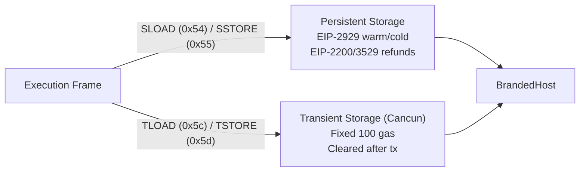

`Storage` (`@tevm/voltaire/evm`) implements the `4` storage opcodes (`0x54`-`0x55`, `0x5c`-`0x5d`). All four take `(frame, host)` and read or mutate per-address `uint256 -> uint256` slots through `BrandedHost`.

## Persistent vs Transient Storage



## Opcode Table

| Opcode | Handler | Gas | Stack (`top` first) | Hardfork | Write-Protected in Static? |
|--------|---------|-----|---------------------|----------|----------------------------|
| `0x54` | [sload](/evm/instructions/storage/sload) | `100` (warm) / `2100` (cold) | `slot -> value` | Frontier (EIP-2929 Berlin+) | No |
| `0x55` | [sstore](/evm/instructions/storage/sstore) | `100`-`20000` (+ EIP-2929/2200/3529) | `slot, value ->` | Frontier | Yes (`WriteProtection`) |
| `0x5c` | [tload](/evm/instructions/storage/tload) | `100` | `slot -> value` | Cancun (EIP-1153) | No |
| `0x5d` | [tstore](/evm/instructions/storage/tstore) | `100` | `slot, value ->` | Cancun (EIP-1153) | Yes (`WriteProtection`) |

## Usage

```typescript
import { Address } from '@tevm/voltaire';
import { Frame, Host, Storage } from '@tevm/voltaire/evm';

const host = Host.createMemoryHost();
const frame = Frame({
  address: Address('0x2222222222222222222222222222222222222222'),
  gas: 100_000n,
});

// TSTORE(slot = 1, value = 99) -> TLOAD(slot = 1)
Frame.pushStack(frame, 99n); // value
Frame.pushStack(frame, 1n);  // slot (top)
Storage.tstore(frame, host);

Frame.pushStack(frame, 1n);
Storage.tload(frame, host);
console.log(Frame.popStack(frame).value); // 99n
```

## Related

- [SLOAD](/evm/instructions/storage/sload)
- [SSTORE](/evm/instructions/storage/sstore)
- [TLOAD](/evm/instructions/storage/tload)
- [TSTORE](/evm/instructions/storage/tstore)
- [Host](/evm/host)
