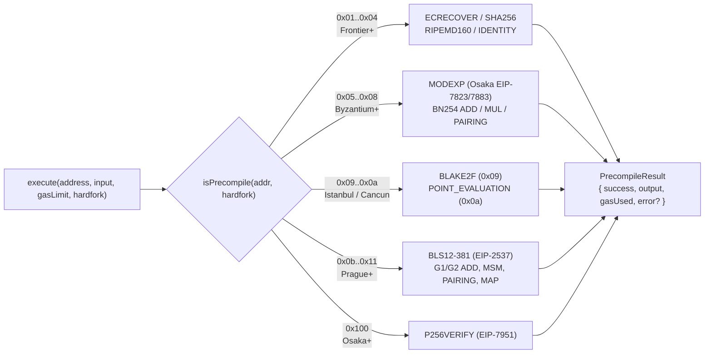

`@tevm/voltaire/precompiles` (also exported as `Precompiles` on `@tevm/voltaire/evm`) implements all `18` Ethereum precompiled contracts: `0x01` (`ECRECOVER`) through `0x11` (`BLS12_MAP_FP2_TO_G2`), plus Osaka `P256VERIFY` at `0x100` (EIP-7951). It includes Osaka `MODEXP` bounds and gas pricing (EIP-7823 / EIP-7883).

## Dispatch Flow



## Complete Precompile Table (`0x01`-`0x11`, `0x100`)

| Address | Enum Key | Function | Gas Cost (Implemented) | Hardfork | Input -> Output |
|---------|----------|----------|------------------------|----------|-----------------|
| `0x01` | `ECRECOVER` | [ecrecover](/evm/precompiles/ecrecover) | `3,000` | Frontier | `128 B (hash,v,r,s)` -> `32 B` (zero-padded address or 32 zeros) |
| `0x02` | `SHA256` | [sha256](/evm/precompiles/sha256) | `60 + 12 * words` | Frontier | arbitrary -> `32 B` |
| `0x03` | `RIPEMD160` | [ripemd160](/evm/precompiles/ripemd160) | `600 + 120 * words` | Frontier | arbitrary -> `32 B` (`12` zero bytes + `20 B` hash) |
| `0x04` | `IDENTITY` | [identity](/evm/precompiles/identity) | `15 + 3 * words` | Frontier | arbitrary -> exact copy |
| `0x05` | `MODEXP` | [modexp](/evm/precompiles/modexp) | Dynamic (EIP-2565 / Osaka EIP-7883) | Byzantium (cap in Osaka) | `96 B lengths + base + exp + mod` -> `modLen B` |
| `0x06` | `BN254_ADD` | [bn254Add](/evm/precompiles/bn254-add) | `150` | Byzantium | `128 B (G1, G1)` -> `64 B (G1)` |
| `0x07` | `BN254_MUL` | [bn254Mul](/evm/precompiles/bn254-mul) | `6,000` | Byzantium | `96 B (G1, scalar)` -> `64 B (G1)` |
| `0x08` | `BN254_PAIRING` | [bn254Pairing](/evm/precompiles/bn254-pairing) | `45,000 + 34,000 * k` | Byzantium | `192 * k B` -> `32 B` (`0` or `1`) |
| `0x09` | `BLAKE2F` | [blake2f](/evm/precompiles/blake2f) | `rounds` (`1` gas/round) | Istanbul | `213 B` -> `64 B` |
| `0x0a` | `POINT_EVALUATION` | [pointEvaluation](/evm/precompiles/point-evaluation) | `50,000` | Cancun | `192 B` -> `64 B` (`4096 \|\| BLS_MODULUS`) |
| `0x0b` | `BLS12_G1_ADD` | [bls12G1Add](/evm/precompiles/bls12-g1-add) | `375` | Prague | `256 B` -> `128 B` |
| `0x0c` | `BLS12_G1_MSM` | [bls12G1Msm](/evm/precompiles/bls12-g1-msm) | `k * 12,000 * discount(k) / 1000` | Prague | `160 * k B` (`k >= 1`) -> `128 B` |
| `0x0d` | `BLS12_G2_ADD` | [bls12G2Add](/evm/precompiles/bls12-g2-add) | `600` | Prague | `512 B` -> `256 B` |
| `0x0e` | `BLS12_G2_MSM` | [bls12G2Msm](/evm/precompiles/bls12-g2-msm) | `k * 22,500 * discount(k) / 1000` | Prague | `288 * k B` (`k >= 1`) -> `256 B` |
| `0x0f` | `BLS12_PAIRING` | [bls12Pairing](/evm/precompiles/bls12-pairing) | `37,700 + 32,600 * k` | Prague | `384 * k B` -> `32 B` (`0` or `1`) |
| `0x10` | `BLS12_MAP_FP_TO_G1` | [bls12MapFpToG1](/evm/precompiles/bls12-map-fp-to-g1) | `5,500` | Prague | `64 B` -> `128 B` |
| `0x11` | `BLS12_MAP_FP2_TO_G2` | [bls12MapFp2ToG2](/evm/precompiles/bls12-map-fp2-to-g2) | `23,800` | Prague | `128 B` -> `256 B` |
| `0x100` | `P256_VERIFY` | [p256Verify](/evm/precompiles/p256verify) | `6,900` | Osaka | `160 B (h,r,s,qx,qy)` -> `32 B` (`1`) or empty |

<Note>
EIP-2537 final addresses: G1 and G2 scalar multiplication are MSM calls with `k = 1`; there are no separate `G1MUL`/`G2MUL` precompiles. `isPrecompile(PrecompileAddress.P256_VERIFY, hardfork)` is `false` before `Hardfork.OSAKA`.
</Note>

## Quick Start

```typescript
import { Hardfork } from '@tevm/voltaire/Hardfork';
import {
  PrecompileAddress,
  execute,
  isPrecompile,
  sha256,
} from '@tevm/voltaire/precompiles';

// Check hardfork availability
console.log(isPrecompile(PrecompileAddress.POINT_EVALUATION, Hardfork.SHANGHAI)); // false
console.log(isPrecompile(PrecompileAddress.POINT_EVALUATION, Hardfork.CANCUN));   // true

// Dispatch by address
const input = new TextEncoder().encode('hello');
const res = execute(PrecompileAddress.SHA256, input, 10_000n, Hardfork.PRAGUE);
if (res.success) {
  console.log(res.output.length, res.gasUsed); // 32, 72n
}

// Or call a precompile function directly
const direct = sha256(input, 10_000n);
```

## API Reference

```typescript
export interface PrecompileResult {
  success: boolean;
  output: Uint8Array;
  gasUsed: bigint;
  error?: string;
}

export function isPrecompile(address: string, hardfork: HardforkType): boolean;
export function execute(
  address: string,
  input: Uint8Array,
  gasLimit: bigint,
  hardfork: HardforkType,
): PrecompileResult;
```

## Implementation Notes

- **MODEXP (`0x05`) Osaka rules:** When `hardfork >= Hardfork.OSAKA`, `modexp` rejects `baseLen`, `expLen`, or `modLen` above `1024` bytes (EIP-7823), uses EIP-7883 gas calculation, and consumes all supplied `gasLimit` on exceptional failure. Defaults to `Hardfork.BERLIN` when `modexp(input, gasLimit)` is called directly without `hardfork`.
- **ECRECOVER (`0x01`) invalid signatures:** Per the Yellow Paper, an unrecoverable or malformed signature succeeds (`success: true`), consumes `3,000` gas, and returns 32 zero bytes rather than failing.
- **POINT_EVALUATION (`0x0a`):** Automatically calls `KZG.loadTrustedSetup()` if not yet initialized and verifies the KZG proof via `KZG.verifyKzgProof`. Rejects the call unless `versionedHash == 0x01 || sha256(commitment)[1..32]` (EIP-4844 `kzg_to_versioned_hash`).
- **BLS12-381 (`0x0b`-`0x11`):** All 7 precompiles execute real curve and pairing arithmetic via `@noble/curves/bls12-381.js`, validating curve membership and subgroup membership on deserialization.

## Related

- [EVM Overview](/evm)
- [BLS12-381 Precompiles](/evm/precompiles/bls12-381)
- [P256VERIFY](/evm/precompiles/p256verify)
- [BN254](/crypto/bn254)
- [KZG Commitments](/crypto/kzg)
- [Hardfork Primitive](/primitives/hardfork)
