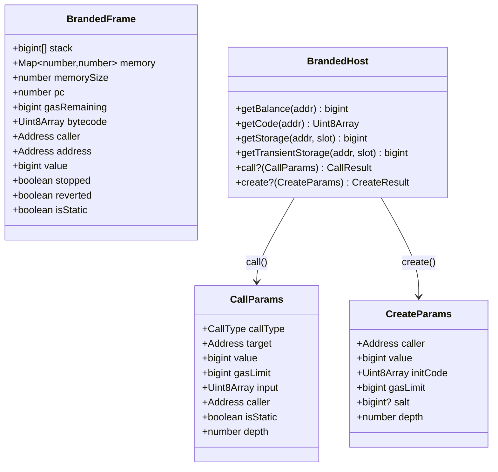

`@tevm/voltaire/evm` defines branded execution types (`BrandedFrame`, `BrandedHost`) and structured call/creation/error unions used across all opcode handlers and custom execution engines.

## Type Relationships



## Importing Types

```typescript
import type {
  BrandedFrame,
  BrandedHost,
  CallParams,
  CallResult,
  CallType,
  CreateParams,
  CreateResult,
  EvmError,
  InstructionHandler,
} from '@tevm/voltaire/evm';
```

## `EvmError`

Discriminated union returned when an instruction fails or halts exceptionally:

```typescript
export type EvmError =
  | { type: 'StackOverflow' }
  | { type: 'StackUnderflow' }
  | { type: 'OutOfGas' }
  | { type: 'OutOfBounds' }
  | { type: 'InvalidJump' }
  | { type: 'InvalidOpcode' }
  | { type: 'RevertExecuted' }
  | { type: 'CallDepthExceeded' }
  | { type: 'WriteProtection' }
  | { type: 'InsufficientBalance' }
  | { type: 'NotImplemented'; message: string };
```

| Error `type` | Trigger |
|--------------|---------|
| `StackOverflow` | Pushing when `frame.stack.length === 1024` |
| `StackUnderflow` | Popping or peeking more items than present on `frame.stack` |
| `OutOfGas` | Required gas exceeds `frame.gasRemaining` |
| `OutOfBounds` | Memory or data offset exceeds safe bounds |
| `InvalidJump` | `JUMP` / `JUMPI` target is out of bytecode range or not a valid `JUMPDEST` |
| `InvalidOpcode` | Undefined opcode byte or opcode disabled on active hardfork |
| `RevertExecuted` | `REVERT` (`0xfd`) executed |
| `CallDepthExceeded` | Nested call/create exceeds depth `1024` |
| `WriteProtection` | State-mutating opcode (`SSTORE`, `TSTORE`, `LOG*`, `CREATE*`, `SELFDESTRUCT`, value-bearing `CALL`) inside `isStatic === true` |
| `InsufficientBalance` | Value transfer exceeds account balance |
| `NotImplemented` | `CALL*` or `CREATE*` invoked when `host.call` / `host.create` is omitted |

## `InstructionHandler`

Type signature for custom dispatch tables:

```typescript
export type InstructionHandler = (
  frame: BrandedFrame,
  host: BrandedHost,
) => EvmError | { type: 'Success' };
```

<Note>
Built-in opcode handlers exported under `Arithmetic`, `Memory`, `Storage`, `Stack`, `Control`, etc. return `EvmError | null` (`null` on success). Wrap them with `const err = handler(frame, host); return err ?? { type: 'Success' };` when conforming strictly to `InstructionHandler`.
</Note>

## `CallParams` and `CallResult`

```typescript
export type CallType = 'CALL' | 'STATICCALL' | 'DELEGATECALL' | 'CALLCODE';

export type CallParams = {
  callType: CallType;
  target: AddressType;
  value: bigint;
  gasLimit: bigint;
  input: Uint8Array;
  caller: AddressType;
  isStatic: boolean;
  depth: number;
};

export type CallResult = {
  success: boolean;
  gasUsed: bigint;
  output: Uint8Array;
  logs: Array<{
    address: AddressType;
    topics: bigint[];
    data: Uint8Array;
  }>;
  gasRefund: bigint;
};
```

## `CreateParams` and `CreateResult`

```typescript
export type CreateParams = {
  caller: AddressType;
  value: bigint;
  initCode: Uint8Array;
  gasLimit: bigint;
  salt?: bigint; // Present for CREATE2
  depth: number;
};

export type CreateResult = {
  success: boolean;
  address: AddressType | null; // null on failure/revert
  gasUsed: bigint;
  output: Uint8Array;          // Runtime bytecode or revert data
  gasRefund: bigint;
};
```

## Related Primitives

- [Opcode](/primitives/opcode) — Branded `0x00`-`0xFF` opcode constants and `Opcode.info()` metadata
- [Bytecode](/primitives/bytecode) — Bytecode parsing, `JUMPDEST` analysis, and instruction decoding
- [Frame](/evm/frame) — Full `BrandedFrame` field reference
- [Host](/evm/host) — Full `BrandedHost` method reference
