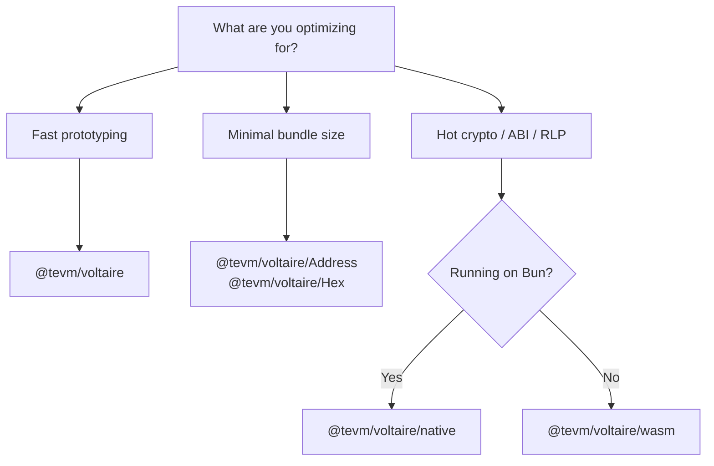

Install Voltaire, run a complete TypeScript example, and pick the import style that fits your runtime.

## Prerequisites

- **Runtime:** Node.js 18+, Bun 1.1+, Deno, or any modern browser
- **TypeScript:** 5.0+ recommended (`strict: true`)

## Installation

<Tabs>
  <Tab title="npm">
    ```bash
    npm install @tevm/voltaire
    ```
  </Tab>
  <Tab title="bun">
    ```bash
    bun add @tevm/voltaire
    ```
  </Tab>
  <Tab title="pnpm">
    ```bash
    pnpm add @tevm/voltaire
    ```
  </Tab>
  <Tab title="yarn">
    ```bash
    yarn add @tevm/voltaire
    ```
  </Tab>
</Tabs>

<Tip>
Prefer importing from `"voltaire"` instead of `"@tevm/voltaire"`? Install with an alias: `pnpm add voltaire@npm:@tevm/voltaire` (or `npm install voltaire@npm:@tevm/voltaire`). All subpath imports work identically under the alias.
</Tip>

## Your First Script

Create `hello.ts` and run it with `bun hello.ts` or `npx tsx hello.ts`:

```typescript
import { Address, Wei } from '@tevm/voltaire';
import { Abi } from '@tevm/voltaire/Abi';
import { Hex } from '@tevm/voltaire/Hex';
import { Keccak256 } from '@tevm/voltaire/Keccak256';

// 1. Parse and checksum an address (validated at construction)
const recipient = Address('0xd8da6bf26964af9d7eed9e03e53415d37aa96045');
console.log('Checksummed:', Address.toChecksummed(recipient));
// 0xd8dA6BF26964aF9D7eEd9e03E53415D37aA96045

// 2. Compute a 4-byte ERC-20 function selector
const selector = Keccak256.selector('transfer(address,uint256)');
console.log('Selector:', Hex.fromBytes(selector));
// 0xa9059cbb

// 3. Encode ERC-20 transfer calldata
const erc20 = Abi([
  {
    type: 'function',
    name: 'transfer',
    stateMutability: 'nonpayable',
    inputs: [
      { type: 'address', name: 'to' },
      { type: 'uint256', name: 'amount' },
    ],
    outputs: [{ type: 'bool' }],
  },
] as const);

const amount = Wei(1_000_000n); // 1 USDC (6 decimals)
const calldata = erc20.encode('transfer', [recipient.toHex(), amount]);
console.log('Calldata bytes:', calldata.length);
// 68 (4-byte selector + 32-byte address + 32-byte uint256)
```

## Choosing an Import Path

Voltaire exposes four entry styles. Start with the root or per-module subpath, and switch to WASM or Native FFI when profiling shows crypto or encoding is hot.



| Import path | Backend | Runtimes | When to use |
| --- | --- | --- | --- |
| `@tevm/voltaire` | Pure TS | Browser, Node, Bun, Deno | Default; simplest imports |
| `@tevm/voltaire/<Module>` | Pure TS | Browser, Node, Bun, Deno | Smallest bundles via subpath tree-shaking |
| `@tevm/voltaire/functional` | Pure TS | Browser, Node, Bun, Deno | Stateless functions with maximum tree-shaking |
| `@tevm/voltaire/wasm` | Zig → WASM | Browser, Node, Bun, Deno | Faster, smaller crypto (Keccak, secp256k1, BLS, KZG) |
| `@tevm/voltaire/native` | Zig → C FFI | Bun only | Highest throughput on server workloads |

Verified module subpaths include `@tevm/voltaire/Address`, `/Abi`, `/Hex`, `/Hash`, `/Bytes`, `/Rlp`, `/Transaction`, `/Uint`, `/Denomination`, `/Bytecode`, `/Opcode`, `/Siwe`, `/Ens`, `/Keccak256`, `/Secp256k1`, `/SHA256`, `/EIP712`, `/Bls12381`, `/BN254`, `/KZG`, `/evm`, `/precompiles`, `/jsonrpc`, `/provider`, `/contract`, and `/utils`.

<Warning>
Native FFI (`@tevm/voltaire/native`) requires **Bun**. On Node.js and browsers, use `@tevm/voltaire` or `@tevm/voltaire/wasm`.
</Warning>

## Where to Go Next

<CardGroup cols={2}>
  <Card title="Tutorials" icon="graduation-cap" href="/tutorials">
    Five hands-on walkthroughs: addresses, ABI calldata, EIP-712 permits, EIP-1559 transactions, and custom Skills.
  </Card>
  <Card title="Core Concepts" icon="book" href="/concepts/branded-types">
    Understand branded types, data-first design, WASM/FFI runtimes, and error handling.
  </Card>
  <Card title="API Reference" icon="cubes" href="/primitives/address">
    Concise specifications and method tables for every primitive, curve, hash, and EVM instruction.
  </Card>
  <Card title="Playground" icon="flask" href="/playground">
    Run Voltaire code directly in your browser with zero setup.
  </Card>
</CardGroup>
