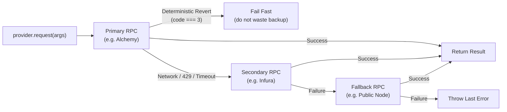

Production indexers, wallets, and relayers cannot depend on a single RPC endpoint. Voltaire supports multi-endpoint failover through `FallbackTransport` in `voltaire-effect/transport` and through a lightweight EIP-1193 wrapper over `HttpProvider` in plain TypeScript.



## Failover Rules

Do not fail over blindly on every error:

| Error Category | Fail Over? | Rationale |
| --- | --- | --- |
| Network error, timeout, HTTP `5xx`, `429` / `-32005` | Yes | Endpoint-specific outage or throttling |
| Node syncing (`-32002`) or missing recent block (`-32001`) | Yes | Lagging replica; another endpoint may be synced |
| Execution revert (`code === 3` or revert message) | No (default) | Deterministic EVM revert; backups will revert identically |
| Invalid params (`-32602`), invalid request (`-32600`) | No | Caller bug; retrying wastes quota across every backup |

## Effect (`voltaire-effect/transport`)

`FallbackTransport` accepts an ordered array of `Transport` layers and supports two strategies:

- `strategy: "sequential"` (default): tries each endpoint in order until one succeeds. Deterministic reverts (`err instanceof RpcError && err.isRevert`) short-circuit unless `failoverOnRevert: true`.
- `strategy: "race"`: sends the request to all endpoints concurrently and returns the first successful response (`Effect.raceAll` / `try.any`).

```typescript
import { Effect } from 'effect';
import {
  FallbackTransport,
  HttpTransport,
  request,
} from 'voltaire-effect/transport';

const ResilientTransport = FallbackTransport(
  [
    HttpTransport({ url: process.env.PRIMARY_RPC_URL!, timeout: '4 seconds' }),
    HttpTransport({ url: process.env.SECONDARY_RPC_URL!, timeout: '6 seconds' }),
    HttpTransport({ url: 'https://eth.llamarpc.com', timeout: '8 seconds' }),
  ],
  {
    strategy: 'sequential',
    failoverOnRevert: false,
  },
);

const program = Effect.all({
  blockNumber: request<string>('eth_blockNumber', []),
  chainId: request<string>('eth_chainId', []),
}).pipe(Effect.provide(ResilientTransport));

const result = await Effect.runPromise(program);
```

### Hedged Latency Racing

For latency-sensitive reads (quotes, mempool checks), set `strategy: "race"` across two or more providers:

```typescript
const HedgedTransport = FallbackTransport(
  [
    HttpTransport({ url: process.env.RPC_US_EAST! }),
    HttpTransport({ url: process.env.RPC_EU_WEST! }),
  ],
  { strategy: 'race' },
);
```

## Plain TypeScript (`@tevm/voltaire/provider`)

Compose multiple `HttpProvider` instances behind a standard EIP-1193 `Provider` interface with per-endpoint timeouts from `@tevm/voltaire/utils`:

```typescript
import {
  HttpProvider,
  JsonRpcErrorCode,
  type Provider,
  type RequestArguments,
} from '@tevm/voltaire/provider';
import { withTimeout } from '@tevm/voltaire/utils';

const NON_FAILOVER_CODES = new Set<number>([
  JsonRpcErrorCode.InvalidRequest,
  JsonRpcErrorCode.InvalidParams,
  3, // Execution reverted
]);

export function createFallbackProvider(urls: string[], timeoutMs = 5000): Provider {
  const providers = urls.map((url) => new HttpProvider({ url, retry: 1, timeout: timeoutMs }));

  return {
    async request(args: RequestArguments): Promise<unknown> {
      let lastError: unknown;

      for (const provider of providers) {
        try {
          return await withTimeout(provider.request(args), { ms: timeoutMs });
        } catch (err) {
          const code = (err as { code?: number })?.code;
          const msg = (err as { message?: string })?.message?.toLowerCase() ?? '';
          if ((code !== undefined && NON_FAILOVER_CODES.has(code)) || msg.includes('revert')) {
            throw err;
          }
          lastError = err;
        }
      }

      throw lastError ?? new Error('No fallback providers configured');
    },
    on() {
      return this;
    },
    removeListener() {
      return this;
    },
  };
}
```

For circuit-breaking, health scoring, and quorum verification, copy and customize the [Fallback Provider Skill](/skills/fallback-provider).

## Related

- [Fallback Provider Skill](/skills/fallback-provider) — Copyable circuit-breaking multi-RPC provider
- [Rate Limiting Guide](/guides/rate-limiting) — Pairing rate limits with multi-endpoint pools
- [Error Handling](/jsonrpc-provider/error-handling) — JSON-RPC and EIP-1193 error codes
- [Timeout Utilities](/utils/timeout) — Per-attempt deadlines with `withTimeout`
