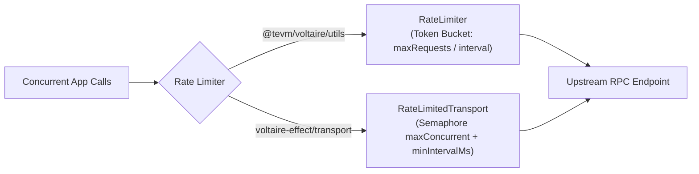

Public and managed Ethereum RPC endpoints enforce strict request-per-second (RPS) and compute-unit (CU) quotas, returning HTTP `429` or JSON-RPC `-32005` (`Limit exceeded`) when exceeded. Voltaire supports client-side throttling via `@tevm/voltaire/utils` (`RateLimiter`) and `voltaire-effect/transport` (`RateLimitedTransport`).



## Choosing an Approach

| Approach | Package | Mechanism | Best For |
| --- | --- | --- | --- |
| `RateLimiter` | `@tevm/voltaire/utils` | Token bucket (`queue`, `reject`, or `drop`) | Plain TypeScript / Promise codebases |
| `RateLimitedTransport` | `voltaire-effect/transport` | Effect `Semaphore` (`maxConcurrent`) + `Clock` (`minIntervalMs`) | Effect.ts services and layers |
| `Effect.RateLimiter` | `effect` | Token bucket / fixed window with per-call `withCost` | Compute-unit (CU) weighted budgets |

## TypeScript (`@tevm/voltaire/utils`)

Wrap an `HttpProvider` request path with a shared `RateLimiter` and optional `retryWithBackoff` for residual `429`/`-32005` spikes:

```typescript
import { Rpc } from '@tevm/voltaire/jsonrpc';
import { HttpProvider, type RequestArguments } from '@tevm/voltaire/provider';
import { RateLimiter, retryWithBackoff } from '@tevm/voltaire/utils';

const provider = new HttpProvider('https://mainnet.infura.io/v3/YOUR_KEY');

// Stay below a 10 req/s quota with a 20% headroom margin
const limiter = new RateLimiter({
  maxRequests: 8,
  interval: 1000,
  strategy: 'queue',
});

export function rateLimitedRequest<T>(args: RequestArguments): Promise<T> {
  return limiter.execute(() =>
    retryWithBackoff(
      () => provider.request(args) as Promise<T>,
      {
        maxRetries: 3,
        initialDelay: 500,
        shouldRetry: (err) => {
          const code = (err as { code?: number })?.code;
          return code === -32005 || code === -32603 || code === undefined;
        },
      },
    ),
  );
}

// Fan out 50 calls safely; RateLimiter paces them at 8/sec
const blocks = await Promise.all(
  Array.from({ length: 50 }, (_, i) =>
    rateLimitedRequest(Rpc.Eth.GetBlockByNumberRequest(`0x${(19_000_000 + i).toString(16)}`, false)),
  ),
);
```

### Per-Method Quotas

Heavy methods (`eth_getLogs`, `debug_traceTransaction`) consume far more node compute units than `eth_blockNumber`. Route them through a dedicated stricter limiter while keeping a global cap:

```typescript
import { RateLimiter } from '@tevm/voltaire/utils';

const globalLimiter = new RateLimiter({ maxRequests: 25, interval: 1000, strategy: 'queue' });
const heavyLimiter = new RateLimiter({ maxRequests: 2, interval: 1000, strategy: 'queue' });

const HEAVY_METHODS = new Set(['eth_getLogs', 'debug_traceTransaction', 'debug_traceBlockByNumber']);

export function throttledRequest<T>(args: RequestArguments): Promise<T> {
  const exec = () => globalLimiter.execute(() => provider.request(args) as Promise<T>);
  return HEAVY_METHODS.has(args.method) ? heavyLimiter.execute(exec) : exec();
}
```

## Effect (`voltaire-effect/transport`)

`RateLimitedTransport` wraps any `Transport` layer with a concurrency semaphore (`maxConcurrent`, default `10`) and minimum inter-request spacing (`minIntervalMs`, default `0`):

```typescript
import { Effect } from 'effect';
import {
  HttpTransport,
  RateLimitedTransport,
  request,
} from 'voltaire-effect/transport';

const LimitedTransport = RateLimitedTransport(
  HttpTransport({ url: 'https://eth.llamarpc.com' }),
  {
    maxConcurrent: 5,
    minIntervalMs: 125, // <= 8 requests/sec
  },
);

const program = Effect.all(
  Array.from({ length: 20 }, (_, i) =>
    request('eth_getBlockByNumber', [`0x${(19_000_000 + i).toString(16)}`, false]),
  ),
  { concurrency: 'unbounded' },
).pipe(Effect.provide(LimitedTransport));

await Effect.runPromise(program);
```

## Compute-Unit Budgeting Reference

| Method | Typical Cost Weight | Recommended Strategy |
| --- | --- | --- |
| `eth_blockNumber`, `eth_chainId` | Low (1x) | Global limiter + short cache |
| `eth_getBalance`, `eth_call` | Low–Medium (1–3x) | Batch with `BatchQueue` or Multicall3 |
| `eth_getLogs` | High (5–10x) | Dedicated limiter + adaptive chunking (`EventStream`) |
| `debug_traceTransaction` | Very High (20–50x) | Low concurrency (`maxConcurrent: 1–2`) |

## Related

- [Rate Limiting Utilities](/utils/rate-limit) — Full `RateLimiter`, `throttle`, and `debounce` API
- [Batching Utilities](/utils/batch) — Reducing total RPC requests with `BatchQueue` and `AsyncQueue`
- [Provider Fallback](/guides/provider-fallback) — Distributing load and failing over across endpoints
