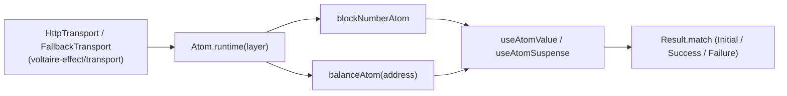

[effect-atom](https://github.com/tim-smart/effect-atom) connects Effect runtimes and `Layer` graphs directly to React hooks (`useAtomValue`, `useAtomRefresh`, `useAtomSuspense`), exposing Effect execution state through the discriminated `Result` union (`Initial | Success | Failure`).



## Installation

```bash
npm install @effect-atom/atom @effect-atom/atom-react effect voltaire-effect @tevm/voltaire
```

## Root Registry

Wrap your React tree with `RegistryProvider` (in Next.js App Router, place this in a `"use client"` boundary):

```tsx
import { RegistryProvider } from '@effect-atom/atom-react';
import type { ReactNode } from 'react';

export function Providers({ children }: { children: ReactNode }) {
  return <RegistryProvider>{children}</RegistryProvider>;
}
```

## Runtime and Atoms

Construct a runtime with `Atom.runtime` backed by `HttpTransport` (or `FallbackTransport` / `RateLimitedTransport`) from `voltaire-effect/transport`:

```typescript
// lib/atoms.ts
import { Atom } from '@effect-atom/atom';
import { Wei } from '@tevm/voltaire/Denomination';
import { Effect } from 'effect';
import { HttpTransport, request } from 'voltaire-effect/transport';

export const ethRuntime = Atom.runtime(
  HttpTransport({
    url: process.env.NEXT_PUBLIC_RPC_URL ?? 'https://eth.llamarpc.com',
    timeout: '10 seconds',
  }),
);

export const blockNumberAtom = ethRuntime.atom(
  request<string>('eth_blockNumber', []).pipe(Effect.map((hex) => BigInt(hex))),
);

const balanceAtomCache = new Map<string, ReturnType<typeof createBalanceAtom>>();

function createBalanceAtom(address: `0x${string}`) {
  return ethRuntime.atom(
    request<string>('eth_getBalance', [address, 'latest']).pipe(
      Effect.map((hex) => {
        const wei = Wei.from(BigInt(hex));
        return { wei, ether: Wei.toEther(wei) };
      }),
    ),
  );
}

// Memoize parameterized atoms so React subscribes to a stable atom identity
export function balanceAtom(address: `0x${string}`) {
  const key = address.toLowerCase();
  let atom = balanceAtomCache.get(key);
  if (!atom) {
    atom = createBalanceAtom(address);
    balanceAtomCache.set(key, atom);
  }
  return atom;
}
```

## Rendering Results in Components

### Pattern Matching with `Result.match`

```tsx
import { Result, useAtomRefresh, useAtomValue } from '@effect-atom/atom-react';
import { Cause } from 'effect';
import { balanceAtom } from '../lib/atoms';

export function BalanceCard({ address }: { address: `0x${string}` }) {
  const atom = balanceAtom(address);
  const result = useAtomValue(atom);
  const refresh = useAtomRefresh(atom);

  return (
    <div>
      {Result.match(result, {
        onInitial: () => <span>Loading...</span>,
        onSuccess: ({ ether }) => <span>{ether} ETH</span>,
        onFailure: (cause) => <span>Error: {String(Cause.squash(cause))}</span>,
      })}
      <button onClick={refresh}>Refresh</button>
    </div>
  );
}
```

### React Suspense

```tsx
import { useAtomSuspense } from '@effect-atom/atom-react';
import { Suspense } from 'react';
import { blockNumberAtom } from '../lib/atoms';

function BlockBadge() {
  const block = useAtomSuspense(blockNumberAtom);
  return <span>Block #{block.toString()}</span>;
}

export function Header() {
  return (
    <Suspense fallback={<span>Loading block...</span>}>
      <BlockBadge />
    </Suspense>
  );
}
```

## Hooks Summary

| Hook | Purpose |
| --- | --- |
| `useAtomValue(atom)` | Subscribes to `Result<A, E>` and re-renders on updates |
| `useAtomRefresh(atom)` | Returns a callback that re-executes the underlying Effect |
| `useAtomSuspense(atom)` | Suspends until `Success`, throws to nearest Error Boundary on `Failure` |
| `useAtomSet(atom)` | Returns setter for writable client atoms |
| `useAtom(atom)` | Tuple `[value, setValue]` for writable atoms |

## Multi-Chain Runtimes

Create one `Atom.runtime` per chain layer to isolate caches and transport settings:

```typescript
const mainnetRuntime = Atom.runtime(HttpTransport({ url: 'https://eth.llamarpc.com' }));
const optimismRuntime = Atom.runtime(HttpTransport({ url: 'https://mainnet.optimism.io' }));
```

## Related

- [Provider Fallback Guide](/guides/provider-fallback) — Swapping `HttpTransport` for `FallbackTransport`
- [Rate Limiting Guide](/guides/rate-limiting) — Adding `RateLimitedTransport`
- [TanStack Query Integration](/integrations/tanstack-query) — Non-Effect React alternative
