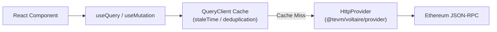

TanStack Query pairs directly with `@tevm/voltaire/provider` and `@tevm/voltaire/jsonrpc` to provide request deduplication, caching, polling, and mutations in React without a framework-specific Web3 wrapper.



## Installation

```bash
npm install @tanstack/react-query @tevm/voltaire
```

## Shared Provider & Query Keys

Create a single `HttpProvider` instance and deterministic query keys:

```typescript
// lib/ethereum.ts
import { HttpProvider } from '@tevm/voltaire/provider';

export const provider = new HttpProvider({
  url: import.meta.env.VITE_RPC_URL ?? 'https://eth.llamarpc.com',
  timeout: 15_000,
});

export const ethKeys = {
  blockNumber: () => ['eth', 'blockNumber'] as const,
  balance: (address: string) => ['eth', 'balance', address.toLowerCase()] as const,
  nonce: (address: string) => ['eth', 'nonce', address.toLowerCase()] as const,
  block: (tag: string) => ['eth', 'block', tag] as const,
  receipt: (hash: string) => ['eth', 'receipt', hash.toLowerCase()] as const,
};
```

## Reading Chain State

### Account Balance

Validate the address with `Address.from`, call `Rpc.Eth.GetBalanceRequest`, and format wei with `Wei.toEther`:

```tsx
import { useQuery } from '@tanstack/react-query';
import { Address } from '@tevm/voltaire/Address';
import { Wei } from '@tevm/voltaire/Denomination';
import { Rpc } from '@tevm/voltaire/jsonrpc';
import { ethKeys, provider } from './lib/ethereum';

export function useBalance(address: string | undefined) {
  return useQuery({
    queryKey: ethKeys.balance(address ?? ''),
    enabled: Boolean(address && Address.isValid(address)),
    staleTime: 10_000,
    queryFn: async () => {
      const addr = Address.from(address!);
      const hex = (await provider.request(Rpc.Eth.GetBalanceRequest(addr, 'latest'))) as string;
      const wei = Wei.from(BigInt(hex));
      return { wei, ether: Wei.toEther(wei) };
    },
  });
}

export function BalanceDisplay({ address }: { address: string }) {
  const { data, isLoading, error } = useBalance(address);
  if (isLoading) return <span>Loading...</span>;
  if (error) return <span>Error: {error.message}</span>;
  return <span>{data?.ether} ETH</span>;
}
```

### Block Number Polling and Immutable Historical Blocks

Set `staleTime: Infinity` for finalized or numbered blocks and `refetchInterval: 12_000` for chain head polling:

```tsx
import { useQuery } from '@tanstack/react-query';
import { Rpc } from '@tevm/voltaire/jsonrpc';
import { ethKeys, provider } from './lib/ethereum';

export function useBlockNumber() {
  return useQuery({
    queryKey: ethKeys.blockNumber(),
    refetchInterval: 12_000,
    queryFn: async () => {
      const hex = (await provider.request(Rpc.Eth.BlockNumberRequest())) as string;
      return BigInt(hex);
    },
  });
}

export function useBlock(blockTag: string) {
  const isImmutable = blockTag.startsWith('0x');
  return useQuery({
    queryKey: ethKeys.block(blockTag),
    staleTime: isImmutable ? Number.POSITIVE_INFINITY : 12_000,
    queryFn: () => provider.request(Rpc.Eth.GetBlockByNumberRequest(blockTag, false)),
  });
}
```

### Parallel Queries

```tsx
import { useQueries } from '@tanstack/react-query';
import { Address } from '@tevm/voltaire/Address';
import { Wei } from '@tevm/voltaire/Denomination';
import { Rpc } from '@tevm/voltaire/jsonrpc';
import { ethKeys, provider } from './lib/ethereum';

export function useBalances(addresses: string[]) {
  return useQueries({
    queries: addresses.map((address) => ({
      queryKey: ethKeys.balance(address),
      staleTime: 10_000,
      queryFn: async () => {
        const hex = (await provider.request(
          Rpc.Eth.GetBalanceRequest(Address.from(address), 'latest'),
        )) as string;
        return { address, ether: Wei.toEther(Wei.from(BigInt(hex))) };
      },
    })),
  });
}
```

## Cache Invalidation After Writes

Invalidate affected account queries after a transaction confirms:

```tsx
import { useMutation, useQueryClient } from '@tanstack/react-query';
import { ethKeys } from './lib/ethereum';

export function useTransferMutation(sendTx: (to: string, amount: bigint) => Promise<string>) {
  const queryClient = useQueryClient();

  return useMutation({
    mutationFn: ({ to, amount }: { from: string; to: string; amount: bigint }) =>
      sendTx(to, amount),
    onSuccess: (_txHash, { from, to }) => {
      void queryClient.invalidateQueries({ queryKey: ethKeys.balance(from) });
      void queryClient.invalidateQueries({ queryKey: ethKeys.balance(to) });
      void queryClient.invalidateQueries({ queryKey: ethKeys.nonce(from) });
    },
  });
}
```

## Caching Guidelines

| Data | Recommended `staleTime` | Notes |
| --- | --- | --- |
| Confirmed receipt / numbered block | `Infinity` | Immutable after finalization |
| Account balance / nonce / allowance | `5_000`–`15_000` ms | Invalidate explicitly after user writes |
| Chain head (`eth_blockNumber`) | `0` + `refetchInterval: 12_000` | Matches 12s Ethereum slot cadence |

## Related

- [React Query Skill](/skills/react-query) — Copyable hooks suite with wallet connection
- [JSON-RPC Provider](/jsonrpc-provider) — `HttpProvider` and `WebSocketProvider`
- [Rate Limiting Guide](/guides/rate-limiting) — Protecting RPC quotas under concurrent queries
