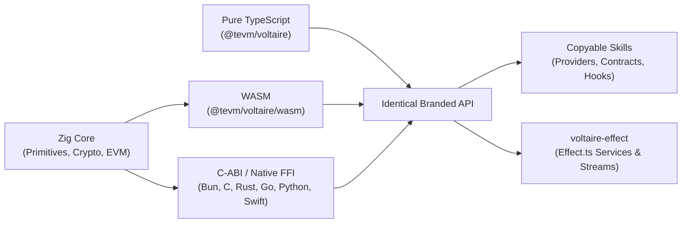

Voltaire is a general-purpose Ethereum library for TypeScript, Zig, C, Rust, Go, Python, and Swift. It gives you type-safe primitives, WASM and native-accelerated cryptography, and an API designed to mirror the Ethereum specification.



<Tip>
**Need providers, signers, or contract registries out of the box?** Use [voltaire-effect](https://github.com/evmts/voltaire/tree/main/packages/voltaire-effect) — an Effect.ts integration with typed errors, composable layers, and event streams built on Voltaire primitives.
</Tip>

## Simple, Spec-Aligned API

Every primitive validates at construction and carries a compile-time brand on top of a standard `Uint8Array` or `bigint`:

```typescript
import { Address, Bytes32, Wei } from '@tevm/voltaire';
import { Hex } from '@tevm/voltaire/Hex';
import { Rlp } from '@tevm/voltaire/Rlp';
import { Abi } from '@tevm/voltaire/Abi';
import { Keccak256 } from '@tevm/voltaire/Keccak256';

// Addresses — branded 20-byte Uint8Array
const addr = Address('0x742d35Cc6634C0532925a3b844Bc9e7595f51e3e');
addr.toHex();                  // "0x742d35cc6634c0532925a3b844bc9e7595f51e3e"
Address.toChecksummed(addr);   // "0x742d35Cc6634C0532925a3b844Bc9e7595f51e3e"

// Denominations — Wei, Gwei, and Ether cannot be mixed at compile time
const value = Wei(1_000_000_000_000_000_000n);
Wei.toEther(value);   // 1n (EtherType)
Wei.toGwei(value);    // 1_000_000_000n (GweiType)

// Fixed-size bytes and Keccak-256
const slot = Bytes32('0x' + '12'.repeat(32));
const digest = Keccak256.hashString('hello');
const selector = Keccak256.selector('transfer(address,uint256)');
// Uint8Array(4) [0xa9, 0x05, 0x9c, 0xbb]

// RLP encoding
const encoded = Rlp.encode([addr, Hex.toBytes(Hex.fromNumber(42n))]);
const decoded = Rlp.decode(encoded);

// ABI encoding
const transferAbi = {
  type: 'function',
  name: 'transfer',
  inputs: [
    { type: 'address', name: 'to' },
    { type: 'uint256', name: 'amount' },
  ],
  outputs: [{ type: 'bool' }],
  stateMutability: 'nonpayable',
} as const;

const calldata = Abi.Function.encodeParams(transferAbi, [
  '0xd8dA6BF26964aF9D7eEd9e03E53415D37aA96045',
  1_000_000_000_000_000_000n,
]);
```

## What's Included

<CardGroup cols={2}>
  <Card title="Primitives" icon="cubes" href="/primitives/address">
    Branded types for Address, Hash, Hex, ABI, RLP, Transaction, Bytecode, Blob, ENS, and SIWE.
  </Card>
  <Card title="Cryptography" icon="lock" href="/crypto/comparison">
    Keccak-256, secp256k1, EIP-712, BLS12-381, BN254, KZG, P-256, Ed25519, HD wallets, and AEAD ciphers.
  </Card>
  <Card title="EVM & Precompiles" icon="microchip" href="/evm">
    Frame execution, opcode handlers, bytecode analysis, and Ethereum precompiles.
  </Card>
  <Card title="JSON-RPC & Skills" icon="wand-magic-sparkles" href="/skills/index">
    Typed EIP-1193 request builders plus copyable Skills for providers, contracts, wallets, and protocols.
  </Card>
</CardGroup>

## What's Unique

- **[Branded types](/concepts/branded-types)** — Runtime-validated TypeScript types with zero wrapper overhead. The compiler rejects swapping an `Address` for a `Hash` or mixing `Wei` with `Gwei`.
- **[Swappable runtimes](/concepts/runtimes-and-wasm)** — Pure TypeScript, WebAssembly, and Bun Native FFI share one API. Switch backends by changing a single import path.
- **[AI-native docs & MCP](/concepts/ai-and-mcp)** — Every primitive mirrors the Ethereum spec, paired with a hosted [MCP server](/concepts/ai-and-mcp) and `/llms.txt`.
- **[Multiplatform core](/concepts/multiplatform)** — One Zig implementation compiles to WASM and exports a stable C ABI consumed by TypeScript, Rust, Go, Python, and Swift.
- **[Skills](/concepts/skills)** — Higher-level abstractions (providers, contract wrappers, React hooks) ship as copyable source you own and customize — shadcn/ui for Ethereum.

## Next Steps

<CardGroup cols={2}>
  <Card title="Quick Start" icon="rocket" href="/getting-started">
    Install `@tevm/voltaire` and run your first script in 5 minutes.
  </Card>
  <Card title="Hands-On Tutorials" icon="graduation-cap" href="/tutorials">
    Build real Ethereum workflows step by step with visual diagrams.
  </Card>
</CardGroup>
